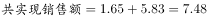

# 跨句数据加总（分项求和）

考点：[[20-考点/资料分析/其他/跨句数据加总（分项求和）|其他 / 跨句数据加总（分项求和）]]
材料：[[15-材料/资料分析/198622 新疆生产建设兵团十八大以来（以201|198622 新疆生产建设兵团十八大以来（以201]]

**问法模型**：题干问'商业综合体共实现多少销售额'，而材料将销售额拆为自营联营与租赁两笔分句给出→采用'分项加总'模型，两笔销售额直接相加

## 推理链
1. 第1步：定位材料第四段：2016年兵团商业综合体中，自营、联营商户64家实现销售额1.65亿元，租赁商户284家实现销售额5.83亿元
2. 第2步：材料未直接给出商业综合体销售总额，题干所求'共实现销售额'=自营联营销售额+租赁销售额，需跨句加总
3. 第3步：代入计算：1.65+5.83=7.48（亿元）
4. 第4步：与选项对照：7.48亿元恰好对应D选项，故正确答案为D

**最快解法**：⚡ 直接加和+尾数验证：小数位0.65+0.83=1.48，整数位1+5=6加进位1得7，即7.48亿元秒锁D；同时利用'总额必大于任一分项'排除A（仅1.65亿元），两笔金额口径一致无需任何换算

## 易错点
- ⚠ 跨句漏加：销售额拆在'自营联营1.65亿元'与'租赁5.83亿元'两处表述中，只读到其中一句就作答会误选A或错认单项数值为答案
- ⚠ 混淆数量与金额：64+284=348是商户数（家）、1802是从业人员（人），均不能代入销售额计算，所求口径是亿元
- ⚠ 量级干扰：商业综合体销售额（7.48亿）与商品销售总额（3341.37亿）、市场交易额（1001.39亿）量级差异大，勿混用其他段落数据

## 母题抽象
> 🧩 当题干出现'共/合计实现多少'且材料以'其中A项…；B项…'分句分别给出数值时，用分项加总法将各分项直接相加，再验证和值与选项对照，警惕只读单句漏加

**同类特征**：商业综合体、共实现、销售额、分项数据分句给出、跨句加和、亿元单位

## 相关题
- [[10-真题/资料分析/增长/2136656 增长量计算（已知现期与增速）|2136656]]（河南 2017，相关度1）
- [[10-真题/资料分析/增长/2377188 增长率比较（环比增长最快）|2377188]]（选调 2019，相关度1）
- [[10-真题/资料分析/平均数/3522362 基期平均数计算（基期总量-(1+r)÷家数）|3522362]]（青海 2021，相关度1）
- [[10-真题/资料分析/增长/4674808 增长量计算（已知现期值与增速）|4674808]]（选调 2021，相关度1）
- [[10-真题/资料分析/其他/4708172 现期数据加和（三大产业合计行求和）|4708172]]（福建 2019，相关度1）

---

### 题干
2016年，兵团商业综合体共实现多少销售额？

### 选项
- A. 1.65亿元
- B. 3.23亿元
- C. 5.19亿元
- D. 7.48亿元　✅

### 官方解析

定位文字材料第四段，2016年兵团商业综合体中自营、联营商户实现销售额1.65亿元；租赁商户实现销售额5.83亿元。可得2016年兵团商业综合体亿元。

故正确答案为D。

### 给定材料

        十八大以来，兵团各级紧紧抓住经济换挡升级的有利时机，有力地推动了商贸规模持续扩大。2016年，兵团实现商品销售总额3341.37亿元，比2012年增长2.2倍；社会消费品零售总额632.29亿元，比2012年增长1.1倍。

        2016年，兵团拥有商贸流通企业3357家，比2012年增长。分行业看，批发零售企业3244家，比2012年增长；住宿餐饮企业113家，比2012年增长。

        2016年，兵团拥有亿元以上商品交易市场23家，比2012年增加13家，总摊位数12621个，实现交易额1001.39亿元，比2012年增长25.6倍。分类型看，综合市场6家，其中，工业消费品综合市场1家，农产品综合市场2家，其他综合市场3家；专业市场17家，其中，生产资料市场2家，农产品市场6家，纺织服装鞋帽市场2家，电器、通讯器材、电子设备市场2家，家具、五金及装饰材料市场2家，汽车、摩托车及零配件市场3家。

        2016年，兵团拥有商业综合体3家，商户数共348家，从业人员1802人。其中，自营、联营商户64家，实现销售额1.65亿元；租赁商户284家，实现销售额5.83亿元。

> [!warning] 疑点（官方解析可能有误，待人工复核）
> 官方解析句'可得2016年兵团商业综合体亿元'未回填数值（文字脱漏），但按1.65+5.83=7.48亿元与答案D完全一致，不影响结论
