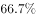
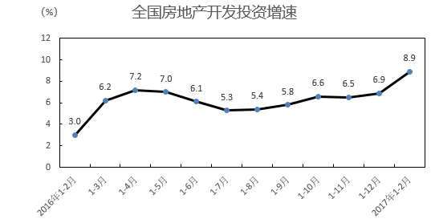
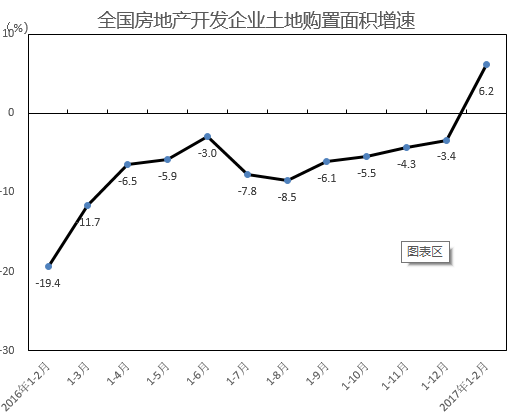
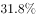
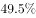
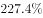
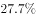
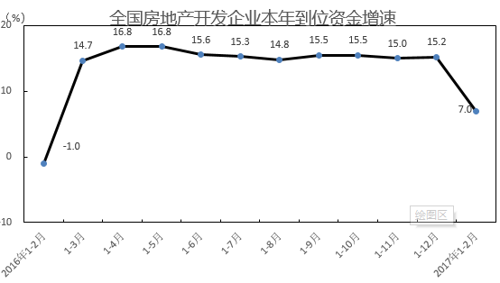
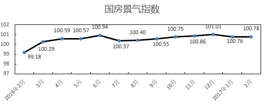

# 时点存量差（基期存量=现期存量-增量）

考点：[[20-考点/资料分析/其他/时点存量差（基期存量=现期存量-增量）|其他 / 时点存量差（基期存量=现期存量-增量）]]
材料：[[15-材料/资料分析/199270 2017年1-2月全国房地产开发投资|199270 2017年1-2月全国房地产开发投资]]

**问法模型**：题干给'2月末待售面积及比去年末增加量'求'去年末待售面积' → 用减法：基期存量=现期存量-增加量

## 推理链
1. 第1步：从材料文字段(2)定位：2月末商品房待售面积70555万平方米，比去年末（即2016年末）增加1015万平方米
2. 第2步：待售面积是时点存量，'比去年末增加1015'即 2017年2月末 - 2016年末 = 1015万平方米，故 2016年末 = 70555 - 1015
3. 第3步：代入计算：70555 - 1015 = 69540万平方米
4. 第4步：与选项对照，B项69540与计算结果一致，故选B

**最快解法**：⚡ 直接减法（尾数法验证）：70555-1015，尾数5-5=0且前四位7055-101=6954，得69540，秒杀选B

## 易错点
- ⚠ 时间口径混淆：'去年末'指2016年末，不是2016年2月末，也不是2017年1月末；与同比增速无关，本题不需要任何折线图数据
- ⚠ 加减方向反了：把'比去年末增加1015'误理解为2016年末更大而做成70555+1015=71570（易错凑D附近数值），实为现期减去增加量
- ⚠ 把增加量1015误当基期值或误用各类同比增速（正文增速均留白、本题也不涉及），别与题1/题3的'基期量=现期÷(1+r)'模型混用

## 母题抽象
> 🧩 当题干出现'某时点存量X，比（去年末/上月末）增加（减少）Y'求基期存量时，直接用X-Y（或X+Y）做时点差，勿套增速公式

**同类特征**：待售面积、2月末、比去年末增加、万平方米、求2016年末、时点存量

## 相关题
- [[10-真题/资料分析/平均数/13319360 现期平均数（总量÷份数）|13319360]]（江苏 2025，相关度1）

---

### 题干
2016年末全国商品房的待售面积（  ）万平方米。

### 选项
- A. 68450
- B. 69540　✅
- C. 79987
- D. 70295

### 官方解析
定位材料文字第七段可知：2017年2月末，商品房待售面积70555万平方米，比去年末增加1015万平方米。故2016年末全国商品房的待售面积万平方米。
故正确答案为B。

### 给定材料

（1）房地产开发投资完成情况

        2017年1-2月份，全国房地产开发投资9854亿元，同比名义增长，增速比去年全年提高2个百分点。其中，住宅投资6571亿元，增长，增速提高2.6个百分点。住宅投资占房地产开发投资的比重为。

        1-2月份，东部地区房地产开发投资5966亿元，同比增长，增速比去年全年提高2.2个百分点；中部地区投资1907亿元，增长，增速提高3个百分点；西部地区投资1982亿元，增长，增速提高1.6个百分点。

        1-2月份，房地产开发企业房屋施工面积622950万平方米，同比增长，增速与去年全年持平。其中，住宅施工面积423185万平方米，增长。房屋新开工面积17238万平方米，增长，增速提高2.3个百分点。其中，住宅新开工面积12410万平方米，增长。房屋竣工面积16141万平方米，增长，增速提高9.7个百分点。其中，住宅竣工面积11674万平方米，增长。

        1-2月份，房地产开发企业土地购置面积2374万平方米，同比增长，去年全年为下降；土地成交价款794亿元，增长，增速回落7.1个百分点。

（2）商品房销售和待售情况

        1-2月，商品房销售面积14054万平方米，同比增长，增速比去年全年提高2.6个百分点。其中，住宅销售面积增长，办公楼销售面积增长，商业营业用房销售面积增长。商品房销售额10806亿元，增长，增速回落8.8个百分点。其中，住宅销售额增长，办公楼销售额增长，商业营业用房销售额增长。

        1-2月份，东部地区商品房销售面积6595万平方米，同比增长，增速比去年全年回落6.8个百分点；销售额6645亿元，增长，增速回落23个百分点。中部地区商品房销售面积3680万平方米，增长，增速提高4.6个百分点；销售额2073亿元，增长44.1%，增速提高5.4个百分点。西部地区商品房销售面积3779万平方米，增长，增速提高20.6个百分点；销售额2088亿元，增长，增速提高31.2个百分点。

        2月末，商品房待售面积70555万平方米，比去年末增加1015万平方米。其中，住宅待售面积增加468万平方米，办公楼待售面积增加155万平方米，商业营业用房待售面积增加260万平方米。

（3）房地产开发企业到位资金情况

        1-2月份，房地产开发企业到位资金22880亿元，同比增长，增速比去年全年回落8.2个百分点。其中，国内贷款4985亿元，增长;利用外资48亿元，增长；自筹资金6897亿元，下降；其他资金10950亿元，增长。在其他资金中，定金及预收款6108亿元，增长；个人按揭贷款3391亿元，增长。

（4）房地产开发景气指数

        2月份，房地产开发景气指数（简称“国房景气指数”，今年起发布的是基期修定后的值）为100.78，比1月份提高0.02点。

