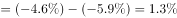
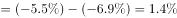

# 极差计算（涨跌幅时间序列：最大值−最小值）

考点：[[20-考点/资料分析/其他/极差计算（涨跌幅时间序列：最大值−最小值）|其他 / 极差计算（涨跌幅时间序列：最大值−最小值）]]
材料：[[15-材料/资料分析/199306 国家统计局发布的2016年2月全国工|199306 国家统计局发布的2016年2月全国工]]

**问法模型**：题干问'2015年2月到2016年2月同比变化的极差'→定位图1、图2的同比折线序列，极差=最大值−最小值（同为负数按数轴比较大小）

## 推理链
1. 第1步：题干限定2015年2月—2016年2月共13个月，要求'出厂价格'与'购进价格'两个同比序列的极差，分别对应图1与图2的同比折线
2. 第2步：极差=最大值−最小值；序列全为负数，'最大'指数轴上最靠右的数值（-4.6＞-5.9），不是降幅最大
3. 第3步：图1同比序列为-4.8、-4.6、-4.6、-4.6、-4.8、-5.4、-5.9、-5.9、-5.9、-5.9、-5.9、-5.3、-4.9，最大值-4.6（2015年3—5月）、最小值-5.9（2015年8—12月），极差=-4.6-(-5.9)=1.3个百分点
4. 第4步：图2同比序列为-5.9、-5.7、-5.5、-5.5、-5.6、-6.1、-6.6、-6.8、-6.9、-6.9、-6.8、-6.3、-5.8，最大值-5.5（2015年4—5月）、最小值-6.9（2015年10—11月），极差=-5.5-(-6.9)=1.4个百分点
5. 第5步：对照选项，出厂价格极差1.3、购进价格极差1.4对应B项，故正确答案为B

**最快解法**：⚡ 折线目测峰谷法：在同比折线上直接找最高点与最低点（出厂-4.6与-5.9、购进-5.5与-6.9），按'大减小'口诀作差得1.3、1.4，全程无需逐点笔算

## 易错点
- ⚠ 读错序列：图1、图2均为'环比/同比'双线，若误用环比序列（出厂环比极差0.7、购进环比极差1.0）即错，题干明确限定'同比'
- ⚠ 负数比大小陷阱：'最大值'指数值最大而非降幅最大，若把-5.9、-6.9当最大值，或见到正负混合序列时直接用绝对值相减，必错方向
- ⚠ 时间范围与口径陷阱：只取13个月当期值，勿把正文'1-2月平均'口径或'影响总水平下降4.8个百分点'的拉动量混入序列

## 母题抽象
> 🧩 当题干出现'某段时间内某指标涨跌幅的极差'时，锁定对应图表的指定序列（同比/环比不可混），目测最高点与最低点，按'最大值−最小值'（负数按数轴）作差，并用两端点数值回验

**同类特征**：极差、2015年2月份到2016年2月份、同比变化、出厂价格与购进价格、时间序列最大值减最小值、双图分别定位

## 相关题
- [[10-真题/资料分析/其他/2661084 极差（最大值-最小值）计算与跨指标比较|2661084]]（选调 2018，相关度1）
- [[10-真题/资料分析/增长/2261767 环比增长率计算（兼考图表极差读数）|2261767]]（选调 2017，相关度1）
- [[10-真题/资料分析/其他/2661076 极差（最大值−最小值）计算及跨图两极差之比|2661076]]（选调 2018，相关度1）

---

### 题干
从2015年2月份到2016年2月份，工业生产者出厂价格和工业生产者购进价格同比变化的极差分别是（  ）。

### 选项
- A. 
，

- B. 
，
　✅
- C. 
，

- D. 
，

### 官方解析

定位图一、图二可知，工业生产者出厂价格同比极差，工业生产者购进价格同比极差。

故正确答案为B。

### 给定材料

        根据国家统计局最新发布的数据，2016年2月份，全国工业生产者出厂价格环比下降，同比下降。工业生产者购进价格环比下降，同比下降。1-2月平均，工业生产者出厂价格同比下降，工业生产者购进价格同比下降。

 

1.工业生产者价格同比变动情况 

        工业生产者出厂价格中，生产资料价格同比下降，影响全国工业生产者出厂价格总水平下降约4.8个百分点。其中，采掘工业价格下降，原材料工业价格下降，加工工业价格下降。生活资料价格同比下降，影响全国工业生产者出厂价格总水平下降约0.1个百分点。其中，食品价格上涨，衣着价格上涨，一般日用品价格下降，耐用消费品价格下降。

        据测算，在2月份-的全国工业生产者出厂价格总水平同比降幅中，去年价格变动的翘尾因素约为-4.1个百分点，新涨价因素约为-0.8个百分点。

        工业生产者购进价格中，黑色金属材料类价格同比下降，燃料动力类价格下降，有色金属材料及电线类价格下降，化工原料类价格下降。

2.工业生产者价格环比变动情况

        工业生产者出厂价格中，生产资料价格环比下降，影响全国工业生产者出厂价格总水平下降约0.3个百分点。其中，采掘工业价格下降，原材料工业价格下降，加工工业价格下降。生活资料价格环比上涨。其中，食品价格上涨，衣着价格持平，一般日用品价格上涨，耐用消费品价格下降。

        工业生产者购进价格中，燃料动力类价格环比下降，黑色金属材料类价格下降，有色金属材料及电线类价格上涨，农副产品类价格上涨。

