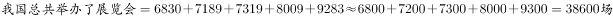

# 区间加总+单位换算（场→万场）

考点：[[20-考点/资料分析/其他/区间加总+单位换算（场→万场）|其他 / 区间加总+单位换算（场→万场）]]
材料：[[15-材料/资料分析/200304 2009～2015年我国会展业发展状|200304 2009～2015年我国会展业发展状]]

**问法模型**：题干问'十二五（2011～2015）期间总共举办约多少万场'→先锁定年份区间逐年加总（场），再÷10000换算为万场，与选项对照

## 推理链
1. 第1步：题干限定'十二五'即2011～2015年共5年，从表格'展览会数量（场）'行横读取数：2011年6830、2012年7189、2013年7319、2014年8009、2015年9283，不含2009年的4920和2010年的6200
2. 第2步：规则——'期间总共'即区间内各年当期值直接求和（各年为年度当期值，非累计）
3. 第3步：代入计算：6830+7189+7319+8009+9283=38630场
4. 第4步：单位换算：38630场÷10000≈3.86万场（表内单位为'场'，题干问'万场'）
5. 第5步：与选项对照：3.86≈3.9万场，对应B；若误含2010年得4.48万≈4.5（误选C），误含2009、2010年得4.98万≈5.0（误选D），可反推验证区间正确

**最快解法**：⚡ 截位估算法：各年数据截前两位相加6.8+7.2+7.3+8.0+9.3=38.6（千场），除以10即约3.86万场，直接锁定B；选项间距大（3.2/3.9/4.5/5.0），无需精算

## 易错点
- ⚠ 时间区间陷阱：'十二五'是2011～2015年，若误把2010年6200场或2009年4920场计入，总和分别约4.48万、4.98万，恰好对应错误选项C、D
- ⚠ 单位换算陷阱：表中单位为'场'，题干问'万场'，须÷10000，忘换算得38630无法与选项匹配
- ⚠ 读数方向陷阱：表为'行指标×列年份'，须沿'展览会数量'行横读，防止串行误取展出面积或总产值数据

## 母题抽象
> 🧩 当题干出现'某五年/某期间总共/累计约多少万（带单位换算）'特征时，先按题干年份区间逐行加总当期值，再÷10⁴换算量级，并用选项间距做粗算验证，同时用'多算一个基期年是否落入错误选项'反向检验区间

**同类特征**：十二五（2011～2015）、总共举办、约多少万场、展览会数量、区间加总、单位换算为万

## 相关题
（暂无）

---

### 题干
“十二五”（2011～2015年）期间，我国总共举办了约多少万场展览会？

### 选项
- A. 3.2
- B. 3.9　✅
- C. 4.5
- D. 5.0

### 官方解析

定位材料，可知2011年举办展览会6830场，2012年举办展览会7189场，2013年举办展览会7319场，2014年举办展览会8009场，2015年举办展览会9283场，故“十二五”（2011-2015年）期间，，约3.9万场。

故正确答案为B。

### 给定材料

<b>根据下列统计资料回答问题</b>

