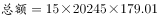
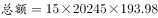
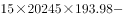
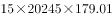
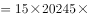
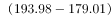
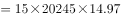
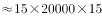
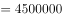

# 汇率折算与付款差额比较

考点：[[20-考点/资料分析/其他/汇率折算与付款差额比较|其他 / 汇率折算与付款差额比较]]
材料：[[15-材料/资料分析/215726 AK制造公司2018年4月五家客户（|215726 AK制造公司2018年4月五家客户（]]

**问法模型**：题干问'同一笔英镑计价订单在9月1日付款与4月1日付款费用大约多付/少付多少日元'→ 差额=英镑订单额×两日期汇率差，方向由两汇率大小决定

## 推理链
1. 第1步：表1中Nipoocar公司铣床订单量为15件、单价20245英镑，订单总额=15×20245=303675英镑（同一笔英镑金额，仅付款日期不同）
2. 第2步：汇率表中1英镑兑日元：4月1日=193.98、9月1日=179.01，英镑金额×汇率=日元金额
3. 第3步：方向判断——同一笔英镑，9月1日每英镑只换179.01日元<4月1日的193.98日元，故9月1日付款日元更少，为'少付'，排除A、B
4. 第4步：差额=303675×(193.98−179.01)=303675×14.97≈4546015日元（精确值4546014.75日元）
5. 第5步：与选项对照，'少付4546015日元'与D项完全吻合，故选D

**最快解法**：⚡ 差额模型+截位口算：同一笔英镑额可约去，只比汇率差——303675×(193.98−179.01)=303675×14.97≈30.4万×15≈455万日元量级，再减303675×0.03≈9110得约454.6万日元；且179.01<193.98锁定'少付'，直接选D

## 易错点
- ⚠ 汇率方向误读：表中是'1英镑=若干外币'，须用英镑金额×汇率得日元，若把汇率方向弄反，多付/少付的判断会完全颠倒
- ⚠ 付款日期与汇率配对错误：4月1日对应193.98、9月1日对应179.01，若错用12月31日的139.89或把两个日期汇率对调，方向和数值全错
- ⚠ 量级陷阱：铣床单价20245英镑远高于磨床405、钻床287，15×20245×14.97的乘法估算极易在位数上出错；同时'同一英镑额、不同日期付款'应直接用汇率差比较，分别算两笔大数再相减既慢又易错

## 母题抽象
> 🧩 当题干出现'同一笔外币计价金额在两个日期付款/折算比较'特征时，用'差额=英镑金额×汇率差'模型，先由两日期汇率大小判定多付/少付的方向，再代入汇率差算差额验证选项

**同类特征**：9月1日付款与4月1日付款费用比较、以英镑标注的订单价格、多付/少付多少日元、同一笔英镑金额不同付款日期、汇率表跨期折算、差额比较

## 相关题
（暂无）

---

### 题干
如果Nipoocar公司4月1日同意以英镑标注的铣床订单价格，在9月1日付款，那么9月1日付款与4月1日付款费用上大约：

### 选项
- A. 多付4242455日元
- B. 多付4546015日元
- C. 少付4242455日元
- D. 少付4546015日元　✅

### 官方解析

根据题干“······9月1日付款与4月1日付款费用······”，可判断本题为基期比较问题。定位材料表格，Nipoocar公司4月铣床订单数量为15，单价为20245英镑；4月1日1英镑=193.98日元，9月1日1英镑=179.01日元。则9月1日付款日元，4月1日付款日元，对比可知4月1日付款金额高，排除A、B两项。具体数据为：日元，与D项最为接近。

故正确答案为D。

### 给定材料

