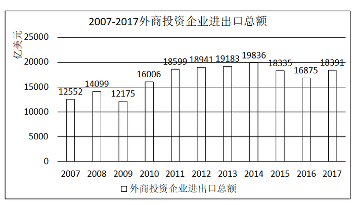

# 五年规划期区间加总（十二五=2011—2015）＋亿美元→万亿美元单位换算

考点：[[20-考点/资料分析/其他/五年规划期区间加总（十二五=2011—2015）＋亿美元→万亿美元单位换算|其他 / 五年规划期区间加总（十二五=2011—2015）＋亿美元→万亿美元单位换算]]
材料：[[15-材料/资料分析/215729 2007—2017年我国外商投资企业|215729 2007—2017年我国外商投资企业]]

**问法模型**：题干为'十二五时期…总额约为（）万亿美元'→将2011—2015共5年各年当期值直接加总后÷10000换算成万亿美元，与选项对照

## 推理链
1. 第1步：明确'十二五'时期=2011—2015年（含两端共5年），从柱状图读取各年进出口总额：18599、18941、19183、19836、18335亿美元，均为各年当期值（非累计数，直接加总即可）
2. 第2步：所用规则：区间总量=各年当期值之和；且1万亿美元=10000亿美元，需÷10000换算
3. 第3步：代入计算：18599+18941+19183+19836+18335=94894亿美元（尾数验证：9+1+3+6+5=24，尾数为4，与94894吻合）
4. 第4步：单位换算：94894亿美元÷10000=9.4894≈9.49万亿美元
5. 第5步：对照选项：A(7.34)、B(7.98)、C(9.26)均明显偏离，仅D(9.49)与9.4894最接近，故选D

**最快解法**：⚡ 截位直加＋量级定位：以万亿美元为单位截两位直加：1.86+1.89+1.92+1.98+1.83≈9.48万亿美元，直接锁定D；辅以尾数法验证总额尾数应为4（9+1+3+6+5=24），94894吻合后再÷10000

## 易错点
- ⚠ 单位陷阱：图为亿美元而设问为万亿美元，相差10^4倍，若不÷10000或把94894直接当答案必错
- ⚠ '十二五'区间端点取错：应为2011—2015年共5年，若误含2010年（16006）或2016年（16875）会得约8.8—9.7万亿的错值，易误选B或C
- ⚠ 加总口算失误：五数直加需精确，若漏加或错加某年（如漏2015年18335）会跌入A/B量级；用尾数法可兜底验证

## 母题抽象
> 🧩 当题干出现'某五年规划时期（十二五/十三五）……合计/总额约为（带单位）'时，先按规划期锁定年份区间（十二五=2011—2015，含两端5年），将各年当期值直接加总，再按设问单位换算（亿美元→万亿美元÷10000），并用尾数法验证加总结果后对照选项

**同类特征**：'十二五'时期（2011—2015五年区间）、进出口总额约为（区间加总设问）、万亿美元（与图单位亿美元不一致，需换算）、柱状图逐年标注数值、各年当期值直接求和（非求平均、非求增速）、选项为小数量级（个位万亿美元）

## 相关题
（暂无）

---

### 题干
“十二五”时期，我国外商投资企业进出口总额约为（    ）万亿美元。

### 选项
- A. 7.34
- B. 7.98
- C. 9.26
- D. 9.49　✅

### 官方解析
定位统计图可知2011-2015年各年我国外商投资企业进出口总额，可知“十二五”时期，我国外商投资企业进出口总额，与D选项最接近。
故正确答案为D。

### 给定材料

