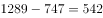

# 折线图直接读数之差值比较（两线'最接近'判定）

考点：[[20-考点/资料分析/其他/折线图直接读数之差值比较（两线'最接近'判定）|其他 / 折线图直接读数之差值比较（两线'最接近'判定）]]
材料：[[15-材料/资料分析/238958 2016年一季度至2018年四季度我|238958 2016年一季度至2018年四季度我]]

**问法模型**：题干问'硫酸、烧碱产量最接近的是哪个季度' → 对选项各季度分别求两线数值之差，差值最小者即为答案（读数—做差—比较模型）

## 推理链
1. 第1步：从折线图提取选项四个季度的两线数值——2017年一季度硫酸1437、烧碱785；2017年四季度硫酸1229、烧碱699；2018年一季度硫酸1284、烧碱761；2018年三季度硫酸1289、烧碱747（万吨）
2. 第2步：所用规则：'两指标产量最接近'即两线数值差值最小的时期，只需对选项所列季度逐项做差
3. 第3步：代入计算差值：1437-785=652，1229-699=530，1284-761=523，1289-747=542（万吨）
4. 第4步：比较四个差值：523＜530＜542＜652，2018年一季度差值523万吨最小
5. 第5步：与选项对照，2018年一季度对应C项，故正确答案为C

**最快解法**：⚡ 目测线间距+截位做差：先看图，硫酸与烧碱两线在2018年明显靠拢、在2017年一季度间距最大，锁定候选后心算差值652/530/523/542，最小者523对应2018年一季度即选C，无需遍历全部12个季度

## 易错点
- ⚠ 烧碱与纯碱两线同处600—900区间且局部贴近，2018年一季度纯碱为653，误把纯碱数值当烧碱会算成1284-653=631而误判；必须认准图例线型（方块为烧碱、三角为纯碱、菱形为硫酸）
- ⚠ 横轴共12个季度标注密集，易把'2018年一季度'列错位读成'2017年一季度'，导致取数错列
- ⚠ 本题只需比较选项给出的4个季度，误对全部12个季度做差浪费时间；最下方乙烯点线（24—44万吨）与本题无关，勿卷入比较

## 母题抽象
> 🧩 当题干出现'两指标数值最接近/差距最小的是哪个时期'且材料为逐点标注数值的多折线图时，先目测两线纵向间距最小的大致区间缩小范围，再对选项时点逐项做差取最小验证

**同类特征**：产量最接近、硫酸、烧碱、折线图逐点标注数值、选项为具体季度时点、差值最小比较、时间范围2016年一季度至2018年四季度

## 相关题
（暂无）

---

### 题干
2016年一季度至2018年四季度，我国硫酸、烧碱产量最接近的是

### 选项
- A. 2017年一季度
- B. 2017年四季度
- C. 2018年一季度　✅
- D. 2018年三季度

### 官方解析

定位折线图可得，2016年一季度至2018年四季度，我国硫酸、烧碱产量情况，结合选项：

2017年一季度产量差值为万吨；

2017年四季度产量差值为万吨；

2018年一季度产量差值为万吨；

2018年三季度产量差值为万吨。

比较四个数字，则2018年一季度，我国硫酸、烧碱产量最接近。

故正确答案为C。

### 给定材料

        2018年我国硫酸、烧碱、纯碱和乙烯产量分别为5496万吨、3159万吨、2651万吨和129万吨。2016年一季度至2018年四季度我国硫酸、烧碱、纯碱和乙烯产量见下图。

> [!warning] 疑点（官方解析可能有误，待人工复核）
> 官方解析中四个季度的差值数字缺失（'产量差值为万吨'处为空），按图补算应为652、530、523、542万吨，与答案C的结论一致，不影响判定

<!-- CODEX-ANSWER-REVIEW:BEGIN -->
### 本次独立复核

**复核状态：** `resolved`（答案与解析已核定）

**计分答案：** C（可计分）

**复核解析：**

1. 第1步：从折线图提取选项四个季度的两线数值——2017年一季度硫酸1437、烧碱785；2017年四季度硫酸1229、烧碱699；2018年一季度硫酸1284、烧碱761；2018年三季度硫酸1289、烧碱747（万吨）
2. 第2步：所用规则：'两指标产量最接近'即两线数值差值最小的时期，只需对选项所列季度逐项做差
3. 第3步：代入计算差值：1437-785=652，1229-699=530，1284-761=523，1289-747=542（万吨）
4. 第4步：比较四个差值：523＜530＜542＜652，2018年一季度差值523万吨最小
5. 第5步：与选项对照，2018年一季度对应C项，故正确答案为C

**最快解法**：⚡ 目测线间距+截位做差：先看图，硫酸与烧碱两线在2018年明显靠拢、在2017年一季度间距最大，锁定候选后心算差值652/530/523/542，最小者523对应2018年一季度即选C，无需遍历全部12个季度

**相关信息：**

2019年江苏省公务员录用考试《行测》题（C类）（网友回忆版）；其他 / 折线图直接读数之差值比较（两线'最接近'判定）。单位与比较口径按题面材料：2019年度/期间。

**题源依据：** [固定版本原题](https://github.com/Mentat-Uran/kaogongzhentizhengliu/blob/84ab93d4b64b61d897bece8a1c0a5bab06b4feb2/10-%E7%9C%9F%E9%A2%98/%E8%B5%84%E6%96%99%E5%88%86%E6%9E%90/%E5%85%B6%E4%BB%96/2367898%20%E6%8A%98%E7%BA%BF%E5%9B%BE%E7%9B%B4%E6%8E%A5%E8%AF%BB%E6%95%B0%E4%B9%8B%E5%B7%AE%E5%80%BC%E6%AF%94%E8%BE%83%EF%BC%88%E4%B8%A4%E7%BA%BF'%E6%9C%80%E6%8E%A5%E8%BF%91'%E5%88%A4%E5%AE%9A%EF%BC%89.md)；固定内容 commit `84ab93d4b64b61d897bece8a1c0a5bab06b4feb2`，Markdown blob `c79b2f05b3f225426dc85910201aaed735e41c72`。
<!-- CODEX-ANSWER-REVIEW:END -->
