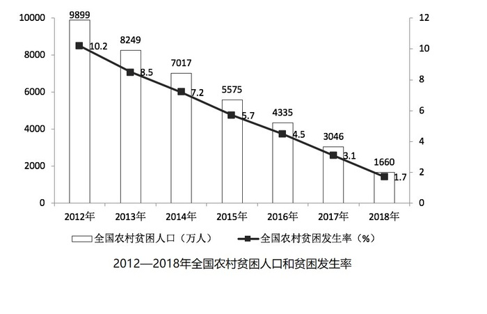

# 表格直接读数比较（最大值识别）

考点：[[20-考点/资料分析/其他/表格直接读数比较（最大值识别）|其他 / 表格直接读数比较（最大值识别）]]
材料：[[15-材料/资料分析/239236 2012—2018年全国脱贫攻坚成效|239236 2012—2018年全国脱贫攻坚成效]]

**问法模型**：题干问'2018年收入来源中最高的是' → 定位表1的2018年列，对四项来源做数值大小比较取最大，无需任何计算

## 推理链
1. 第1步：题干时间口径为2018年，考点为'收入来源中最高'，定位表1《我国贫困地区农村居民收入来源》的2018年列
2. 第2步：提取2018年四项数据：人均工资性收入3627元、人均转移净收入2719元、人均经营净收入3888元、人均财产净收入137元
3. 第3步：比较大小：3888＞3627＞2719＞137，最大值为3888元
4. 第4步：3888元对应'人均经营净收入'，与选项C吻合，故选C

**最快解法**：⚡ 直接读数法：锁定表1'2018年'列，扫一眼四行数值，最大数3888（经营净收入）即答案；只需确认次大3627（工资性收入）不构成威胁即可锁定C，全程口算

## 易错点
- ⚠ 列定位错误：表1有2018、2017两列，若误看2017年列（最大为经营净3723元），结论虽同项但数值口径错误，遇'最高且增速/增量'类变形题会直接出错
- ⚠ 口径陷阱：表1为人均收入来源（单位：元），四项之和3627+2719+3888+137=10371元才等于正文的人均可支配收入，勿把单项3888元误当可支配收入总量
- ⚠ 材料区域混淆：本题只需表1读数，勿被图1贫困人口（万人）和贫困发生率（%）数据干扰，也勿与兄弟题3的比重计算（3627÷10371）混淆

## 母题抽象
> 🧩 当题干出现'……来源/构成中最高（最大）的是'且材料为分项统计表时，直接定位对应年份列做数值大小比较即可，无需计算；注意核对年份列与单位口径

**同类特征**：收入来源中最高的是、2018年、人均口径、表1四项来源、直接读数比较、无需计算

## 相关题
- [[10-真题/资料分析/其他/5623 直接查找比较（涨幅最大项）|5623]]（福建 2008，相关度1）
- [[10-真题/资料分析/其他/2139506 表格定位读数与最值比较（直接查数）|2139506]]（天津 2017，相关度1）
- [[10-真题/资料分析/增长/2374708 同比增长率比较（增幅最大）|2374708]]（广东 2019，相关度1）
- [[10-真题/资料分析/其他/2374811 简单查找比较（表格直接读数比大小）|2374811]]（广东 2019，相关度1）
- [[10-真题/资料分析/增长/2374835 增长量计算（现期值-基期值）|2374835]]（广东 2019，相关度1）

---

### 题干
2018年，我国贫困地区农村居民收入来源中，最高的是（     ）。

### 选项
- A. 人均工资性收入
- B. 人均转移净收入
- C. 人均经营净收入　✅
- D. 人均财产净收入

### 官方解析
题目所求“2018年我国贫困地区农村居民收入来源最高的”，定位表格，观察数据可得，人均经营净收入3888元最高。
故正确答案为C。

### 给定材料

        党的十八大以来，脱贫工作取得巨大成效，全国农村贫困人口大幅减少。截至2018年末，全国农村贫困人口从2012年末的9899万人减少至1660万人；农村贫困发生率从2012年的下降至，累计下降8.5个百分点。

        2018年，贫困地区农村居民人均可支配收入10371元，扣除价格因素，实际增长，实际增速高出全国农村居民人均可支配收入实际增速1.7个百分点，圆满完成增长幅度高于全国增速的年度目标任务。

