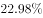

# 简单查找比较（表格直接读数比大小）

考点：[[20-考点/资料分析/其他/简单查找比较（表格直接读数比大小）|其他 / 简单查找比较（表格直接读数比大小）]]
材料：[[15-材料/资料分析/239248 B省2015-2018年市场主体发展|239248 B省2015-2018年市场主体发展]]

**问法模型**：题干问'某指标最多的是哪一年'→定位统计表对应指标行，逐年读数直接比较取最大值，无需计算

## 推理链
1. 第1步：题干限定指标为'新登记个体工商户'，时间范围2015-2018年，定位统计表'新登记个体工商户'行
2. 第2步：按表格列读取四年数据：2018年131.56万户、2017年104.10万户、2016年82.04万户、2015年77.11万户
3. 第3步：比较大小：131.56＞104.10＞82.04＞77.11，逐年递增，最大值131.56万户对应2018年
4. 第4步：对照选项，2018年为D项，故正确答案为D

**最快解法**：⚡ 直接查找比较法：锁定'新登记个体工商户'行，从2018列往右扫，首列131.56已是最大（后三年104.10/82.04/77.11均更小），直接选D，全程不需要动笔

## 易错点
- ⚠ 年份列倒序陷阱：表格年份从左到右为2018/2017/2016/2015，误按'最左列=2015'的惯性读数会选错
- ⚠ 行混淆陷阱：误读相邻行，如'新登记市场主体'（229.76/195/161.58/178.76）或'新登记企业'（97.80/90.41/79.05/61.10），虽2018年同为最大但数据口径已错
- ⚠ 口径陷阱：'新登记个体工商户'是当年新增流量，勿与'实有各类市场主体'存量行混淆

## 母题抽象
> 🧩 当题干出现'某指标最多/最大的年份'且指标为表格单一行时，用直接查找比较法，定位该行按列读数取最大，验证最大值所在列的年份与选项对应即可

**同类特征**：最多的是哪一年、新登记个体工商户、2015-2018年、表格单行读数、无需计算、逐年递增

## 相关题
- [[10-真题/资料分析/其他/5623 直接查找比较（涨幅最大项）|5623]]（福建 2008，相关度1）
- [[10-真题/资料分析/其他/2139506 表格定位读数与最值比较（直接查数）|2139506]]（天津 2017，相关度1）
- [[10-真题/资料分析/增长/2374708 同比增长率比较（增幅最大）|2374708]]（广东 2019，相关度1）
- [[10-真题/资料分析/其他/2374716 表格直接读数比较（最大值识别）|2374716]]（广东 2019，相关度1）
- [[10-真题/资料分析/综合/4652204 综合判断题（核心验证点：两期比重升降判定；辅助：增长率比较、逐年数据核对、消费总量加总）|4652204]]（北京 2022，相关度1）

---

### 题干
2015-2018年，B省新登记个体工商户最多的是（    ）年。

### 选项
- A. 2015
- B. 2016
- C. 2017
- D. 2018　✅

### 官方解析
定位表格材料，可知B省各年新登记个体工商户数分别是：2018年131.56万户，2017年104.10万户，2016年82.04万户，2015年77.11万户，则2018年最多。
故正确答案为D。

### 给定材料

        近年来，B省营商环境不断优化，市场活力不断增强，新登记市场主体都保持较快增长势头。2018年，全省新登记市场主体229.74万户，日均新登记市场主体6294户，同比增长。

        全省产业结构也进一步调整优化，新登记市场主体主要集中在第三产业。2018年，全省三大产业新登记市场主体分别为第一产业2.02万户，第二产业24.01万户，第三产业203.71万户。截止2018年12月末，全省三大产业的实有各类市场主体户数分别为9.83万户，157.38万户，978.92万户。

        2018年，全省新登记企业最集中的三个行业分别是批发和零售业、租赁和商务服务业、制造业，新登记企业数分别为36.14万户、15.19万户、9.25万户，分别同比增长、增长、下降。

