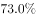
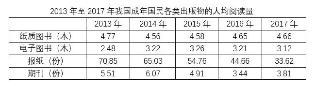

# 基期率之差（现期值±变化百分点的简单加减计算）

考点：[[20-考点/资料分析/其他/基期率之差（现期值±变化百分点的简单加减计算）|其他 / 基期率之差（现期值±变化百分点的简单加减计算）]]
材料：[[15-材料/资料分析/239327 2017年我国成年国民阅读情况：传统|239327 2017年我国成年国民阅读情况：传统]]

**问法模型**：题干给‘2017年报纸/期刊阅读率较上年±N个百分点’、问‘2016年报纸阅读率比期刊阅读率高几个百分点’→先用‘基期=现期±变化百分点’（降低取加、增加取减）还原两个2016年基期率，再作差：基期差=现期差+2.1+1.0。

## 推理链
1. 第1步：从文字材料第一段提取：2017年报纸阅读率比上年降低2.1个百分点，期刊阅读率比上年增加1个百分点（本文本两现期率具体数值空缺，须以原卷数值代入）。
2. 第2步：基期还原规则：‘降低2.1个百分点’说明2016年报纸率更高，2016报纸率=2017报纸率+2.1；‘增加1个百分点’说明2016年期刊率更低，2016期刊率=2017期刊率−1.0。
3. 第3步：作差合并：2016年差=(2017报纸率−2017期刊率)+2.1+1.0=2017年两率之差+3.1个百分点（‘个百分点’只能加减、不能乘除）。
4. 第4步：代入原卷2017年两率（当年两率之差为12.3个百分点）：12.3+3.1=15.4个百分点。
5. 第5步：与选项对照：15.4个百分点对应C，故选C；注意12.3个百分点（2017年当年差）恰好被设为干扰项B，是方向反置的陷阱。

**最快解法**：⚡ 公式法（百分点平移）：基期差=现期差−ΔA−ΔB，报纸Δ=−2.1、期刊Δ=+1.0，故2016差=2017差+2.1+1.0=2017差+3.1，代入2017差12.3得15.4；考场秒验：干扰项B(12.3)与正确项C(15.4)恰差3.1=2.1+1.0，结构吻合即锁C。

## 易错点
- ⚠ 方向反置：‘比上年降低2.1’要加回去（2016年更高）、‘比上年增加1.0’要减回去（2016年更低），方向搞反就得到2017年当年差12.3而误选B。
- ⚠ 口径混淆：变化量单位是‘个百分点’，只能与百分数加减，若按百分数做乘除或把百分点当%运算即错。
- ⚠ 取数错位：误从统计表取报纸/期刊人均阅读量（单位‘份’，量级几十）替代阅读率，或未核对原卷补全文字段空缺的现期率数值就凭空计算。

## 母题抽象
> 🧩 当题干出现‘基期年A指标比B指标高/低多少个百分点’且材料只给‘现期A较上年±x、B较上年±y个百分点’时，用‘基期差=现期差−ΔA−ΔB（降低记负、增加记正）’一步求解，并可用‘干扰项=现期差、正确项=现期差+|x|+|y|’的选项结构秒验。

**同类特征**：2016年（基期年）两率之差、报纸阅读率比期刊阅读率高、多少个百分点、比上年增加/降低N个百分点、百分数与百分点的加减运算、文字材料定位

## 相关题
- [[10-真题/资料分析/比重/10297073 两期比重差（比重变化量，百分点）|10297073]]（天津 2025，相关度1）
- [[10-真题/资料分析/增长/1752612 增速同比变动幅度（百分点作差）·折线图读数|1752612]]（北京 2016，相关度1）
- [[10-真题/资料分析/增长/12019689 增长量计算（已知现期与增长率）|12019689]]（广东 2026，相关度1）
- [[10-真题/资料分析/比重/2172703 现期比重计算与比重差值（地区构成比重×地区基数后再对全省同类总量作比作差）|2172703]]（江苏 2018，相关度1）
- [[10-真题/资料分析/平均数/4674812 现期平均数计算（每所学校平均在校生数＝人数÷学校数）|4674812]]（选调 2021，相关度1）

---

### 题干
2016年我国成年国民报纸阅读率比期刊阅读率高：

### 选项
- A. 11.1个百分点
- B. 12.3个百分点
- C. 15.4个百分点　✅
- D. 17.5个百分点

### 官方解析
由题干“成年国民报纸阅读率比期刊阅读率高多少百分点”，可判定本题为简单加减计算问题。定位文字材料第一段“2017年报纸阅读率为，比上年降低2.1个百分点；2017年期刊阅读为，比上年增加1个百分点”，故2016年报纸阅读率为；2016年期刊阅读率为。因此，2016年我国成年国民报纸阅读率比期刊阅读率高，即15.4个百分点。
故正确答案为C。

### 给定材料

        2017年我国成年国民图书阅读率为，比上年增加0.3个百分点；报纸阅读率为，比上年降低2.1个百分点；期刊阅读率为，比上年增加1个百分点。 

        2017年我国成年国民数字化阅读方式(网络在线阅读、手机阅读、电子阅读器阅读、平板电脑阅读等)的接触率为。其中，网络在线阅读接触率为，比上年增加4.4个百分点；手机阅读接触率为，比上年增加4.9个百分点；电子阅读器阅读接触率为，比上年增加6.5个百分点；平板电脑阅读接触率为，比上年增加2.2个百分点。

        传统纸质媒介中，2017年我国成年国民人均每天阅读纸质图书时长为20.38分钟，人均每天阅读报纸时长为12.00分钟，人均每天阅读期刊时长为6.88分钟。

> [!warning] 疑点（官方解析可能有误，待人工复核）
> 非解析错误，属材料完整性问题：本文本中2017年报纸、期刊阅读率具体数值空缺，官方解析中间式亦留空，直接验算须以原卷数值代入（按答案C反推，2017年两率之差应为12.3个百分点，与干扰项B呼应）。
