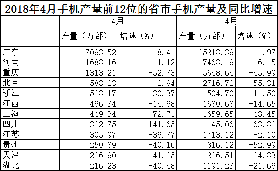

# 排序位次比较（重排后位次不变个数）

考点：[[20-考点/资料分析/其他/排序位次比较（重排后位次不变个数）|其他 / 排序位次比较（重排后位次不变个数）]]
材料：[[15-材料/资料分析/239410 2018年4月（当月）及1~4月（累|239410 2018年4月（当月）及1~4月（累]]

**问法模型**：题干问'按1~4月产量重新排列后有几个省市位次不变'→ 将表格中1~4月累计产量列单独排序，与原表按4月产量的位次逐一对比，数出位次相同的个数

## 推理链
1. 第1步：题干要求把按4月产量排好的前12省市改按1~4月累计产量重排，与原位次对比，属直接找数比较，无需计算
2. 第2步：从表中提取两列数据（4月产量/1~4月累计产量，万部）：广东7093.52/25218.39、河南1688.16/7468.19、重庆1313.21/5648.64、北京588.23/2716.72、浙江528.17/1504.70、江西466.34/1680.68、上海449.34/1659.65、四川322.75/1145.06、江苏305.97/1713.12、贵州250.89/816.12、天津226.90/1226.51、湖北216.23/1191.23
3. 第3步：按1~4月累计产量从大到小重排为：广东、河南、重庆、北京、江苏(1713.12)、江西(1680.68)、上海(1659.65)、浙江、天津(1226.51)、湖北(1191.23)、四川、贵州
4. 第4步：逐一对比位次：广东1→1、河南2→2、重庆3→3、北京4→4、江西6→6、上海7→7共6个不变；变动6个：浙江5→8、江苏9→5、四川8→11、贵州10→12、天津11→9、湖北12→10
5. 第5步：位次不变的省市为广东、河南、重庆、北京、江西、上海，共6个，与选项B吻合

**最快解法**：⚡ 直接找数+标注法：在原表行旁标注各省市累计产量的新名次，无需逐一定序——先锁定前4名（粤25218.39、豫7468.19、渝5648.64、京2716.72在累计列仍稳居前4）直接得4个不变，再在中段比较江苏1713.12>江西1680.68>上海1659.65>浙江1504.70，江西、上海夹在江苏与浙江之间位次未动，再得2个，合计6个，选B

## 易错点
- ⚠ 表格主排序是'4月产量'列，若不重排、直接按原表顺序数位次，会误判全部12个位次都不变（错选D或更大）；必须用'1~4月累计产量'列重新定序
- ⚠ 两列排序差异隐蔽：江苏4月第9但累计第5（跳升最大）、浙江4月第5但累计第8、四川/贵州/天津/湖北也两两互换，漏看任何一个都会数错不变个数
- ⚠ 切勿用'同比增速'或'产量增减'判断位次变化：位次只看累计产量绝对值大小，与增速正负无关（如北京4月增速-2.94%但位次不变，四川增速+141.65%位次反而下滑）

## 母题抽象
> 🧩 当题干出现'按另一指标重新排列后位次不变的有几个'时，在原排序表旁标注新指标名次、逐一对比，只需数名次相同的行数，全程不做算术运算，重点防范双列排序不一致的陷阱

**同类特征**：重新排列、位次不会发生变化、按1~4月产量、前12位省市、直接找数比较、排序对比

## 相关题
- [[10-真题/资料分析/增长/2402482 同比增长率比较（直接找数）|2402482]]（重庆 2018，相关度1）

---

### 题干
如将2018年4月手机产量前12位的省市按2018年1~4月产量重新排列，有几个省市的位次将不会发生变化？

### 选项
- A. 5
- B. 6　✅
- C. 7
- D. 8

### 官方解析
根据题干“······按2018年1-4月产量重新排列，有几个省市的位次将不会发生变化”可知本题是将12个省份按1-4月产量进行排序和之前按4月产量的排序进行比较，因此本题为直接找数比较问题。将12个省份按1-4月产量重新排列从大到小为：广东、河南、重庆、北京、江苏、江西、上海、浙江、天津、湖北、四川、贵州。位次没有发生变化的有：广东、河南、重庆、北京、江西、上海这6个省份。
故正确答案为B。

### 给定材料

根据所给资料，回答下列问题。

        2018年4月全国手机产量达14366.7万部，同比增长；2018年1～4月全国手机累计产量为56479.3万部，累计增长。

