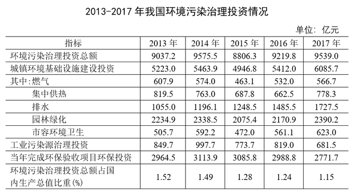

# 两行数据逐年加和与阈值比较（简单加减计数题）

考点：[[20-考点/资料分析/其他/两行数据逐年加和与阈值比较（简单加减计数题）|其他 / 两行数据逐年加和与阈值比较（简单加减计数题）]]
材料：[[15-材料/资料分析/239972 2013~2017年我国环境污染治理|239972 2013~2017年我国环境污染治理]]

**问法模型**：题干问'两指标之和超过2800亿元的年份有几个'→ 将园林绿化与市容环境卫生两行逐年横向加和，与2800亿元逐一年份比较后计数

## 推理链
1. 第1步：定位表格'园林绿化'行（2234.9/2338.5/2075.4/2170.9/2390.2）与'市容环境卫生'行（505.7/592.2/472.0/561.1/623.0），两行均为城镇环境基础设施建设投资的'其中'分项，单位均为亿元
2. 第2步：规则：2013~2017五年逐年加和，与阈值2800亿元比较，统计严格大于2800的年份数
3. 第3步：代入计算：2013年2234.9+505.7=2740.6；2014年2338.5+592.2=2930.7；2015年2075.4+472.0=2547.4；2016年2170.9+561.1=2732.0；2017年2390.2+623.0=3013.2
4. 第4步：比较：2740.6、2547.4、2732.0均<2800，仅2930.7（2014年）和3013.2（2017年）>2800
5. 第5步：超过2800亿元的年份共2个，对照选项得B

**最快解法**：⚡ 补数法（转化为一数比较）：用2800减去市容环境卫生后与园林绿化比较——2014年2800−592.2=2207.8<2338.5✓、2017年2800−623.0=2177.0<2390.2✓；2013年2294.3>2234.9、2015年2328.0>2075.4、2016年2238.9>2170.9均✗；每岁只做一次减法比较，共2年达标，选B

## 易错点
- ⚠ 行定位陷阱：园林绿化、市容环境卫生是'城镇环境基础设施建设投资'的'其中'分项，二者之和≠城镇投资总额（6085.7），更不涉及投资总额行，取数勿串行
- ⚠ 阈值判断：2016年2732.0、2013年2740.6均接近但未超过2800，'超过'是严格大于，不能凭接近误判达标
- ⚠ 计数完整性：五年须逐一年份计算，不能凭趋势直觉只挑波动大的年份，遗漏2014年或2017年会错选A或C；问'几个'选的是年份数（2），不是列出年份

## 母题抽象
> 🧩 当题干出现'两个指标之和超过（或低于）某具体阈值的年份有几个'时，逐年横向加和（或用补数法：阈值减其一再比另一指标），逐岁与阈值比较后数达标年份个数对照选项

**同类特征**：两指标之和、超过+具体阈值（2800亿元）、年份有几个（计数类问法）、同表两行逐年取数、简单加减计算、无公式、五年逐岁比较

## 相关题
（暂无）

---

### 题干
20132017年，我国园林绿化投资额和市容环境卫生投资额之和超过2800亿元的年份有几个？

### 选项
- A. 1
- B. 2　✅
- C. 3
- D. 4

### 官方解析
定位表格第七、八行数据可知：20132017各年份我国园林绿化投资额和市容环境卫生投资额，判断本题为简单加减计算。计算题目所求各年度二者之和：2013年：；2014年：；2015年：；2016年：；2017年：，只有2014年和2017年两年超过2800亿元。
故正确答案为B。

### 给定材料

根据所给资料，回答下列问题。

