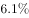
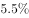
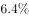
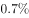
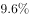

# 累计值求当月值（相邻累计差值简单计算）

考点：[[20-考点/资料分析/其他/累计值求当月值（相邻累计差值简单计算）|其他 / 累计值求当月值（相邻累计差值简单计算）]]
材料：[[15-材料/资料分析/240010 2019年1-2月与1-3月全国固定|240010 2019年1-2月与1-3月全国固定]]

**问法模型**：题干问'2019年3月（单月）民间固定资产投资约多少亿元'而材料只给'1-3月、1-2月累计值'→采用相邻累计相减模型：3月当月=1-3月累计−1-2月累计

## 推理链
1. 第1步：从段1提取2019年1-2月民间固定资产投资26963亿元（累计值），从段2提取2019年1-3月民间固定资产投资61492亿元（累计值），材料无3月当月直接数据
2. 第2步：由累计口径关系确立规则：3月当月民间投资=1-3月累计民间投资−1-2月累计民间投资
3. 第3步：代入计算：61492−26963=34529亿元（可用尾数核对：末两位92−63=29）
4. 第4步：与选项对照，仅B项34529吻合；A项19360恰为二产差值(33224−13864)、C项36205恰为三产差值(66240−30035)、D项57022≈全国差值(101872−44849=57023)，均为口径干扰，锁定B

**最快解法**：⚡ 累计差值+尾数法：定位两段'民间固定资产投资'行，直接61492−26963，末两位92−63=29，四个选项中只有B（34529）尾数为29，秒锁；亦可估算61500−27000≈34500验证

## 易错点
- ⚠ 累计值当月值混用：26963与61492均为'1-X月累计'而非3月当月，直接取某一累计数作答必错
- ⚠ 口径读错行：民间投资是全国投资的子口径，误用全国总量相减(101872−44849≈57023)会落入D项陷阱；误用二产/三产行相减分别落入A项(19360)与C项(36205)陷阱
- ⚠ 增速缺失不碍事：本题只用累计投资额，原文同比增速空白处无需补数；'个百分点'信息与本题无关，不参与计算

## 母题抽象
> 🧩 当题干问'某单月值'而材料只给相邻两期'1-X月累计值'时，用'后期累计−前期累计'求当月值，且代入前先核对行口径（全国/民间/分产业）与题干一致，再用尾数法快速锁定选项

**同类特征**：单月时点问法（2019年3月）、民间固定资产投资口径、约为多少亿元、累计值相减、段1段2数据复用、不依赖缺失增速

## 相关题
- [[10-真题/资料分析/增长/2456363 基期量计算|2456363]]（浙江 2020，相关度1）
- [[10-真题/资料分析/平均数/2579778 现期平均数计算（累计值−单月值做差求子时段总量后求月均）|2579778]]（浙江 2020，相关度1）
- [[10-真题/资料分析/平均数/4652180 现期平均数之两步拼接（单位企业利润=利润总额÷企业数，企业数由营业收入÷单位企业营业收入间接求出）|4652180]]（北京 2022，相关度1）
- [[10-真题/资料分析/增长/2188210 累计值相减构造单季值+环比升降方向判断计数|2188210]]（陕西 2018，相关度1）
- [[10-真题/资料分析/增长/2388066 按上年价格计算的现期值折算（名义增速→实际增速）|2388066]]（河北 2019，相关度1）

---

### 题干
2019年3月民间固定资产投资额约为多少亿元？

### 选项
- A. 19360
- B. 34529　✅
- C. 36205
- D. 57022

### 官方解析
定位文字材料第一段可得：“2019年1-2月份···其中，民间固定资产投资26963亿元，同比增长···”定位文字材料第二段可得：“2019年1-3月份···其中，民间固定资产投资61492亿元，同比增长。”故2019年3月民间固定资产投资额=2019年1-3月份民间固定资产投资额-2019年1-2月份民间固定资产投资额亿元。
故正确答案为B。

### 给定材料

        2019年1-2月份，全国固定资产投资（不含农户）44849亿元，同比增长，增速比2018年全年提高0.2个百分点。其中，民间固定资产投资26963亿元，同比增长。分产业看，第一产业投资950亿元，同比增长，增速比2018年全年回落9.2个百分点；第二产业投资13864亿元，增长，增速回落0.7个百分点；第三产业投资30035亿元，增长，增速提高1个百分点。

        2019年1-3月份，全国固定资产投资（不含农户）101872亿元，同比增长，增速比去年同期回落1.2个百分点。其中，民间固定资产投资61492亿元，同比增长。

        分产业看，第一产业投资2408亿元，同比增长，增速比1-2月份回落0.7个百分点；第二产业投资33224亿元，增长，增速回落1.3个百分点；第三产业投资66240亿元，增长，增速提高1个百分点。

        第二产业中，工业投资同比增长，增速比1-2月份回落1.4个百分点；其中，采矿业投资增长，增速回落26.6个百分点；制造业投资增长，增速回落1.3个百分点；电力、热力、燃气及水生产和供应业投资增长，1-2月份为下降。

        第三产业中，基础设施投资（不含电力、热力、燃气及水生产和供应业）同比增长，增速比1-2月份提高0.1个百分点。其中，水利管理业投资下降，降幅扩大3.7个百分点；公共设施管理业投资下降，降幅收窄2.3个百分点；道路运输业投资增长，增速回落2.5个百分点；铁路运输业投资增长，增速回落11.5个百分点。

        分地区看，东部地区投资同比增长，增速比1-2月份提高1个百分点；中部地区投资增长，增速提高0.2个百分点；西部地区投资增长，增速提高0.2个百分点；东北地区投资增长，增速回落2.8个百分点。

        分登记注册类型看，内资企业投资同比增长，增速与1-2月份持平；港澳台商投资增长，增速提高2.8个百分点；外商投资增长，增速提高5.3个百分点。

