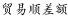
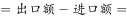
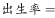
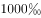
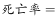
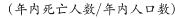
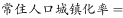

# 进出口顺差计算（顺差=出口-进口，简单作差）

考点：[[20-考点/资料分析/其他/进出口顺差计算（顺差=出口-进口，简单作差）|其他 / 进出口顺差计算（顺差=出口-进口，简单作差）]]
材料：[[15-材料/资料分析/240291 2018年我国国民经济和社会发展主要|240291 2018年我国国民经济和社会发展主要]]

**问法模型**：题干问某特定对象（'一带一路'沿线国家）的'贸易顺差' → 顺差=出口额-进口额，直接取同段数据作差即可

## 推理链
1. 第1步：从材料第二段提取对'一带一路'沿线国家的数据：出口46478亿元、进口37179亿元（同段还给出进出口总额83657亿元）；注意与全国出口164177、进口140873、全国顺差23304区分
2. 第2步：贸易顺差=出口-进口，代入同一段内配对的出口与进口数据
3. 第3步：计算46478-37179=9299亿元；可用恒等式验算：出口+进口=46478+37179=83657，与材料总额吻合，或总额-进口=83657-37179=9299
4. 第4步：与选项对照，D选项9299与计算结果一致，A、B、C均无数据支撑，故选D

**最快解法**：⚡ 直接减法+尾数法：46478-37179，尾数8-9借位得9，首位4-3=3……快速锁定9299；更稳妥可交叉验算83657-37179=9299（顺差=总额-进口）

## 易错点
- ⚠ 跨段借用数据：误用全国顺差23304或全国出口/进口（164177/140873），本题必须用'一带一路'段内配对的46478与37179
- ⚠ 概念误选：顺差不等于出口额本身（误选C的46478），也不等于进出口总额83657
- ⚠ 出口与进口方向搞反或对'顺差/逆差'定义不清，误作进口-出口

## 母题抽象
> 🧩 当题干出现'某对象贸易顺差'特征时，从同一句定位该对象对应的出口额与进口额（严禁借用全国或其他对象数据），用顺差=出口-进口作差，并以'出口+进口=进出口总额'恒等式验算取数是否正确

**同类特征**：对'一带一路'沿线国家、贸易顺差、出口与进口、亿元、2018年、简单作差型求值

## 相关题
- [[10-真题/资料分析/其他/14096272 贸易顺差计算（顺差=出口额-进口额）＋月度数据季度加总＋亿元→万亿元单位换算|14096272]]（选调 2025，相关度1）
- [[10-真题/资料分析/平均数/19797282 现期平均数（年均生产总值=多个年度GDP算术平均）|19797282]]（山西 2024，相关度1）
- [[10-真题/资料分析/增长/2374708 同比增长率比较（增幅最大）|2374708]]（广东 2019，相关度1）
- [[10-真题/资料分析/其他/2374716 表格直接读数比较（最大值识别）|2374716]]（广东 2019，相关度1）
- [[10-真题/资料分析/增长/2374835 增长量计算（现期值-基期值）|2374835]]（广东 2019，相关度1）

---

### 题干
2018年我国对“一带一路”沿线国家的贸易顺差为（    ）亿元。

### 选项
- A. 11308
- B. 10190
- C. 46478
- D. 9299　✅

### 官方解析

定位文字材料第二段，2018年我国对“一带一路”沿线国家出口46478亿元，进口37179亿元，因此亿元，只有D满足。

故正确答案为D。

### 给定材料

        2018年我国国内生产总值900309亿元，比上年增长，全国居民人均可支配收入28228元，比上年增长，全国居民恩格尔系数为。2018年我国总人口139538万人，比上年增加530万人，其中城镇常住人口83137万人，全年出生人口1523万人，死亡人口993万人。

        2018年我国货物进出口总额305050亿元，比上年增长。其中，出口164177亿元，增长；进口140873亿元，增长。货物进出口顺差23304亿元，比上年减少5217亿元。对“一带一路”沿线国家进出口总额83657亿元，比上年增长。其中，出口46478亿元，增长；进口37179亿元，增长。

        2018年社会消费品零售总额380987亿元，比上年增长。全年实物商品网上零售额70198亿元，比上年增长。按经营地统计，城镇消费品零售额325637亿元，增长；乡村消费品零售额55350亿元，增长。按消费类型统计，商品零售额338271亿元，增长；餐饮收入额42716亿元，增长。

注释：

