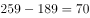

# 差额法求隐含部分量（交叉分类结构拆分）

考点：[[20-考点/资料分析/其他/差额法求隐含部分量（交叉分类结构拆分）|其他 / 差额法求隐含部分量（交叉分类结构拆分）]]
材料：[[15-材料/资料分析/246391 2016年4月保监会机关及各保监局接|246391 2016年4月保监会机关及各保监局接]]

**问法模型**：题干问一个材料未直接给出的交叉分类件数（财产险×违法违规）→ 沿两条穷尽拆分线做差额：违法违规总量259 −（人身险1470−人身险合同纠纷1281）＝财产险违法违规

## 推理链
1. 第1步：从材料第一段提取：保险公司投诉2980件＝合同纠纷类2721件＋涉嫌违法违规类259件（2721+259=2980，穷尽二分）
2. 第2步：从材料第二段提取：2980件保险公司投诉＝财产险1510件＋人身险1470件（穷尽二分），且人身险涉及合同纠纷1281件
3. 第3步：人身险内部同样按合同纠纷/违法违规二分，故人身险违法违规类＝1470−1281＝189件
4. 第4步：财产险违法违规类＝违法违规总量259−人身险违法违规189＝70件
5. 第5步：对照选项，A为70，故选A

**最快解法**：⚡ 差额法口算：只需三个数 259−(1470−1281)=259−189=70，直接锁定A；全程不碰2989、2721、1510，避免卷入口径陷阱

## 易错点
- ⚠ 口径选错基数：把含非保险公司投诉的总量2989或财产险1510当减数/基数，本题运算只发生在2980体系内（2980=2721+259=1510+1470）
- ⚠ 误选C(189)：算出人身险违法违规1470−1281=189后直接当答案，漏掉再从259中扣除这一步
- ⚠ 误用无关数据：把销售481/理赔357/保全237（和仅1075<1281，非穷尽）或2721代入运算，这些细分项与本题无关

## 母题抽象
> 🧩 当题干要求材料未直接给出的交叉分类部分量时，找到它所属的两条穷尽拆分线（总量=A+B，A内部=甲+乙），用'该性质的总量−另一分支内的同性质量'差额即得，并用各层加和还原总量自检

**同类特征**：财产险×违法违规交叉分类、该数材料未直接给出、需跨句拼接两条拆分线、差额法求隐含项、二分类穷尽（相加还原总量）、选项含189/259强干扰项

## 相关题
（暂无）

---

### 题干
2016年4月，涉及财产险公司违法违规类的投诉为多少件？

### 选项
- A. 70　✅
- B. 119
- C. 189
- D. 259

### 官方解析

定位文字材料第一段可知，接收保险公司投诉2980件，其中涉及保险公司合同纠纷类投诉2721件，涉嫌保险公司违法违规类投诉259件。即接收保险公司的投诉合同纠纷类违法违规类。

定位文字材料第二段可知，接收的2980件保险公司投诉又可分为财产险公司投诉（1510件）和人身险公司的投诉（1470件）。人身险公司的投诉中，合同纠纷的投诉有1281件，则人身险公司投诉中的违法违规类投诉为件。则涉及财产险公司违法违规类的投诉为件。

列表梳理如下：

故正确答案为A。

### 给定材料

        2016年4月，保监会机关及各保监局共接收各类涉及保险消费者权益的有效投诉总量为2989件，同比上升，环比上升。其中，接收保险公司投诉2980件，其他非保险公司投诉9件。接收保险公司投诉中，涉及保险公司合同纠纷类投诉2721件；涉嫌保险公司违法违规类投诉259件。

        所接收的2980件保险公司投诉中，财产险公司的投诉为1510件。其中，投诉量位居前10的财产险公司的投诉总和占投诉所有公司投诉总量的。人身险公司的投诉为1470件。其中，投诉量位居前10的人身险公司的投诉量总和占所有公司投诉总量的。另外，人身险涉及保险合同纠纷的投诉有1281件，其中销售纠纷481件，理赔纠纷357件，保全纠纷237件。

