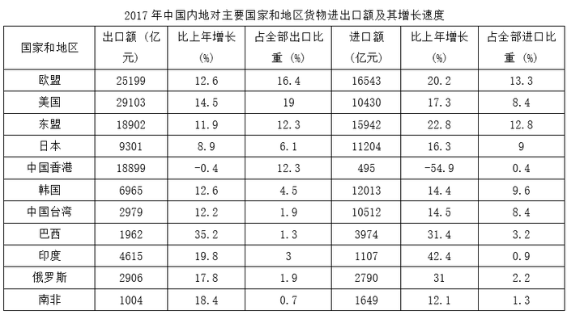

# 贸易顺逆差判定（同行出口额与进口额大小比较）

考点：[[20-考点/资料分析/其他/贸易顺逆差判定（同行出口额与进口额大小比较）|其他 / 贸易顺逆差判定（同行出口额与进口额大小比较）]]
材料：[[15-材料/资料分析/247418 2017年中国内地对欧盟、美国、东盟|247418 2017年中国内地对欧盟、美国、东盟]]

**问法模型**：题干问'实现贸易逆差的是'→ 判定模型：贸易逆差=进口额>出口额，只需在同一行比较'出口额'列与'进口额'列两个现期值，无需任何计算

## 推理链
1. 第1步：明确判定规则：贸易逆差即进口额大于出口额，即同一行'出口额'列数值小于'进口额'列数值，只需比较2017年现期值
2. 第2步：定位俄罗斯行：出口额2906亿元，进口额2790亿元，出口>进口，为顺差，排除A
3. 第3步：定位东盟行：出口额18902亿元，进口额15942亿元，出口>进口，为顺差，排除B
4. 第4步：定位中国台湾行：出口额2979亿元，进口额10512亿元，进口>出口，实现贸易逆差，对应选项C
5. 第5步：定位印度行：出口额4615亿元，进口额1107亿元，出口>进口，为顺差，排除D
6. 第6步：四个选项中仅中国台湾为进口>出口，与官方答案C一致

**最快解法**：⚡ 口诀判定法：逆差=进口>出口。四个选项中先扫中国台湾行：2979 vs 10512，进口约为出口的3.5倍，一眼即知是唯一逆差，锁定C；再快速扫其余三项（俄2906>2790、东盟18902>15942、印度4615>1107均为出口>进口）验证即可，全程零计算、纯比大小

## 易错点
- ⚠ 横向串列串行：表格出口三列与进口三列并排，须认准同一行的'出口额'与'进口额'两列，不能拿A国出口额与B国进口额比，也不能把进口增速14.5%等百分比混入比较
- ⚠ 凭增速正负或占比大小臆断顺逆差：如俄罗斯进口增速31%＞出口增速17.8%，但现期2906＞2790仍为顺差；顺逆差只看出口额与进口额的现期绝对值，与增长率、占比无关
- ⚠ 现期基期混淆：判定用2017年现期值，切勿用增速倒推基期再比较

## 母题抽象
> 🧩 当题干出现'贸易顺差/逆差'特征时，用'同行两列直接比大小'方法，验证'同一行进口额>出口额即为逆差'，与增速、占比、基期统统无关。

**同类特征**：实现贸易逆差、四个国家和地区、2017年现期、出口额与进口额同行比较、定性判断零计算

## 相关题
- [[10-真题/资料分析/比重/2448576 两期比重升降判断（定性比较计数型）|2448576]]（国考 2020，相关度1）

---

### 题干
2017年中国内地与下列四个国家和地区中实现贸易逆差的是：

### 选项
- A. 俄罗斯
- B. 东盟
- C. 中国台湾　✅
- D. 印度

### 官方解析
贸易逆差即，即只需表格中第二列数据小于第五列数据即可。分别定位表格第四、八、十、十一行，中国内地只有对中国台湾的出口额（2979亿元）进口额（10512亿元），因此对其实现贸易逆差。
故正确答案为C。

### 给定材料

