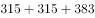
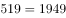

# 期间总量加总（流量指标逐年累加+区间判定）

考点：[[20-考点/资料分析/其他/期间总量加总（流量指标逐年累加+区间判定）|其他 / 期间总量加总（流量指标逐年累加+区间判定）]]
材料：[[15-材料/资料分析/257533 2010～2017年我国生物质发电的|257533 2010～2017年我国生物质发电的]]

**问法模型**：题干出现'十二五（2011～2015）期间'的总量并给区间选项 → 从折线取2011～2015五年发电量逐年加总，与选项区间比对，无需精确到个位

## 推理链
1. 第1步：'十二五'指2011～2015年，从统计图折线（发电规模，右轴，亿千瓦时）读出五年数据：2011年315、2012年315、2013年383、2014年417、2015年519亿千瓦时，不取2010年（248）与2016年（634）
2. 第2步：期间总量=各年流量之和：315+315+383+417+519；注意问的是'发电总量'须用折线（亿千瓦时），不能用柱形装机数据
3. 第3步：逐项累加：315+315=630，630+383=1013，1013+417=1430，1430+519=1949亿千瓦时
4. 第4步：1949落在1700～2000亿千瓦时区间内，且贴近但未超过2000，对照选项锁定B；A（<1700）排除，C（2000～2300）、D（>2300）排除

**最快解法**：⚡ 区间判定+凑整估算：先看五年均在300～550之间，粗加约320+320+380+420+520=1960，落在1700～2000内；再用尾数验证（5+5+3+7+9尾数9，精确值1949<2000），即可锁定B，不必精确计算

## 易错点
- ⚠ 时间范围错位：'十二五'是2011～2015五年，误加2010年（248）或2016年（634），或误用装机柱形数据（550/700/770/900/1070）加总
- ⚠ 双轴图混淆：柱形是年末装机容量（左轴，万千瓦，存量），折线是发电规模（右轴，亿千瓦时，流量），问'发电总量'必须读右轴折线
- ⚠ 2011年与2012年发电量相同（均315），易漏加或误以为读错；1949贴近2000边界，估算精度需控制在百位以内才能与C区分

## 母题抽象
> 🧩 当题干出现'××规划期间（如十二五2011～2015）某流量的总量/合计'特征时，锁定对应年份流量指标逐年加总并剔除期初前一年与期末后一年，用选项区间判定即可，估算到百位即可定答案

**同类特征**：'十二五'（2011～2015年）期间、发电总量/合计、区间范围选项（小于/～/大于）、折线数据逐年加总、流量指标（发电规模亿千瓦时）、总量与选项区间比对

## 相关题
（暂无）

---

### 题干
“十二五”（2011～2015年）期间，我国生物质发电总量在以下哪个范围内？

### 选项
- A. 小于1700亿千瓦时
- B. 1700～2000亿千瓦时　✅
- C. 2000～2300亿千瓦时
- D. 大于2300亿千瓦时

### 官方解析

定位图形材料可知“十二五”（2011-2015年）期间我国生物质发电量分别为315、315、383、417、519亿千瓦时，相加为亿千瓦时，即在1700～2000亿千瓦时之间。

故正确答案为B。

### 给定材料

        截至2017年底，我国共有30个省（区、市）投产了747个生物质发电项目，并网装机容量1476.2万千瓦（不含自备电厂），年发电量794.5亿千瓦时。其中农林生物质发电项目271个，累计并网装机700.9万千瓦，年发电量397.3亿千瓦时；生活垃圾焚烧发电项目339个，累计并网装机725.3万千瓦，年发电量375.2亿千瓦时；沼气发电项目137个，累计并网装机50.0万千瓦，年发电量22.0亿千瓦时。

        2017年，全国生物质发电替代化石能源约2500万吨标煤，减排二氧化碳约6500万吨，农林生物质发电共计处理农林废弃物约5400万吨；垃圾焚烧发电共计处理城镇生活垃圾约10600万吨，约占全国垃圾清运量的。

