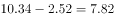
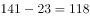
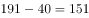
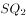
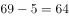
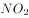
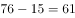
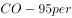
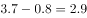
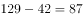

# 极差（最大值-最小值）计算与跨指标比较

考点：[[20-考点/资料分析/其他/极差（最大值-最小值）计算与跨指标比较|其他 / 极差（最大值-最小值）计算与跨指标比较]]
材料：[[15-材料/资料分析/264405 2018年1月我国32个重点城市的空|264405 2018年1月我国32个重点城市的空]]

**问法模型**：题干问'各项指标的极差的最大值和最小值'→对综合指数及6项污染物共7个数值列逐一用'列内最大值-列内最小值'求极差，再横向比较取极差的最大与最小。

## 推理链
1. 第1步：从材料提取7个指标的数值范围（只读'数值'列，勿读'排名'列）：综合指数2.52(海口)~10.34(西安)、PM2.5为23~141、PM10为40~191、SO₂为5(海口)~69(太原)、NO₂为15~76、CO-95per为0.8~3.7(乌鲁木齐)、O₃-8H-90per为42(乌鲁木齐)~129(深圳)。
2. 第2步：所用规则：极差=该指标最大值-最小值，7个指标须逐列分别计算，跨指标量级悬殊不可混算。
3. 第3步：代入计算：综合指数极差=10.34-2.52=7.82；PM2.5极差=141-23=118；PM10极差=191-40=151；SO₂极差=69-5=64；NO₂极差=76-15=61；CO极差=3.7-0.8=2.9；O₃极差=129-42=87。
4. 第4步：横向比较7个极差，最大为PM10的151，最小为CO-95per的2.9，综合指数的7.82和PM2.5的118均非最值。
5. 第5步：与选项对照：D项'151，2.9'吻合，A/B误用PM2.5极差118，A/C误把综合指数极差7.82当最小，故选D。

**最快解法**：⚡ 逐列定位+口算减法：极值大多集中在首行海口与末行西安（综合指数、PM2.5、PM10、NO₂均如此），只需再扫SO₂（太原69）、CO（乌鲁木齐3.7）、O₃（深圳129、乌鲁木齐42）三处例外；口算191-40=151为最大、3.7-0.8=2.9为最小，直接锁定D。

## 易错点
- ⚠ 双列表串列：每项指标是'排名列+数值列'并排，横向读行易把排名32当数值、或把PM2.5极差118误当最大值（A/B项陷阱）。
- ⚠ 误把综合指数极差7.82当作最小极差而错选A/C：综合指数也是一列，但其极差7.82既非最大也非最小。
- ⚠ 极值不在首末行的指标易漏：SO₂最大69在太原、CO最大3.7和O₃最小42在乌鲁木齐、O₃最大129在深圳，需全表扫描；且CO量级为mg/m³（0.8~3.7），小数极差2.9最易被忽视。

## 母题抽象
> 🧩 当题干出现'各指标的极差（最大值与最小值）'特征时，先逐列用'最大-最小'算出全部极差，再横向比较取最值，并警惕选项用其他列的极差（如PM2.5的118、综合指数的7.82）作干扰。

**同类特征**：各项空气质量指标、极差、最大值和最小值、32个城市、逐列分别计算、排名+数值双列表

## 相关题
- [[10-真题/资料分析/增长/2261767 环比增长率计算（兼考图表极差读数）|2261767]]（选调 2017，相关度1）
- [[10-真题/资料分析/其他/2262880 极差计算（涨跌幅时间序列：最大值−最小值）|2262880]]（选调 2016，相关度1）
- [[10-真题/资料分析/其他/2661076 极差（最大值−最小值）计算及跨图两极差之比|2661076]]（选调 2018，相关度1）
- [[10-真题/资料分析/倍数/2661090 现期倍数——相对差异（极差÷最小值，'高出'型倍数）比较|2661090]]（选调 2018，相关度1）

---

### 题干
在表中所列32个城市中各项空气质量指标的极差的最大值和最小值分别是：

### 选项
- A. 118，7.82
- B. 118，2.9
- C. 151，7.82
- D. 151，2.9　✅

### 官方解析

定位表格可知：综合指数的第1名和第32名分别是2.52、10.34，极差为；PM2.5数值的第1名和第32名分别是23、141，极差为；PM10数值的第1名和第32名分别是40、191，极差为；数值的第1名和第32名分别是5、69，极差为；数值的第1名和第32名分别是15、76，极差为；数值的第1名和第32名分别是0.8、3.7，极差为；数值的第1名和第32名名分别是42、129，极差为。则表中所列32个城市中各项空气质量指标的极差的最大值和最小值分别是151与2.9。

故正确答案为D。 

### 给定材料

        我国自2013年1月开始按照《环境空气质量标准》（GB3095-2012）开展空气质量监测和评价，2018年1月部分城市的评价结果如下表：

        2018年1月部分城市空气质量综合指数与各项污染物指标月均浓度及排名情况

