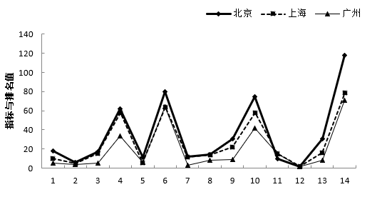
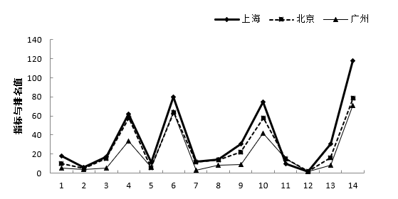
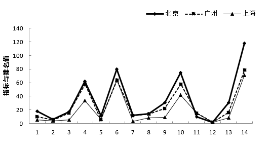
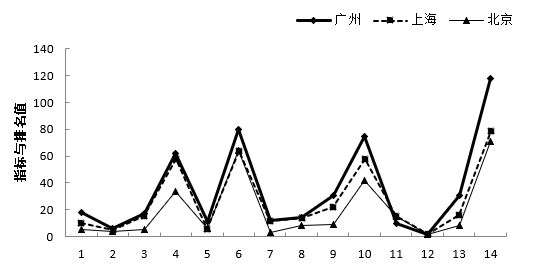

# 表格数据转统计图（折线图）识别——综合指数排名定位排除法

考点：[[20-考点/资料分析/其他/表格数据转统计图（折线图）识别——综合指数排名定位排除法|其他 / 表格数据转统计图（折线图）识别——综合指数排名定位排除法]]
材料：[[15-材料/资料分析/264405 2018年1月我国32个重点城市的空|264405 2018年1月我国32个重点城市的空]]

**问法模型**：题干要求由'排名+数值'双列表判定北京、上海、广州三城市'各项指标及排名'折线图正误 → 提取区分度最高的综合指数排名（北京5、上海10、广州18）作为判据对照选项排除，无需逐项核对全部7项污染物

## 推理链
1. 第1步：从表格第2列（综合指数排名）定位三城市：北京综合指数3.92排第5，上海5.16排第10，广州6.16排第18
2. 第2步：折线图为'三城市×各指标排名'的图形化呈现，采用'以点带面'排除法：排名序列呈北京5<上海10<广州18的递增形态（空气质量由好到差），且三点间距为5与8，区分度极高
3. 第3步：补充参照点增强判据——北京各指标排名（PM2.5第5、PM10第6、SO₂第3、NO₂第9、CO第15、O₃第8）普遍优于上海（15、6、14、12、15、16），上海又普遍劣于广州在NO₂（第31）处的显著恶化
4. 第4步：将'综合指数排名5→10→18递增'这一序列与A、B、C、D四个折线图对照，只有D项呈现该形态
5. 第5步：故正确答案为D，与官方解析'只有D项符合'一致

**最快解法**：⚡ 定位直选法（以点带面）：只读表格第2列综合指数排名——北京5、上海10、广州18，直接锁定呈现该递增序列的D项；7项污染物排名与浓度数值全部免核，考场上10秒内完成

## 易错点
- ⚠ '排名列+数值列'并排且量级悬殊（北京PM2.5排名5/数值34、西安排名32/数值141），横向读行极易串列，把数值34、58、62当排名去核图
- ⚠ 广州与武汉综合指数同为6.16、分列第18、19名，按数值横向扫描时易错位串行，把广州综合排名误读为19或把武汉数据带入
- ⚠ 排名方向易反：排名数字越大空气越差（西安综合排名32、指数10.34最大），误把'排名大'理解为'指数小/空气好'，导致对折线图升降方向判断颠倒

## 母题抽象
> 🧩 当题干出现'由表格数据判定某组城市的折线图/柱形图是否正确'特征时，用'以点带面'排除法：先选区分度最高、最易定位的1~2个数据点（首选综合指数排名列），对照选项逐一排除即可锁定答案，切忌7项指标逐项全核浪费时间

**同类特征**：折线图正误判断、北京、上海、广州三城市对比、'各项指标及排名'双维度由表转图、排名列+数值列并排双列表、以点带面排除法、综合指数排名定位

## 相关题
（暂无）

---

### 题干
2018年1月，北京、上海、广州三城市空气质量各项指标及排名的折线图，正确的是：

### 选项
- A. 

- B. 

- C. 

- D. 

　✅

### 官方解析
定位表格第2列可知：北京、上海、广州三城市综合指数的排名分别为5、10、18，只有D项符合。
故正确答案为D。

### 给定材料

        我国自2013年1月开始按照《环境空气质量标准》（GB3095-2012）开展空气质量监测和评价，2018年1月部分城市的评价结果如下表：

        2018年1月部分城市空气质量综合指数与各项污染物指标月均浓度及排名情况

