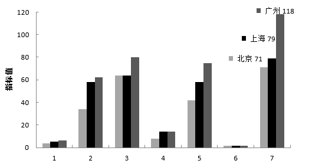
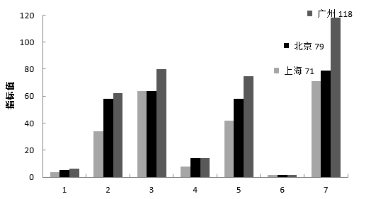
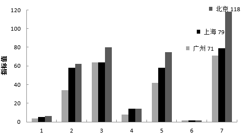
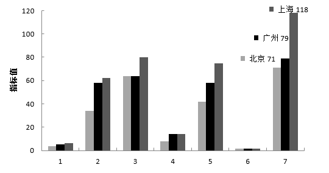
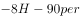
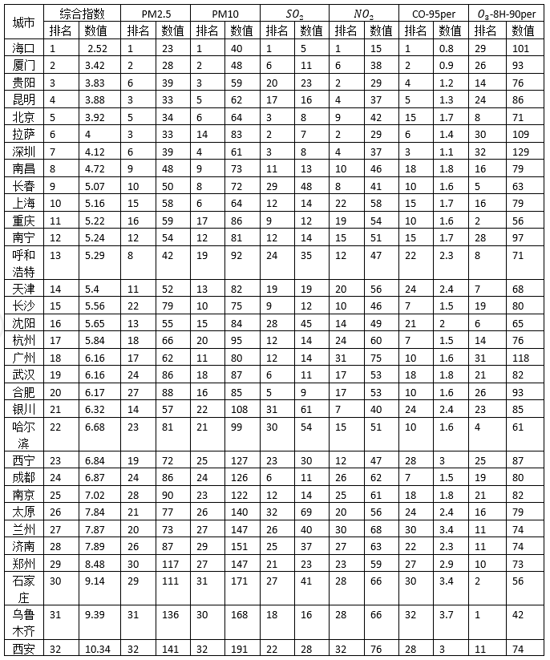

# 统计表转柱形图识别（数值维度核对）

考点：[[20-考点/资料分析/其他/统计表转柱形图识别（数值维度核对）|其他 / 统计表转柱形图识别（数值维度核对）]]
材料：[[15-材料/资料分析/264405 2018年1月我国32个重点城市的空|264405 2018年1月我国32个重点城市的空]]

**问法模型**：题干要求判断'北京、上海、广州三城市各项指标的柱形图哪项正确'→从表中提取三城市各指标数值，选区分度最大的一列（O₃-8H-90per：71/79/118）作突破口与选项图形比对排除

## 推理链
1. 第1步：从表格提取三城市7项指标数值：北京为综合指数3.92、PM2.5=34、PM10=64、SO₂=8、NO₂=42、CO=1.7、O₃-8H-90per=71；上海为5.16、58、64、14、58、1.7、79；广州为6.16、62、80、14、75、1.6、118
2. 第2步：柱形图核对无需七项逐一验证，选取量级大、三城间差异特征明显的表末列（O₃-8H-90per）作突破口
3. 第3步：末列三城数值为北京71、上海79、广州118，呈71→79→118逐级递增，广州显著突出（118约为北京的1.66倍）
4. 第4步：辅验其他列特征：PM10为64=64<80，SO₂为8<14=14，CO为1.7=1.7>1.6（仅CO广州最小），整体上广州各浓度指标普遍最高
5. 第5步：与选项对照：官方解析判定四个选项中仅A项柱形图与该组数值吻合（末列71/79/118递增），B、C、D均不符
6. 第6步：故正确答案为A

**最快解法**：⚡ 突破口排除法：只核对表末列O₃-8H-90per三城数值71/79/118（逐级递增、广州118最高），与四个选项柱形图逐一比对，仅A吻合即锁定答案，其余六项指标无需全验

## 易错点
- ⚠ '排名列+数值列'并排且量级悬殊，横向读行极易串列：北京O₃排名是8、数值是71，广州O₃排名是31、数值是118，勿把排名当数值核对柱高
- ⚠ 广州与武汉综合指数同为6.16（分列第18、19名），按数值定位广州行时易串到武汉行（武汉O₃为82≠118）
- ⚠ 本题柱形图仅按'数值'维度核对，勿与兄弟题折线图的'数值+排名'双维度混淆；且CO为mg/m³量级(1.6~1.7)、综合指数为2.52~10.34，与μg/m³量级指标尺度悬殊，不能跨指标凭柱高直觉比大小

## 母题抽象
> 🧩 当题干出现'某几个对象各项指标的柱形图/折线图正确的是'时，先从表中提取各对象指标数值，选区分度最大的一列（极值突出、递增递减特征明显）作突破口与选项图形排除比对，不必逐项全验

**同类特征**：柱形图正确的是、北京、上海、广州三城市、各项指标、单一月份截面(2018年1月)、表格数据转图形核对、仅按数值维度

## 相关题
- [[10-真题/资料分析/倍数/2661090 现期倍数——相对差异（极差÷最小值，'高出'型倍数）比较|2661090]]（选调 2018，相关度1）

---

### 题干
2018年1月，北京、上海、广州三城市空气质量各项指标的柱形图正确的是：

### 选项
- A. 

　✅
- B. 

- C. 

- D. 

### 官方解析

定位表格最后1列可知，北京、上海、广州三城市的数值分别为71、79、118，只有A项符合。

故正确答案为A

### 给定材料

        我国自2013年1月开始按照《环境空气质量标准》（GB3095-2012）开展空气质量监测和评价，2018年1月部分城市的评价结果如下表：

        2018年1月部分城市空气质量综合指数与各项污染物指标月均浓度及排名情况

