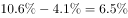

# 百分点差值推算（利润率'高于全国4.1个百分点'反向相减）

考点：[[20-考点/资料分析/其他/百分点差值推算（利润率'高于全国4.1个百分点'反向相减）|其他 / 百分点差值推算（利润率'高于全国4.1个百分点'反向相减）]]
材料：[[15-材料/资料分析/264431 N省2018年规模以上工业运行情况（|264431 N省2018年规模以上工业运行情况（]]

**问法模型**：题干问'全国平均利润率'而材料只给N省利润率及其'高于全国平均水平4.1个百分点'→采用反向差值模型：全国=N省利润率−4.1个百分点（个百分点只做加减）。

## 推理链
1. 第1步：从文字材料第二段提取条件：2018年1—11月N省规模以上工业企业主营业务收入利润率为（本版数值空缺，以完整版材料为准），同比提高0.3个百分点，且高于全国平均水平4.1个百分点。
2. 第2步：明确规则：'高于全国平均水平4.1个百分点'是差值关系，即N省利润率−全国平均利润率=4.1个百分点，故全国平均=N省利润率−4.1个百分点；'4.1个百分点'不是增速，只能加减、不能乘除。
3. 第3步：代入计算：全国平均利润率=N省利润率−4.1个百分点；'同比提高0.3个百分点'描述的是N省利润率自身与2017年比较的变化量，与求全国值无关，为干扰信息，不参与运算。
4. 第4步：与选项对照：四个选项中只有C项在结构上等于'N省利润率−4.1个百分点'（其余项多为'−0.3个百分点''+4.1个百分点'等错误方向或错误差值），故正确答案为C。

**最快解法**：⚡ 口诀法'高减低加'：看到'N省高于全国4.1个百分点'求全国，立即反应全国=N省−4.1个百分点，心算减4.1直接锁定C；同时主动排除含'+4.1'与含'0.3'的干扰选项，全程无需动笔列式。

## 易错点
- ⚠ 方向搞反：把'高于全国4.1个百分点'误理解为'全国比N省高'而做加法（N省+4.1个百分点），正确是做减法。
- ⚠ 量纲误用：把'4.1个百分点'当成增速或倍数去乘除运算，'个百分点'只能与同量纲比率直接加减。
- ⚠ 干扰项误用：被'同比提高0.3个百分点'带偏，误用0.3参与计算或误推2017年数据；本题只需现期（2018年1—11月）的静态差值关系。

## 母题抽象
> 🧩 当题干出现'A比B高/低X个百分点'并求B（或求基期同类比率）时，用'B=A∓X个百分点'反向加减：'高于'取减号、'低于'取加号，'个百分点'只加减不乘除，并验证方向与现期口径。

**同类特征**：全国……平均水平、高于全国平均水平4.1个百分点、主营业务收入利润率、1—11月累计、个百分点差值、由A反推B

## 相关题
- [[10-真题/资料分析/比重/2188168 现期比重（比值）比较排序——主营业务收入利润率=利润总额-主营业务收入|2188168]]（陕西 2018，相关度1）

---

### 题干
2018年1—11月，全国规模以上工业企业主营业务收入利润率平均水平为：

### 选项
- A. 

- B. 

- C. 

　✅
- D. 

### 官方解析

定位文字材料第二段“（2018年）1—11月，N省······规模以上工业企业主营业务收入利润率为，同比提高0.3个百分点，也高于全国平均水平4.1个百分点。”则2018年1—11月，全国规模以上工业企业主营业务收入利润率平均水平为。

故正确答案为C。

### 给定材料

        2018年N省规模以上工业增加值比上年增加，增速比上年提高4.0个百分点。其中，新产品增长强劲。石墨及碳素制品增长，单晶硅增长1.2倍，多晶硅增长，汽车增长。

        1—11月，N省规模以上工业企业实现利润总额达到1332.8亿元，同比增长，同期全国平均水平为。其中，制造业利润474.48亿元，同比增长。规模以上工业企业主营业务收入利润率为，同比提高0.3个百分点，也高于全国平均水平4.1个百分点。

> [!warning] 疑点（官方解析可能有误，待人工复核）
> 本版材料中N省利润率具体数值空缺（官方解析亦以空缺形式表述），无法代入数字复核C的具体表达式；但答案C与'全国平均=N省利润率−4.1个百分点'的逻辑完全自洽，不构成官方解析错误，仅提示使用完整版材料时需代入具体数值再验一次。
