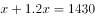
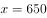
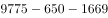

# 两集合容斥原理（交集不等式推理+补集求两类均不提供的机构数）

考点：[[20-考点/资料分析/其他/两集合容斥原理（交集不等式推理+补集求两类均不提供的机构数）|其他 / 两集合容斥原理（交集不等式推理+补集求两类均不提供的机构数）]]
材料：[[15-材料/资料分析/269189 全国残疾人康复事业发展情况：2014|269189 全国残疾人康复事业发展情况：2014]]

**问法模型**：题干给出'A类机构中同时提供B服务的比不提供的多'的不等式条件→用两集合容斥+补集模型：先对半分界定出只提供A（不提供B）的机构数上限，再用总数9775减去并集得两类均不提供的机构数，落区间选答案

## 推理链
1. 第1步：由图1及文字取得2019年末全国残疾人康复机构总数9775个；由图2取得提供视力残疾康复服务1430个、提供听力言语残疾康复服务1669个（图2各类间有重复计数，不可加总）
2. 第2步：设提供视力残疾服务的1430个中不提供听力言语服务的有x个，则同时提供两种服务的是(1430-x)个，由'同时提供>不提供'得1430-x>x，解得x<715，即x最大取714
3. 第3步：两种服务至少提供一种的机构数（并集）=1669+x，其最大值为1669+714=2383个
4. 第4步：两类服务均不提供的机构数=总数-并集=9775-(1669+x)=8106-x，取边界x=714得至少9775-1669-714=7392家（等价验证：只提供听力言语的至多1669-716=953个，9775-1430-953=7392，两法一致）
5. 第5步：7392落在7300~7600家区间内，对照选项确定B项

**最快解法**：⚡ 容斥极限法（对半分界）：视力1430的一半是715，'同时提供>不提供'推出只提供视力者至多714个；两类均不提供=9775-1669-714=7392家，心算落区间即选B，无需精确解方程

## 易错点
- ⚠ 图2各类服务数据存在重复计数（一个机构可提供多类服务），七类之和远大于总数9775，绝不能把1430+1669=3099直接当并集相减（会得6676误选A）
- ⚠ '多于'是严格大于：不提供听力言语的最多714个而非715个；且所求'均不提供'实为下限值（至少7392），本题按极限边界情形落区间定答案
- ⚠ 总数只能用图1/文字的9775个（时点存量），勿与'1043.0万人'的当期流量口径混淆；单位是'个/家'，与第4题的万平方米无关

## 母题抽象
> 🧩 当题干出现'A集合中同时具备B的比不具备的多（少）'特征时，先取A的一半（如1430→715）作分界推出只具备A者的极值（≤714），再用'总数-另一集合-极值'求两类都不具备的数量，落入选项区间即得答案

**同类特征**：同时提供…比不提供…多、不提供任意一种（两类补集）、容斥原理、机构总数9775、选项为区间（不到/之间/超过）、2019年末时点数

## 相关题
（暂无）

---

### 题干

如提供视力残疾康复服务的残疾人康复机构中，同时提供听力言语残疾康复服务的机构比不提供该服务的机构多，则2019年末全国有多少家残疾人康复机构不提供以上两种康复服务中的任意一种？

### 选项
- A. 不到7300家
- B. 7300～7600家之间　✅
- C. 7600～7900家之间
- D. 超过7900家

### 官方解析

定位图形材料1可得：2019年全国残疾人康复机构总数为9775个；定位图形材料2可得：提供视力残疾康复服务的机构为1430个，提供听力言语残疾康复服务的机构为1669个。根据题干“提供视力残疾康复服务的残疾人康复机构中，同时提供听力言语残疾康复服务的机构比不提供该服务的机构多”，假设在提供视力残疾康复服务的机构中，不提供听力言语残疾康复服务的机构数为个，则提供的机构数为个，可得：，解得，即只提供视力残疾康复服务的机构为650个。因此2019年末不提供以上两种康复服务中的任意一种的机构数为个，在B项范围内。

故正确答案为B。

### 给定材料

        截至2019年末，全国已有残疾人康复机构9775个，比2018年增长739个。2019年，1043.0万残疾儿童及持证残疾人得到基本康复服务，其中包括0～6岁残疾儿童18.1万人。

        截至2019年末，全国已竣工的各级残疾人综合服务设施2341个，总建设规模584.5万平方米，总投资183.1亿元；已竣工各级残疾人康复设施1006个，总建设规模414.2万平方米，总投资132.2亿元。

> [!warning] 疑点（官方解析可能有误，待人工复核）
> 官方解析公式缺字，且'只提供视力残疾康复服务的机构为650个'与题干不等式1430-x>x（x<715，至多714个）不符，疑为排版/识别讹误（应为至多714个）；按正确边界计算'两类均不提供'至少为9775-1669-714=7392家，仍落在B区间，最终答案B不受影响

<!-- CODEX-ANSWER-REVIEW:BEGIN -->
### 本次独立复核

**复核状态：** `resolved`（答案与解析已核定）

**计分答案：** B（可计分）

**复核解析：**

1. 第1步：由图1及文字取得2019年末全国残疾人康复机构总数9775个；由图2取得提供视力残疾康复服务1430个、提供听力言语残疾康复服务1669个（图2各类间有重复计数，不可加总）
2. 第2步：设提供视力残疾服务的1430个中不提供听力言语服务的有x个，则同时提供两种服务的是(1430-x)个，由'同时提供>不提供'得1430-x>x，解得x<715，即x最大取714
3. 第3步：两种服务至少提供一种的机构数（并集）=1669+x，其最大值为1669+714=2383个
4. 第4步：两类服务均不提供的机构数=总数-并集=9775-(1669+x)=8106-x，取边界x=714得至少9775-1669-714=7392家（等价验证：只提供听力言语的至多1669-716=953个，9775-1430-953=7392，两法一致）
5. 第5步：7392落在7300~7600家区间内，对照选项确定B项

**最快解法**：⚡ 容斥极限法（对半分界）：视力1430的一半是715，'同时提供>不提供'推出只提供视力者至多714个；两类均不提供=9775-1669-714=7392家，心算落区间即选B，无需精确解方程

**相关信息：**

2021年国家公务员录用考试《行测》题（副省级网友回忆版）；其他 / 两集合容斥原理（交集不等式推理+补集求两类均不提供的机构数）。单位与比较口径按题面材料：2021年度/期间。

**题源依据：** [固定版本原题](https://github.com/Mentat-Uran/kaogongzhentizhengliu/blob/84ab93d4b64b61d897bece8a1c0a5bab06b4feb2/10-%E7%9C%9F%E9%A2%98/%E8%B5%84%E6%96%99%E5%88%86%E6%9E%90/%E5%85%B6%E4%BB%96/2719397%20%E4%B8%A4%E9%9B%86%E5%90%88%E5%AE%B9%E6%96%A5%E5%8E%9F%E7%90%86%EF%BC%88%E4%BA%A4%E9%9B%86%E4%B8%8D%E7%AD%89%E5%BC%8F%E6%8E%A8%E7%90%86%2B%E8%A1%A5%E9%9B%86%E6%B1%82%E4%B8%A4%E7%B1%BB%E5%9D%87%E4%B8%8D%E6%8F%90%E4%BE%9B%E7%9A%84%E6%9C%BA%E6%9E%84%E6%95%B0%EF%BC%89.md)；固定内容 commit `84ab93d4b64b61d897bece8a1c0a5bab06b4feb2`，Markdown blob `adc38e5d95ca34ace922c99922f592a569b479f6`。
<!-- CODEX-ANSWER-REVIEW:END -->
