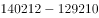
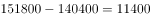
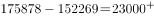
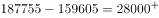
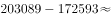

# 财政赤字定义式差值计算（支出−收入）与逐年趋势判断

考点：[[20-考点/资料分析/其他/财政赤字定义式差值计算（支出−收入）与逐年趋势判断|其他 / 财政赤字定义式差值计算（支出−收入）与逐年趋势判断]]
材料：[[15-材料/资料分析/270127 2011—2018年我国部分财政指标|270127 2011—2018年我国部分财政指标]]

**问法模型**：题干问'财政赤字的变化趋势'→先用定义式'财政赤字=财政支出−财政收入'逐年求差，再对8年差值序列判断单调性并与趋势类选项对照。

## 推理链
1. 第1步：财政赤字指财政支出超过财政收入的部分，从表中提取'国家财政收入'行（2011年103874→2018年183360亿元）与'国家财政支出'行（109248→220904亿元）共8对数据
2. 第2步：公式：财政赤字=国家财政支出−国家财政收入，逐年计算
3. 第3步：2011年109248−103874=5374；2012年125953−117254=8699；2013年140212−129210=11002；2014年151786−140370=11416
4. 第4步：2015年175878−152269=23609；2016年187755−159605=28150；2017年203089−172593=30496；2018年220904−183360=37544（单位均为亿元）
5. 第5步：赤字序列5374→8699→11002→11416→23609→28150→30496→37544，8年逐年上升、无任何一年回落
6. 第6步：与选项对照：A'不断缩小'、D'先扩大后缩小'与逐年递增矛盾；B'与财政收入变化趋势相反'不成立——财政收入103874→183360逐年上升，赤字亦逐年上升，两者同向而非反向，排除；故选C'不断扩大'

**最快解法**：⚡ 逐年直减+趋势扫描：每年用心算做'支出−收入'（如2011年109248−103874≈0.54万亿、2018年220904−183360≈3.75万亿），只要逐对相减发现差值一年比一年大即锁定'不断扩大'选C；考场可只验首年、末年并快速扫中间年份差值是否单调升，无需列完整算式。

## 易错点
- ⚠ 方向搞反：赤字=支出−收入（每年支出均大于收入为正），勿误用'收入−支出'得负值再误判趋势
- ⚠ 行名混淆：必须用'国家财政收入/国家财政支出'两行，勿误拿'中央财政'块或'国家税收收入'行替代（同名易混、口径嵌套）
- ⚠ 趋势误判：2014年赤字11416仅比2013年11002多约414亿元，增幅很小，粗略估算可能误判为'有波动'或'先扩后缩'；需逐年在原值上做减法确认8年全部递增

## 母题抽象
> 🧩 当题干出现'材料未直接给出的派生指标的变化趋势'时，先按其定义用表中相关两行逐年求差（如赤字=支出−收入），再对差值序列判断单调性，与'不断扩大/缩小/先扩后缩'类选项逐一对照。

**同类特征**：财政赤字、变化趋势、2011-2018年逐年判断、未直接给出的派生指标、定义式：支出−收入、趋势类选项（不断扩大/缩小/先扩后缩）

## 相关题
- [[10-真题/资料分析/增长/15833691 环比增速计算与折线趋势匹配（累计值连环相减化当期值）|15833691]]（黑龙江 2026，相关度1）
- [[10-真题/资料分析/增长/12882030 累计转当期+环比增长率计算与趋势匹配|12882030]]（内蒙古 2025，相关度1）
- [[10-真题/资料分析/增长/15833698 环比增速计算与折线趋势图匹配|15833698]]（黑龙江 2026，相关度1）
- [[10-真题/资料分析/倍数/2050544 比值（城乡收入比）逐年计算与趋势判断|2050544]]（吉林 2017，相关度1）
- [[10-真题/资料分析/增长/2051184 增长量比较（同比增长量趋势折线图判断）|2051184]]（黑龙江 2017，相关度1）

---

### 题干
2011-2018年，国家财政赤字的变化趋势为：

### 选项
- A. 不断缩小
- B. 与国家财政收入的变化趋势相反
- C. 不断扩大　✅
- D. 先扩大后缩小

### 官方解析

财政赤字是指财政支出超过财政收入的部分，即财政赤字财政支出财政收入。定位统计表材料，可知2011-2018年国家财政收入和国家财政支出。则各年份的财政赤字如下：

2011年：亿元；

2012年：亿元；

2013年：亿元；

2014年：亿元；

2015年：亿元；

2016年：亿元；

2017年：亿元；

2018年：亿元。

则2011-2018年，国家财政赤字的变化趋势为不断扩大。

故正确答案为C。

### 给定材料

> [!warning] 疑点（官方解析可能有误，待人工复核）
> 官方解析中各年份赤字的具体数值缺失（'2011年：亿元'等处为空白），但不影响结论；按表计算5374→37544逐年递增，答案C可验证无误。

<!-- CODEX-ANSWER-REVIEW:BEGIN -->
### 本次独立复核

**复核状态：** `resolved`（答案与解析已核定）

**计分答案：** C（可计分）

**复核解析：**

1. 第1步：财政赤字指财政支出超过财政收入的部分，从表中提取'国家财政收入'行（2011年103874→2018年183360亿元）与'国家财政支出'行（109248→220904亿元）共8对数据
2. 第2步：公式：财政赤字=国家财政支出−国家财政收入，逐年计算
3. 第3步：2011年109248−103874=5374；2012年125953−117254=8699；2013年140212−129210=11002；2014年151786−140370=11416
4. 第4步：2015年175878−152269=23609；2016年187755−159605=28150；2017年203089−172593=30496；2018年220904−183360=37544（单位均为亿元）
5. 第5步：赤字序列5374→8699→11002→11416→23609→28150→30496→37544，8年逐年上升、无任何一年回落
6. 第6步：与选项对照：A'不断缩小'、D'先扩大后缩小'与逐年递增矛盾；B'与财政收入变化趋势相反'不成立——财政收入103874→183360逐年上升，赤字亦逐年上升，两者同向而非反向，排除；故选C'不断扩大'

**最快解法**：⚡ 逐年直减+趋势扫描：每年用心算做'支出−收入'（如2011年109248−103874≈0.54万亿、2018年220904−183360≈3.75万亿），只要逐对相减发现差值一年比一年大即锁定'不断扩大'选C；考场可只验首年、末年并快速扫中间年份差值是否单调升，无需列完整算式。

**相关信息：**

2020年深圳市考公务员录用考试《行测2》试题（网友回忆版）；其他 / 财政赤字定义式差值计算（支出−收入）与逐年趋势判断。单位与比较口径按题面材料：2020年度/期间。

**题源依据：** [固定版本原题](https://github.com/Mentat-Uran/kaogongzhentizhengliu/blob/84ab93d4b64b61d897bece8a1c0a5bab06b4feb2/10-%E7%9C%9F%E9%A2%98/%E8%B5%84%E6%96%99%E5%88%86%E6%9E%90/%E5%85%B6%E4%BB%96/2730466%20%E8%B4%A2%E6%94%BF%E8%B5%A4%E5%AD%97%E5%AE%9A%E4%B9%89%E5%BC%8F%E5%B7%AE%E5%80%BC%E8%AE%A1%E7%AE%97%EF%BC%88%E6%94%AF%E5%87%BA%E2%88%92%E6%94%B6%E5%85%A5%EF%BC%89%E4%B8%8E%E9%80%90%E5%B9%B4%E8%B6%8B%E5%8A%BF%E5%88%A4%E6%96%AD.md)；固定内容 commit `84ab93d4b64b61d897bece8a1c0a5bab06b4feb2`，Markdown blob `af54f490d8cbce6bf33deefcd377e5689c34982d`。
<!-- CODEX-ANSWER-REVIEW:END -->
