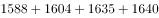
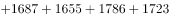
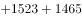
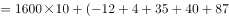
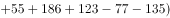
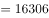
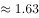

# 简单加和计算（跨材料数据拼接：2010-2019年出生人口累加+万-亿量级换算）

考点：[[20-考点/资料分析/其他/简单加和计算（跨材料数据拼接：2010-2019年出生人口累加+万-亿量级换算）|其他 / 简单加和计算（跨材料数据拼接：2010-2019年出生人口累加+万/亿量级换算）]]
材料：[[15-材料/资料分析/270514 2019年末我国80后-90后-00|270514 2019年末我国80后-90后-00]]

**问法模型**：题干问'2019年末10后人数'→10后即2010-2019年出生人口，采用'逐年出生数累加求和+单位换算'模型（1亿=10000万）

## 推理链
1. 第1步：'10后'指2010-2019年出生的人口，故需从组合图柱状数据（左轴，万人）提取10年数据：1588、1604、1635、1640、1687、1655、1786、1723、1523、1465
2. 第2步：所用规则为累加求和：10后人数=2010-2019各年出生人口之和（材料导读提示：默认忽略死亡，用累计出生数近似）
3. 第3步：代入求和：1588+1604+1635+1640+1687+1655+1786+1723+1523+1465=16306万人
4. 第4步：量级换算：16306万=1.6306亿≈1.63亿人（尾数验证：8+4+5+0+7+5+6+3+3+5=46，和尾数为6，与16306吻合）
5. 第5步：对照选项：1.63亿对应B项；巧的是文字段00后也是1.63亿，但口径不同（存活存量vs累计出生），本题答案是独立计算所得，非抄文字数据

**最快解法**：⚡ 估算法+尾数法：每年出生人口均在1500-1800万之间，约1600万×10年≈16000万=1.6亿，唯一接近的选项是B（1.63亿）；再用尾数法验证：各年尾数求和46，尾数为6，与B项1.6306亿一致，秒选B

## 易错点
- ⚠ 量级换算遗漏：算出16306后忘记1亿=10000万的换算，在选项中找不到16306对应项而慌乱，或误把16306万当1.6306亿以外的量级
- ⚠ 双轴混读：柱状图出生人口对应左轴（万人），折线出生率对应右轴（‰），误把折线读数（如10.48-12.95）当出生人口参与求和
- ⚠ 文字数据干扰：文字段00后恰好也是1.63亿，易误以为直接抄文字段数据；实际须对图表累加计算，二者口径不同（年末存活存量vs十年累计出生数），只是数值巧合相同
- ⚠ 时间范围错位：10后=2010-2019年出生，不能漏加2010年，也不能把文字段80/90/00后人数混入计算

## 母题抽象
> 🧩 当题干出现'某代际/某时段人数'且材料给出逐年新增（出生）量时，用'范围界定+累加求和+单位换算'方法：先确定年份区间（10后=2010-2019），再累加对应年度数据，最后按1亿=10000万换算并与选项量级对照

**同类特征**：10后、2019年末……约为、代际人数、跨材料拼接（文字段+组合图）、逐年出生人口累加、万人换算亿人

## 相关题
（暂无）

---

### 题干
2019年末我国10后人数约为：

### 选项
- A. 1.52亿人
- B. 1.63亿人　✅
- C. 1.88亿人
- D. 2.02亿人

### 官方解析

根据题干“2019年末我国10后人数为······”，可判定本题为简单加减计算问题。2019年末我国10后人数即2010-2019年出生的人数，定位统计图材料可得，2010-2019年出生的人数为：万人亿人。

故正确答案为B。

### 给定材料

        2019年末，我国80后、90后、00后人数分别为2.21亿人、2.08亿人、1.63亿人。

