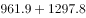

# 简单加总·部分求整体（整体=私有云+公有云）

考点：[[20-考点/资料分析/其他/简单加总·部分求整体（整体=私有云+公有云）|其他 / 简单加总·部分求整体（整体=私有云+公有云）]]
材料：[[15-材料/资料分析/270539 2013-2022年某地区云计算市场|270539 2013-2022年某地区云计算市场]]

**问法模型**：题干问'2021年整体市场规模最接近哪个数字'且图中只给分项 → 用'整体=私有云+公有云'加总当年两根条形，再与选项比距

## 推理链
1. 第1步：题干限定'根据预测'，2021年为预测年份（2021E），从条形图按图例读出该年私有云961.9亿元、公有云1297.8亿元
2. 第2步：图中未直接给出云计算整体规模，须用公式：整体市场规模=私有云+公有云
3. 第3步：代入计算：961.9+1297.8=2259.7亿元
4. 第4步：与选项对照：2259.7与C项2300仅差约40，与A（1300）、B（1700）、D（2900）均相差数百，故选C

**最快解法**：⚡ 取整估算：961.9≈960、1297.8≈1300，加总≈2260亿元，四个选项中仅2300（C）量级与数值吻合，直接锁定C

## 易错点
- ⚠ 图中没有'整体规模'条形，只读一根条形（如仅公有云1297.8≈1300）会误选A
- ⚠ 水平双条形易串行：2021E行（961.9/1297.8）与2020E行（787.8/949.6）、2022E行（1171.6/1731.3）数值接近，须对准年份读数
- ⚠ 白色=私有云、灰色=公有云，私有云整体小于公有云，对照图例勿把两根条形张冠李戴

## 母题抽象
> 🧩 当题干出现'整体/合计规模最接近哪个数字'而图中只给分项条形时，用'整体=各部分之和'加总，再选与结果差值最小的选项

**同类特征**：整体市场规模、根据预测、2021年（2021E）、最接近以下哪个数字、亿元、部分加总求整体

## 相关题
- [[10-真题/资料分析/增长/2742301 整体同比增长率计算（整体=私有云+公有云加总后求增速）|2742301]]（北京 2021，相关度2）
- [[10-真题/资料分析/平均数/19797282 现期平均数（年均生产总值=多个年度GDP算术平均）|19797282]]（山西 2024，相关度1）
- [[10-真题/资料分析/增长/2049720 混合增长率（居中偏向）|2049720]]（山东 2017，相关度1）
- [[10-真题/资料分析/其他/2394011 进出口顺差计算（顺差=出口-进口，简单作差）|2394011]]（青海 2019，相关度1）
- [[10-真题/资料分析/增长/5514931 年均增长量|5514931]]（广东 2023，相关度1）

---

### 题干
根据预测，2021年该地区云计算整体市场规模最接近以下哪个数字？

### 选项
- A. 1300亿元
- B. 1700亿元
- C. 2300亿元　✅
- D. 2900亿元

### 官方解析

定位条形图可得，2021年该地区私有云和公有云市场规模分别为961.9亿元、1297.8亿元。则2021年该地区云计算整体市场规模约为亿元。

故正确答案为C。

### 给定材料

> [!warning] 疑点（官方解析可能有误，待人工复核）
> 官方解析正文'约为亿元'处缺失具体数值（应为961.9+1297.8=2259.7亿元），不影响正确答案C的判定

<!-- CODEX-ANSWER-REVIEW:BEGIN -->
### 本次独立复核

**复核状态：** `resolved`（答案与解析已核定）

**计分答案：** C（可计分）

**复核解析：**

1. 第1步：题干限定'根据预测'，2021年为预测年份（2021E），从条形图按图例读出该年私有云961.9亿元、公有云1297.8亿元
2. 第2步：图中未直接给出云计算整体规模，须用公式：整体市场规模=私有云+公有云
3. 第3步：代入计算：961.9+1297.8=2259.7亿元
4. 第4步：与选项对照：2259.7与C项2300仅差约40，与A（1300）、B（1700）、D（2900）均相差数百，故选C

**最快解法**：⚡ 取整估算：961.9≈960、1297.8≈1300，加总≈2260亿元，四个选项中仅2300（C）量级与数值吻合，直接锁定C

**相关信息：**

2021年北京市公务员录用考试《行测》题（区级及以上卷）（网友回忆版）；其他 / 简单加总·部分求整体（整体=私有云+公有云）。单位与比较口径按题面材料：2021年度/期间。

**题源依据：** [固定版本原题](https://github.com/Mentat-Uran/kaogongzhentizhengliu/blob/84ab93d4b64b61d897bece8a1c0a5bab06b4feb2/10-%E7%9C%9F%E9%A2%98/%E8%B5%84%E6%96%99%E5%88%86%E6%9E%90/%E5%85%B6%E4%BB%96/2742291%20%E7%AE%80%E5%8D%95%E5%8A%A0%E6%80%BB%C2%B7%E9%83%A8%E5%88%86%E6%B1%82%E6%95%B4%E4%BD%93%EF%BC%88%E6%95%B4%E4%BD%93%3D%E7%A7%81%E6%9C%89%E4%BA%91%2B%E5%85%AC%E6%9C%89%E4%BA%91%EF%BC%89.md)；固定内容 commit `84ab93d4b64b61d897bece8a1c0a5bab06b4feb2`，Markdown blob `5625b1d99884d9d90f9bb82392e40264e58a47e4`。
<!-- CODEX-ANSWER-REVIEW:END -->
