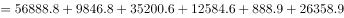
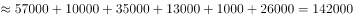

# 多分类数据加总与单位换算（亿元→万亿元）

考点：[[20-考点/资料分析/其他/多分类数据加总与单位换算（亿元→万亿元）|其他 / 多分类数据加总与单位换算（亿元→万亿元）]]
材料：[[15-材料/资料分析/272113 2015年S省“四上”企业（6个一级|272113 2015年S省“四上”企业（6个一级]]

**问法模型**：题干问'总计负债约多少万亿元'→按注释口径锁定6个一级分类的负债加总，再÷10000换算单位，与选项比量级

## 推理链
1. 第1步：表下注释明确'四上'企业包含表中所列6个一级分类，故总负债只需加总6个一级分类的负债总计，'其中'的10个服务业子行业不得重复加入
2. 第2步：从表中提取6个一级分类负债总计（亿元）：规模以上工业56888.8、资质等级建筑业9846.8、房地产开发35200.6、限额以上批发和零售业12584.6、限额以上住宿和餐饮业888.9、规模以上服务业26358.9
3. 第3步：加总：56888.8+9846.8+35200.6+12584.6+888.9+26358.9=141768.6亿元
4. 第4步：单位换算：1万亿元=10000亿元，141768.6÷10000≈14.18万亿元
5. 第5步：与选项对照：14.18万亿元与C项14最接近，故选C

**最快解法**：⚡ 截位加总+量级换算：把6个负债按万位截位相加 5.7+1.0+3.5+1.3+0.1+2.6≈14.2（万亿元级，因1万亿=10000亿，可直接以'万亿'为单位截两位相加），结果约14.2万亿元，直选C；无需精算到141768.6

## 易错点
- ⚠ 单位换算陷阱：表格单位为亿元，题干问万亿元，须÷10000（4位量级跨越），若换算错误（如÷1000得141.8）则量级全错
- ⚠ 口径重复陷阱：把'其中'服务业10个子行业的负债再叠加到26358.9之上，导致总和偏大约4.6万亿；同时注意勿漏掉数值最小的限额以上住宿和餐饮业888.9
- ⚠ 名称混淆陷阱：'房地产开发企业'负债35200.6与'房地产服务业'负债523.5口径完全不同，切勿取错

## 母题抽象
> 🧩 当题干出现'总计/合计约多少'且选项单位与表格单位不一致时，先依注释确定加总范围（不含'其中'细分项），截位加总后按10^4换算单位，再选最近选项

**同类特征**：总计负债、约多少万亿元、6个一级分类加总、注释口径定义'四上'企业、亿元→万亿元换算、单一现期存量数据求和

## 相关题
- [[10-真题/资料分析/增长/2188568 增长量计算（现期+增长率，附亿元→万亿元单位换算）|2188568]]（黑龙江 2018，相关度2）
- [[10-真题/资料分析/增长/2448408 增长量计算（相邻两年合计数差值，含亿元→万亿元单位换算）|2448408]]（国考 2020，相关度1）
- [[10-真题/资料分析/其他/5430291 多期累计加总求差+单位换算（亿元→万亿元）|5430291]]（浙江 2023，相关度1）

---

### 题干
2015年S省“四上”企业总计负债约多少万亿元？

### 选项
- A. 9
- B. 12
- C. 14　✅
- D. 16

### 官方解析

根据注释“‘四上’企业包含表中所列6个一级分类”，定位表格材料可知，2015年S省“四上”企业的负债分别为56888.8亿元、9846.8亿元、35200.6亿元、12584.6亿元、888.9亿元、26358.9亿元。故总计负债亿元，即14.2万亿元，与C项最为接近。

故正确答案为C。

### 给定材料

