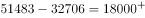
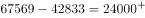
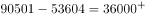

# 双序列逐年作差比较（差额最大年份判定）

考点：[[20-考点/资料分析/其他/双序列逐年作差比较（差额最大年份判定）|其他 / 双序列逐年作差比较（差额最大年份判定）]]
材料：[[15-材料/资料分析/280165 我国城镇就业人员平均工资：图1给出2|280165 我国城镇就业人员平均工资：图1给出2]]

**问法模型**：题干问'非私营与私营平均工资差额最大的年份' → 对选项各年份取图1两条序列数值作差（非私营−私营），比较差值取最大

## 推理链
1. 第1步：从图1提取选项涉及年份的两条序列数值：非私营2009/2013/2016/2019年分别为32244、51483、67569、90501元，私营对应为18199、32706、42833、53604元
2. 第2步：所用规则：差额=非私营单位平均工资−私营单位平均工资（同一年份的当期值，单位均为元，可直接相减）
3. 第3步：代入计算：2009年32244−18199=14045元，2013年51483−32706=18777元
4. 第4步：继续计算：2016年67569−42833=24736元，2019年90501−53604=36897元
5. 第5步：比较四年差额：36897＞24736＞18777＞14045，差额最大的是2019年，对照选项得出D

**最快解法**：⚡ 趋势观察+作差验证：图1中两线张口逐年扩大（差额由2009年14045元逐年增至2019年36897元，单调递增），四个选项中2019年最晚，直接锁定；验证一步作差：90501−53604≈3.7万元，明显大于2009年约1.4万、2013年约1.9万、2016年约2.5万元

## 易错点
- ⚠ 图1数据标签密集，非私营与私营两条线的标注极易串行读错（如把2018年非私营82413、私营49575错配到2019年），须逐点核对年份与线型
- ⚠ 差额是'作差'不是'作比'，勿用90501÷53604≈1.7倍的倍数关系替代差值比较
- ⚠ 数值单位为元且量级上万，作差时注意位数；只需比较选项涉及的4个年份，且'取最晚年份'的捷径须以差额逐年递增为前提

## 母题抽象
> 🧩 当题干出现'A与B差额/差值最大（小）的年份'特征时，从双序列图逐年取值作差比较候选年份；若两线张口单调扩大，可直接选最晚年份并用一次作差验证

**同类特征**：差额最大、城镇非私营单位和私营单位平均工资、2009年-2019年、年份判定、图1双折线序列、逐年作差

## 相关题
- [[10-真题/资料分析/其他/5509527 直接读数与大小比较（定位最大值）|5509527]]（甘肃 2023，相关度1）
- [[10-真题/资料分析/增长/5102149 同比增量（增长量）计算与临界值计数比较|5102149]]（浙江 2022，相关度1）
- [[10-真题/资料分析/增长/3522690 年均增长率比较（现期-基期开n次方模型）|3522690]]（广西 2021，相关度1）
- [[10-真题/资料分析/综合/3522692 综合判断题（核心验证项为年均增长率大小比较，辅以数据可得性-口径判断）|3522692]]（广西 2021，相关度1）
- [[10-真题/资料分析/增长/2731618 增长量比较（结合柱状图趋势判断）|2731618]]（上海 2021，相关度1）

---

### 题干
2009年-2019年，城镇非私营单位和私营单位平均工资差额最大的年份是：

### 选项
- A. 2009年
- B. 2013年
- C. 2016年
- D. 2019年　✅

### 官方解析

定位图1可知，2009年-2019年我国城镇私营和非私营单位就业人员的平均工资。选项各年份对应的城镇非私营单位和私营单位平均工资差额计算如下：

A项（2009年）：元；

B项（2013年）：元；

C项（2016年）：元；

D项（2019年）：元。

因此，平均工资差额最大的年份是2019年。

故正确答案为D。

### 给定材料

