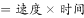

# 固定距离下时间与速度的反比比较（时间=距离÷速度）

考点：[[20-考点/资料分析/其他/固定距离下时间与速度的反比比较（时间=距离÷速度）|其他 / 固定距离下时间与速度的反比比较（时间=距离÷速度）]]
材料：[[15-材料/资料分析/280256 2020年一线城市和新一线城市的通勤|280256 2020年一线城市和新一线城市的通勤]]

**问法模型**：题干给定固定通勤距离20公里、问哪个城市高峰通勤用时最短 → 用'时间=距离÷速度'模型，距离一定时时间与速度成反比，直接比较四城市'通勤高峰实际速度'大小，速度最大者用时最短

## 推理链
1. 第1步：从题干提取条件——通勤距离固定为20公里、均为开车方式、比较2020年高峰时段用时，只需对比广州、成都、苏州、西安四个选项城市
2. 第2步：从表格'通勤高峰实际速度(km/h)'列提取四城数据：广州29.84、成都32.72、苏州37.26、西安26.41
3. 第3步：所用规则——时间=距离÷速度，距离同为20公里时，时间与速度成反比，速度越大用时越短
4. 第4步：代入验证（可选）——苏州20÷37.26≈0.54小时，成都20÷32.72≈0.61小时，广州20÷29.84≈0.67小时，西安20÷26.41≈0.76小时，苏州用时最短
5. 第5步：与选项对照——苏州速度37.26 km/h在四城中最大，对应C项，当选

**最快解法**：⚡ 定性反比法（免计算）：距离相同则时间与速度成反比，直接在'通勤高峰实际速度'列圈出四个选项城市——37.26（苏州）>32.72（成都）>29.84（广州）>26.41（西安），最大者即用时最短，秒选C，无需算出具体时间

## 易错点
- ⚠ 比较方向搞反：误以为速度越大用时越长，实际距离一定时二者成反比，速度最大（苏州37.26）对应用时最短
- ⚠ 取错数据列：误用'拥堵指数'或'2020年度排名'判断通勤快慢——排名第1的重庆只是最拥堵，与车速无关；本题只需读'通勤高峰实际速度'一列
- ⚠ 误扩大比较范围：应在四个选项城市内比较，而非对全部19城排序；另注意速度列单位统一为km/h，20公里无需任何单位换算
- ⚠ 做无用功：硬算20÷各速度的具体时间浪费时间，定性比较即可得出答案

## 母题抽象
> 🧩 当题干出现'距离一定/相同路程、比较通勤（行车）用时'特征时，用反比关系'时间=距离÷速度'，直接在'实际速度'列比较选项城市数值，速度最大者用时最短，免计算秒杀

**同类特征**：距离固定（20公里）、通勤用时最短、开车方式、通勤高峰实际速度、反比比较、2020年现期数据直接读数

## 相关题
（暂无）

---

### 题干
如果小张从家里到公司的距离是20公里，并且都采用开车方式，2020年他在下列哪个城市居住高峰时段通勤用时最短？

### 选项
- A. 广州
- B. 成都
- C. 苏州　✅
- D. 西安

### 官方解析

在表格材料中分别给出了2020年广州、成都、苏州和西安的通勤高峰实际速度，四个数据分别为29.84km/h、32.72km/h、37.26km/h和26.41km/h。根据路程，距离一定的情况下，速度越大，通勤时间越短，C项速度最大，当选。

故正确答案为C。

### 给定材料

