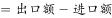
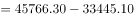
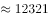
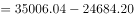
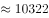
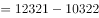
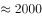
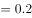

# 贸易顺差计算与两口径做差比较

考点：[[20-考点/资料分析/其他/贸易顺差计算与两口径做差比较|其他 / 贸易顺差计算与两口径做差比较]]
材料：[[15-材料/资料分析/280259 2017年上海三个统计口径（上海口岸|280259 2017年上海三个统计口径（上海口岸]]

**问法模型**：题干问'A口径顺差比B口径顺差高/低多少' → 分别用顺差=出口−进口算出两个顺差，作差后统一换算成万亿元与0.3万亿元阈值比较

## 推理链
1. 第1步：从文字段第一、二段提取数据：2017年口岸进口33445.10亿元、出口45766.30亿元；关区进口24684.20亿元、出口35006.04亿元（单位均为亿元）
2. 第2步：用公式：顺差=出口额−进口额，分别对两个口径计算
3. 第3步：口岸顺差=45766.30−33445.10=12321.20亿元；关区顺差=35006.04−24684.20=10321.84亿元
4. 第4步：作差=12321.20−10321.84=1999.36亿元≈0.2万亿元，即口岸顺差比关区顺差高约0.2万亿元
5. 第5步：0.2万亿元<0.3万亿元且方向为'高'，对照选项，C项'高不到0.3万亿元'符合

**最快解法**：⚡ 截位口算做差＋单位换算：口岸顺差≈45766−33445=12321亿元，关区顺差≈35006−24684=10322亿元，差≈2000亿元即0.2万亿元；1万亿元=10000亿元，0.2万亿<0.3万亿，直接锁定C（高不到0.3万亿元）

## 易错点
- ⚠ 口径张冠李戴：必须分别用'上海口岸'段与'上海关区'段数据，不能混用也不能错取上海市口径（32237.82亿元那段）
- ⚠ 顺差方向判断：口岸、关区口径均为出口>进口（有顺差），若误用上海市口径则进口19117.51>出口13120.31为逆差，无顺差可比
- ⚠ 单位换算陷阱：差值1999.36亿元=0.199936万亿元≈0.2万亿元，易误把'亿元'当'万亿元'或把0.2万亿误判为'0.3以上'

## 母题抽象
> 🧩 当题干出现'A口径顺差/差额比B口径高（低）多少'特征时，先用顺差=出口−进口分别算两个大数，再作差，最后把亿元换算成万亿元（÷10000）与选项阈值比较

**同类特征**：两个统计口径对比（口岸vs关区）、贸易顺差、高/低+固定阈值（0.3万亿元）、顺差=出口−进口、亿元与万亿元换算、同一文字段两段并列数据做差

## 相关题
- [[10-真题/资料分析/其他/14096272 贸易顺差计算（顺差=出口额-进口额）＋月度数据季度加总＋亿元→万亿元单位换算|14096272]]（选调 2025，相关度1）
- [[10-真题/资料分析/其他/2394011 进出口顺差计算（顺差=出口-进口，简单作差）|2394011]]（青海 2019，相关度1）
- [[10-真题/资料分析/其他/18643746 多期当期值累加求和（累计收入区间判断）|18643746]]（天津 2026，相关度1）
- [[10-真题/资料分析/综合/5509894 综合分析判断（累计差值求当期值＋总量量级比较）|5509894]]（内蒙古 2023，相关度1）
- [[10-真题/资料分析/增长/2033788 贸易差额同比增速比较（顺差地区筛选+增长率取最大）|2033788]]（江苏 2016，相关度1）

---

### 题干
2017年全年，上海口岸货物进出口贸易顺差比同期上海关区顺差：

### 选项
- A. 低不到0.3万亿元
- B. 低0.3万亿元以上
- C. 高不到0.3万亿元　✅
- D. 高0.3万亿元以上

### 官方解析

定位文字材料第一段可知，2017年全年，上海口岸货物进口33445.10亿元，出口45766.30亿元；全年上海关区货物进口24684.20亿元，出口35006.04亿元。根据公式：进出口贸易顺差可得，2017年全年，上海口岸货物进出口贸易顺差亿元，上海关区货物进出口贸易顺差亿元，故差值亿元万亿元，对应C项。

故正确答案为C。

### 给定材料

        2017年全年，上海口岸货物进出口总额79211.40亿元，比上年增长。其中，进口33445.10亿元，增长；出口45766.30亿元，增长。全年上海关区货物进出口总额59690.24亿元，比上年增长。其中，进口24684.20亿元，增长；出口35006.04亿元，增长。

        全年上海市货物进出口总额32237.82亿元，比上年增长。其中，进口19117.51亿元，增长；出口13120.31亿元，增长。

