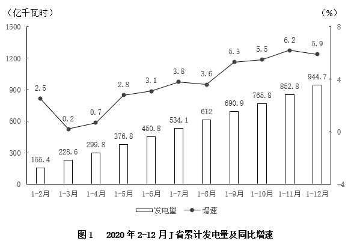

# 累计值差分求季度量＋整体-部分差值计算（跨图双差分）

考点：[[20-考点/资料分析/其他/累计值差分求季度量＋整体-部分差值计算（跨图双差分）|其他 / 累计值差分求季度量＋整体-部分差值计算（跨图双差分）]]
材料：[[15-材料/资料分析/307146 J省2020年2-12月逐月累计发电|307146 J省2020年2-12月逐月累计发电]]

**问法模型**：题干问'某季度除风力发电之外的发电量'→先用相邻累计值差分求出该季度总发电量与风力发电量，再做'整体−部分=另一部分'，对照区间选项

## 推理链
1. 第1步：定位图1，2020年1-3月累计发电量228.6亿千瓦时、1-6月累计450.8亿千瓦时；定位图2，同期累计风力发电量24.2、50.2亿千瓦时
2. 第2步：规则①第二季度（4-6月）当季值=1-6月累计−1-3月累计；规则②除风电外发电量=发电总量−风力发电量（跨图1、图2联动）
3. 第3步：Q2总发电量=450.8−228.6=222.2亿千瓦时；Q2风力发电量=50.2−24.2=26.0亿千瓦时
4. 第4步：Q2除风电外发电量=222.2−26=196.2亿千瓦时
5. 第5步：196.2<200亿千瓦时，落在'不到200亿千瓦时'区间，与选项A吻合

**最快解法**：⚡ 差分口算＋区间对照：450.8−228.6=222.2，50.2−24.2=26，两差相减196.2，一眼判断<200，直接锁定A（选项档位间隔10-15亿，无需精算）

## 易错点
- ⚠ 把累计值当单季值：直接用1-6月数据（450.8−50.2≈400.6）或1-3月数据而不差分，会错选D；Q2当季值必须=1-6月累计−1-3月累计
- ⚠ 只看单图：'除风力发电之外'必须图1（总量）与图2（部分）跨图联动，仅用图1无法求解；且'部分差值'要分别差分后再相减，不能拿累计值直接混算
- ⚠ 时间与单位口径：'第二季度'=4-6月（不是1-3月或1-6月）；图1纵轴印'千瓦时'实为亿千瓦时，与图2、文字同口径，误做单位换算会全盘出错

## 母题抽象
> 🧩 当题干出现'某季度/某月除去某部分后的量'特征时，先分别用相邻累计值差分求出该时段的整体量与被扣除部分量，再做整体−部分，最后对照区间选项验证

**同类特征**：第二季度（季度时段）、除风力发电之外的发电量、累计值差分、跨图整体-部分联动、数值区间型选项

## 相关题
- [[10-真题/资料分析/其他/5832470 累计值差分求当月值再作差（和差计算）|5832470]]（浙江 2021，相关度1）

---

### 题干
2020年第二季度，J省除风力发电之外的发电量在以下哪个范围内？

### 选项
- A. 不到200亿千瓦时　✅
- B. 在200亿~215亿千瓦时
- C. 在215亿~230亿千瓦时
- D. 超过230亿千瓦时

### 官方解析

定位图1可得：2020年1-3月J省累计发电量为228.6亿千瓦时，1-6月为450.8亿千瓦时。定位图2可得：2020年1-3月J省累计风力发电量为24.2亿千瓦时，1-6月为50.2亿千瓦时。则2020年第二季度J省除风力发电之外的发电量=（450.8-228.6）-（50.2-24.2）=222.2-26=亿千瓦时，在A项范围内。

故正确答案为A。

### 给定材料

        2021年1-2月，J省发电量为167亿千瓦时，其中风力发电量为17.4亿千瓦时。

> [!warning] 疑点（官方解析可能有误，待人工复核）
> 官方解析'（450.8-228.6）-（50.2-24.2）=222.2-26='后漏写结果196.2（单位'亿千瓦时'前缺数值），属笔误，计算过程与答案A本身无误

<!-- CODEX-ANSWER-REVIEW:BEGIN -->
### 本次独立复核

**复核状态：** `resolved`（答案与解析已核定）

**计分答案：** A（可计分）

**复核解析：**

1. 第1步：定位图1，2020年1-3月累计发电量228.6亿千瓦时、1-6月累计450.8亿千瓦时；定位图2，同期累计风力发电量24.2、50.2亿千瓦时
2. 第2步：规则①第二季度（4-6月）当季值=1-6月累计−1-3月累计；规则②除风电外发电量=发电总量−风力发电量（跨图1、图2联动）
3. 第3步：Q2总发电量=450.8−228.6=222.2亿千瓦时；Q2风力发电量=50.2−24.2=26.0亿千瓦时
4. 第4步：Q2除风电外发电量=222.2−26=196.2亿千瓦时
5. 第5步：196.2<200亿千瓦时，落在'不到200亿千瓦时'区间，与选项A吻合

**最快解法**：⚡ 差分口算＋区间对照：450.8−228.6=222.2，50.2−24.2=26，两差相减196.2，一眼判断<200，直接锁定A（选项档位间隔10-15亿，无需精算）

**相关信息：**

2022年国家公务员录用考试《行测》题（副省级网友回忆版）；其他 / 累计值差分求季度量＋整体-部分差值计算（跨图双差分）。单位与比较口径按题面材料：2022年度/期间。

**题源依据：** [固定版本原题](https://github.com/Mentat-Uran/kaogongzhentizhengliu/blob/84ab93d4b64b61d897bece8a1c0a5bab06b4feb2/10-%E7%9C%9F%E9%A2%98/%E8%B5%84%E6%96%99%E5%88%86%E6%9E%90/%E5%85%B6%E4%BB%96/4639483%20%E7%B4%AF%E8%AE%A1%E5%80%BC%E5%B7%AE%E5%88%86%E6%B1%82%E5%AD%A3%E5%BA%A6%E9%87%8F%EF%BC%8B%E6%95%B4%E4%BD%93-%E9%83%A8%E5%88%86%E5%B7%AE%E5%80%BC%E8%AE%A1%E7%AE%97%EF%BC%88%E8%B7%A8%E5%9B%BE%E5%8F%8C%E5%B7%AE%E5%88%86%EF%BC%89.md)；固定内容 commit `84ab93d4b64b61d897bece8a1c0a5bab06b4feb2`，Markdown blob `644ca84572b3dd2dbfb787add0bd1fabec92394d`。
<!-- CODEX-ANSWER-REVIEW:END -->
