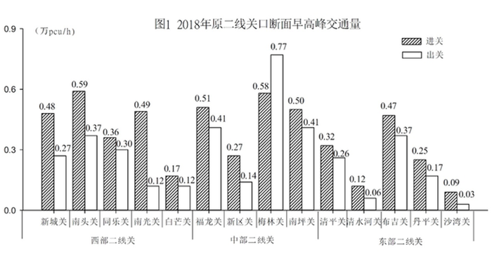
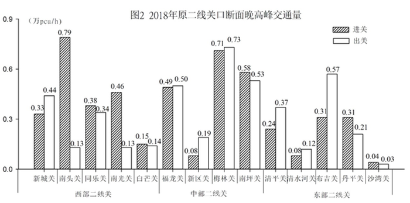

# 单位换算＋双条件（进关且出关均超线）筛选计数

考点：[[20-考点/资料分析/其他/单位换算＋双条件（进关且出关均超线）筛选计数|其他 / 单位换算＋双条件（进关且出关均超线）筛选计数]]
材料：[[15-材料/资料分析/307983 2018年深圳原二线关口按西-中-东|307983 2018年深圳原二线关口按西-中-东]]

**问法模型**：题干给出设计通行能力并问'晚高峰进出关均超设计值的关口有几个'→先把1500pcu/h换算成0.15万pcu/h与图2同量级，再对13个关口逐个执行'进关>0.15且出关>0.15'的双条件严格筛选计数

## 推理链
1. 第1步：从题干提取标准值1500pcu/h，比较对象锁定图2《2018年原二线关口断面晚高峰交通量》，其纵轴单位为万pcu/h
2. 第2步：统一单位量级，1500pcu/h=0.15万pcu/h，判定规则为该关晚高峰进关、出关两个数值均严格大于0.15万pcu/h
3. 第3步：逐关核对图2双柱数据，两值均>0.15的有：新城关(0.33/0.44)、同乐关(0.38/0.34)、福龙关(0.49/0.50)、梅林关(0.71/0.73)、南坪关(0.58/0.53)、清平关(0.24/0.37)、布吉关(0.31/0.57)、丹平关(0.31/0.21)，共8个
4. 第4步：核查临界与不足项并排除：南头关(0.79/0.15)出关恰等于0.15不属'超'，白芒关(0.15/0.14)进关等于0.15且出关不足，南光关(0.46/0.13)、新区关(0.08/0.19)、清水河关(0.08/0.12)、沙湾关(0.04/0.03)均存在单项低于0.15，全部不计入
5. 第5步：合计8个关口，与选项对照，A.7、C.9、D.10均不符，锁定B

**最快解法**：⚡ 单位换算＋出关柱优先排除法：先心算1500pcu/h=0.15万pcu/h；再横向扫图2的出关柱（空白柱），出关<0.15的直接淘汰——南光关0.13、白芒关0.14、清水河关0.12、沙湾关0.03，以及临界等于0.15的南头关；余下关中再看进关柱，仅新区关(0.08)被淘汰，剩余新城、同乐、福龙、梅林、南坪、清平、布吉、丹平恰8个，秒选B

## 易错点
- ⚠ 单位量级陷阱：纵轴是'万pcu/h'而设计值是'pcu/h'，相差1万倍，必须把1500pcu/h换算为0.15万pcu/h后再比较，不换算会使所有比较失效
- ⚠ 临界值陷阱：'超过'是严格大于，南头关出关0.15、白芒关进关0.15恰好等于设计值不能计入；若误按'≥'筛选会把这两关数进去而错得10个、误选D
- ⚠ 跨图取数陷阱：必须取图2晚高峰数据，误用图1早高峰（如南头关0.59/0.37）会整体错位；且南头/南光/南坪等关名相近、柱子数值接近，定位时易串行读错

## 母题抽象
> 🧩 当题干出现'均超过设计值/标准值的对象有几个'的计数特征时，先把标准值换算成与图表一致的单位，再按'两个指标同时严格大于临界值'逐项筛选，并单独核查恰好等于临界值的个体是否应排除

**同类特征**：设计通行能力1500pcu/h、晚高峰、进出关交通量均超设计值、关口个数计数、万pcu/h单位换算、临界等于值排除

## 相关题
（暂无）

---

### 题干
若城市道路的设计通行能力为1500pcu/h，则晚高峰进出关交通量均超设计值的关口有（    ）个。

### 选项
- A. 7
- B. 8　✅
- C. 9
- D. 10

### 官方解析
定位图2可得：2018年原二线关口断面晚高峰进出关交通量，由题干可知城市道路的设计通行能力为1500pcu/h=0.15万pcu/h，比较可得进出关交通量均超过0.15万pcu/h的有：新城关（0.33、0.44万pcu/h）、同乐关（0.38、0.34万pcu/h）、福龙关（0.49、0.50万pcu/h）、梅林关（0.71、0.73万pcu/h）、南坪关（0.58、0.53万pcu/h）、清平关（0.24、0.37万pcu/h）、布吉关（0.31、0.57万pcu/h）、丹平关（0.31、0.21万pcu/h），共8个关口。
故正确答案为B。

### 给定材料

