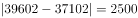
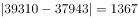
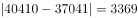
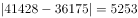

# 两分量差值（做差取绝对值）逐年比较

考点：[[20-考点/资料分析/其他/两分量差值（做差取绝对值）逐年比较|其他 / 两分量差值（做差取绝对值）逐年比较]]
材料：[[15-材料/资料分析/309616 2012—2016年全国就业人员数量|309616 2012—2016年全国就业人员数量]]

**问法模型**：题干问'两分量数量相差最大的是哪一年' → 对每一年计算|乡村−城镇|的绝对差值并比较大小，取差值最大年份

## 推理链
1. 第1步：从堆积柱状图读取各年数据（万人）：2012城镇37102/乡村39602，2013城镇38737/乡村38240，2014城镇37943/乡村39310，2015城镇37041/乡村40410，2016城镇36175/乡村41428
2. 第2步：所用规则：差值=|乡村−城镇|，逐年做差取绝对值（2013年为唯一城镇>乡村年份，方向为负仍取绝对值）
3. 第3步：代入计算：2012年|39602−37102|=2500，2013年|38240−38737|=497，2014年|39310−37943|=1367，2015年|40410−37041|=3369，2016年|41428−36175|=5253
4. 第4步：与选项对照：A.2012年(2500)、B.2014年(1367)、C.2015年(3369)、D.2016年(5253)，差值最大为2016年5253万人
5. 第5步：故正确答案为D（2016年）

**最快解法**：⚡ 观察法+做差验证：乡村逐年递增至41428（2016年为5年最大），城镇（除2013外）逐年递减至36175（2016年为5年最小），两分量一增一减反向拉开，最大差必在2016年；验证41428−36175=5253＞2012年2500＞2014年1367，直接锁定D

## 易错点
- ⚠ 柱内标签对应颠倒：上段（深灰）是乡村、下段（浅灰）是城镇，读反会整体误判
- ⚠ 2013年是唯一城镇(38737)>乡村(38240)的年份，差值方向为负，'相差'须取绝对值，忽略符号易漏算误排
- ⚠ '相差最大'指差值绝对值最大而非某单一年份分量最大；且2012年差值(2500)大于2014年(1367)，只盯年份靠后或单分量走势易误选B

## 母题抽象
> 🧩 当题干出现'两个分量相差最大（最小）的是哪一期'时，逐年做差取绝对值再比较；若一分量递增、另一分量递减，可用'递增分量最大值与递减分量最小值是否同年'快速锁定答案

**同类特征**：相差最大、哪一年、乡村与城镇就业人员、两分量做差、逐年比较、绝对差值

## 相关题
- [[10-真题/资料分析/倍数/2050544 比值（城乡收入比）逐年计算与趋势判断|2050544]]（吉林 2017，相关度1）
- [[10-真题/资料分析/其他/2133496 现期差值比较（同一行-进口额−出口额-取最大）|2133496]]（国考 2018，相关度1）
- [[10-真题/资料分析/综合/2452881 简单差值比较（进出口额差额最大值）|2452881]]（河南 2019，相关度1）
- [[10-真题/资料分析/增长/2741959 增长量比较（定基指数逐年增量作差）|2741959]]（江苏 2021，相关度1）
- [[10-真题/资料分析/增长/5510330 增长率（同比增幅）比较|5510330]]（山东 2023，相关度1）

---

### 题干
2012—2016年，乡村就业人员与城镇就业人员数量相差最大的是哪一年？

### 选项
- A. 2012年
- B. 2014年
- C. 2015年
- D. 2016年　✅

### 官方解析

定位统计图可得，2012—2016年全国乡村、城镇就业人员数量。计算每年，可得该年份就业人员数量差值。

A项2012年：万人；B项2014年：万人；C项2015年：万人；D项2016年：万人。比较可知，乡村就业人员与城镇就业人员数量相差最大的是2016年。

故正确答案为D。

### 给定材料

> [!warning] 疑点（官方解析可能有误，待人工复核）
> 官方解析中各年差值数字缺失（仅显示'万人'字样），经复算2012年2500、2014年1367、2015年3369、2016年5253万人，结论D无误，仅解析文本数字缺失，不影响答案
