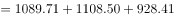
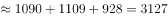
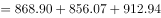
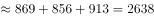
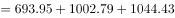
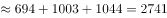

# 多期求和排序（季度进口量加总比较）

考点：[[20-考点/资料分析/其他/多期求和排序（季度进口量加总比较）|其他 / 多期求和排序（季度进口量加总比较）]]
材料：[[15-材料/资料分析/311726 2015年1-12月中国多晶硅逐月进|311726 2015年1-12月中国多晶硅逐月进]]

**问法模型**：题干要求'二、三、四季度进口量从高到低排列'→ 逐月加总各季度3个月的当期进口量，再比大小（时间求和排序模型）

## 推理链
1. 第1步：从图中柱状数据标签提取4-12月进口量：4月1089.71、5月1108.50、6月928.41、7月868.90、8月856.07、9月912.94、10月693.95、11月1002.79、12月1044.43（万千克）
2. 第2步：图中只有月度当期值、无季度合计，故各季度进口量=该季度3个月当期值之和
3. 第3步：代入计算：第二季度=1089.71+1108.50+928.41≈3126.62万千克；第三季度=868.90+856.07+912.94≈2637.91万千克；第四季度=693.95+1002.79+1044.43≈2741.17万千克
4. 第4步：比较大小：3126.62＞2741.17＞2637.91，即第二季度＞第四季度＞第三季度
5. 第5步：与选项对照，C项'第二季度 第四季度 第三季度'与计算结果一致

**最快解法**：⚡ 粗估排除+截位加总：第二季度三个月（1089.71、1108.50、928.41）均明显大于或接近其他季度各月，先排除A、D；只需精算Q3与Q4，截位至十位：Q3≈870+860+910=2640，Q4≈690+1000+1040=2730，Q4＞Q3，直接锁定C

## 易错点
- ⚠ 图中无季度合计数据，不能按柱高目测排序，必须逐月相加拼出季度总量
- ⚠ 10月进口量693.95为全年最低，易据此误判第四季度最小而错选B；实际11月1002.79、12月1044.43均超1000，Q4反超Q3
- ⚠ 柱读量、线读额不可混淆：误把1.61等折线金额值参与加总或排序

## 母题抽象
> 🧩 当题干出现'某几个季度/半年合计后从高到低（低到高）排列'特征时，从月度当期值逐月加总各期再比大小；先用各月整体量级粗估排除明显错误选项，只对剩余候选做截位精算

**同类特征**：季度进口量、从高到低排列、二三四季度、逐月加总、柱状图数据标签、排序比较

## 相关题
- [[10-真题/资料分析/比重/16069815 基期比重倒推与排序（现期比重−提升百分点）|16069815]]（贵州 2026，相关度1）
- [[10-真题/资料分析/增长/2444076 同比降速（负增长）比较-排序|2444076]]（江西 2019，相关度1）
- [[10-真题/资料分析/增长/4652203 年均增长率比较（年份差相同，比较末期值-基期值）|4652203]]（北京 2022，相关度1）
- [[10-真题/资料分析/其他/1796248 多期数据区间加总（简单加减计算）|1796248]]（黑龙江 2016，相关度1）
- [[10-真题/资料分析/其他/18643734 现期数据加总与排序（月度拼季度）|18643734]]（天津 2026，相关度1）

---

### 题干
2015年二、三、四季度多晶硅进口量按从高到低排列正确的是：

### 选项
- A. 第四季度 第三季度 第二季度
- B. 第二季度 第三季度 第四季度
- C. 第二季度 第四季度 第三季度　✅
- D. 第四季度 第二季度 第三季度

### 官方解析

定位统计图可得2015年4-12月多晶硅进口量。则2015年第二季度多晶硅进口量万千克；第三季度多晶硅进口量万千克；第四季度多晶硅进口量万千克，则进口量从高到低的排序是第二季度、第四季度、第三季度。

故正确答案为C。

备注：通过柱状图可明显看出第二季度的三个月数量均大于第三季度、第四季度三个月的数量，可排除A、D两项，故比较第三季度和第四季度即可。

### 给定材料

