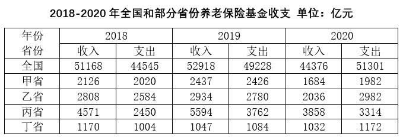

# 收支结余判断（收入-支出差值正负比较）

考点：[[20-考点/资料分析/其他/收支结余判断（收入-支出差值正负比较）|其他 / 收支结余判断（收入-支出差值正负比较）]]
材料：[[15-材料/资料分析/317194 2018-2020年全国及甲、乙、丙|317194 2018-2020年全国及甲、乙、丙]]

**问法模型**：问2020年'有结余'的主体 → 锁定2020年列组中各主体的收入、支出两列，逐个判断'收入-支出'是否为正

## 推理链
1. 第1步：从表中2020年列组提取四省数据：甲省收入1684、支出1982；乙省收入2036、支出2982；丙省收入3858、支出3314；丁省收入1032、支出1172（单位均为亿元）
2. 第2步：规则：结余=收入-支出，收入＞支出即有结余，为负则为赤字
3. 第3步：逐个做差：甲1684-1982=-298；乙2036-2982=-946；丙3858-3314=+544；丁1032-1172=-140
4. 第4步：仅丙省差值为正（结余544亿元），甲、乙、丁均为赤字，对照选项排除A、B、D，选C

**最快解法**：⚡ 同位大小比较法（无需算出差值）：在2020年组内逐行比较收入与支出首位/大小——甲1684<1982、乙2036<2982、丁1032<1172，三行收入均小于支出直接排除，唯一收入大于支出的是丙省3858>3314，故选C

## 易错点
- ⚠ 表中没有'结余'列，须自行按收入-支出判断，勿在其他列找数据
- ⚠ 2020年普遍'收入<支出'（全国及甲、乙、丁均为赤字），若沿用2018、2019年普遍盈余的惯性思维或按往年结余额大小（如丙省2019年结余5594-3762=1832最大）选答案易踩坑，必须用2020年数据判断
- ⚠ 表头'年份'横跨收入支出两列，5行×6列交叉定位易串行串列，如把丙省2019年收入5594误当2020年数据

## 母题抽象
> 🧩 当题干出现'某年收支有结余/盈余/收大于支'特征时，锁定该年份组各主体的收入与支出两列，用同位大小比较逐一判断收入是否大于支出，排除不符项锁定答案，无需精确求差

**同类特征**：2020年、收支有结余、收入-支出为正、逐主体排除判断、单一年份截面比较、匿名省份甲乙丙丁

## 相关题
- [[10-真题/资料分析/增长/5521195 增长率（同比增幅）比较|5521195]]（深圳市考 2023，相关度1）
- [[10-真题/资料分析/平均数/5101656 现期平均数（含'万吨-日→万吨-年'单位换算）|5101656]]（云南 2022，相关度1）
- [[10-真题/资料分析/增长/5408642 增长率计算（已知现期量与增长量求同比增速）|5408642]]（四川 2022，相关度1）
- [[10-真题/资料分析/增长/3018825 增长量计算（部分现期=总量×占比，再套公式增长量=现期×r-(1+r)）|3018825]]（广东 2021，相关度1）

---

### 题干
2020年养老保险基金收支有结余的是：

### 选项
- A. 甲省
- B. 乙省
- C. 丙省　✅
- D. 丁省

### 官方解析
定位统计表可知2020年甲省、乙省、丙省、丁省的养老保险基金收支数据。根据：结余即收入大于支出，仅丙省养老保险基金收入（3858亿元）＞支出（3314亿元），有结余。
故正确答案为C。

### 给定材料

