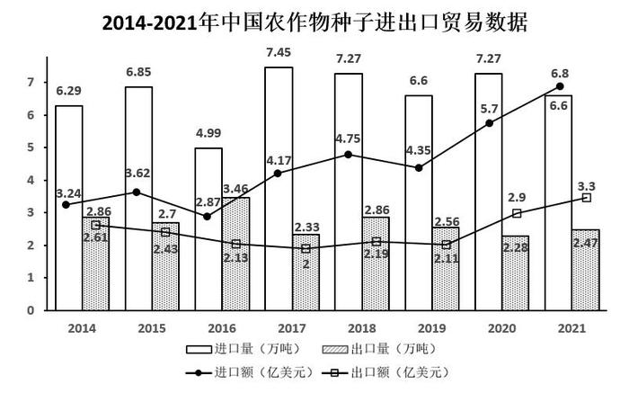

# 贸易逆差计算与计数比较（逆差=进口额−出口额）

考点：[[20-考点/资料分析/其他/贸易逆差计算与计数比较（逆差=进口额−出口额）|其他 / 贸易逆差计算与计数比较（逆差=进口额−出口额）]]
材料：[[15-材料/资料分析/323356 中国农作物种业概况：2021年良种繁|323356 中国农作物种业概况：2021年良种繁]]

**问法模型**：题干问'逆差超2亿美元的年份有几个'→ 同在'亿美元'口径内逐年做差（逆差=当年进口额−当年出口额），与阈值2比较后数年份

## 推理链
1. 第1步：从统计图两条折线取数——2014-2021年进口额为3.24、3.62、2.87、4.17、4.75、4.35、5.7、6.8亿美元，出口额为2.61、2.43、2.13、2、2.15、2.11、2.28、2.47亿美元（注意2020年的2.9、2021年的3.3是出口量'万吨'柱标签，不是出口额）
2. 第2步：用规则'贸易逆差=进口额−出口额'，只在亿美元口径内做差，再与2亿美元阈值比较
3. 第3步：逐年做差得：2014年0.63、2015年1.19、2016年0.74、2017年2.17、2018年2.60、2019年2.24、2020年3.42、2021年4.33亿美元
4. 第4步：与2亿美元逐一比较：2017-2021年5年均超2亿美元，2014-2016年均不足2亿美元
5. 第5步：符合条件的年份共5个，对照选项A(3)、B(4)、D(6)排除，锁定C(5)

**最快解法**：⚡ 移项比较法避免逐个减法：'逆差>2'等价于'进口额>出口额+2'。2014年3.24<4.61、2015年3.62<4.43、2016年2.87<4.13直接排除前三年；2017年4.17>4.00（临界需细看）、2018年4.75>4.15、2019年4.35>4.11、2020年5.7>4.28、2021年6.8>4.47，共5年，选C

## 易错点
- ⚠ 量额混读：图中2.9（2020）、3.3（2021）是出口量'万吨'柱标签，出口额实为2.28、2.47亿美元；误把出口量当出口额做差，本题侥幸不改变结论，但在比重、增速类题中必错
- ⚠ 双折线标签串行：进口额（实心圆点）与出口额（空心方块）数值标签上下交错，2014年3.24与2.61纵向紧邻，抄数极易错位取错行
- ⚠ 临界年误判：2017年逆差2.17、2019年2.24仅略超2亿美元，'超2亿美元'是严格大于，目测粗估易漏数2017或2019

## 母题抽象
> 🧩 当题干出现'逆差（进口额−出口额）超某阈值的年份有几个'时，在同一货币口径内逐年做差，或等价转化为'进口额>出口额+阈值'直接比较排除，再数年份对选项

**同类特征**：进出口贸易逆差、超2亿美元、年份有几个（计数类）、进口额/出口额双折线取数、逐年做差比较、亿美元口径

## 相关题
- [[10-真题/资料分析/增长/2097108 基期量计算（同比下降型）|2097108]]（四川 2017，相关度1）

---

### 题干
2014-2021年间，我国农作物种子进出口贸易逆差超2亿美元的年份有几个？

### 选项
- A. 3
- B. 4
- C. 5　✅
- D. 6

### 官方解析
定位统计图可得：2014-2021年中国农作物种子进口额分别为3.24亿美元、3.62亿美元、2.87亿美元、4.17亿美元、4.75亿美元、4.35亿美元、5.7亿美元、6.8亿美元；出口额分别为2.61亿美元、2.43亿美元、2.13亿美元、2亿美元、2.19亿美元、2.11亿美元、2.9亿美元、3.3亿美元。则2014-2021年间，我国农作物种子进出口贸易逆差分别为：
2014年：3.24-2.61=0.63亿美元；
2015年：3.62-2.43=1.19亿美元；
2016年：2.87-2.13=0.74亿美元；
2017年：4.17-2=2.17亿美元；
2018年：4.75-2.19=2.56亿美元；
2019年：4.35-2.11=2.24亿美元；
2020年：5.7-2.9=2.8亿美元；
2021年：6.8-3.3=3.5亿美元。
因此，2014-2021年间，我国农作物种子进出口贸易逆差超2亿美元的年份有2017年、2018年、2019年、2020年、2021年，共5个。
故正确答案为C。

### 给定材料

        2021年全国共有138个国家级区域性良种繁育基地，其中山东、黑龙江分别有16和12个基地，云南、湖北均以10个居于其后，2021年全国通过国审的水稻品种有677个，其中湖南有169个；玉米通过国审的919个品种中，134个来自北京，其后是吉林99个、河南95个；与水稻、玉米相比，大豆种源高度依赖进口，2021年仅有86个国审品种，其中黑龙江18个、山东14个；棉花39个国审品种中，最多的是新疆，有12个，其次为河南，有6个。

        2021年，我国农作物自主选育品种面积占比超95%，水稻、小麦两大口粮作物品种100%自给。大豆种子对外依赖度高达86%，胡萝卜、茄子、菠菜、洋葱、高端品种番茄及甜菜等种子的进口依赖度超过90%。

> [!warning] 疑点（官方解析可能有误，待人工复核）
> 官方解析取数与图中标签不符：2018年出口额应为2.15（解析误取2.19），2020年应为2.28（解析误取2.9，2.9实为当年出口量·万吨），2021年应为2.47（解析误取3.3，3.3实为当年出口量·万吨），属'量额混读'口径问题；但按图中正确数值计算，2018/2020/2021年逆差为2.60/3.42/4.33亿美元，比解析值更大且同样超2亿美元，超2亿美元年份仍为2017-2021共5年，正确答案C不受影响

<!-- CODEX-ANSWER-REVIEW:BEGIN -->
### 本次独立复核

**复核状态：** `resolved`（答案与解析已核定）

**计分答案：** C（可计分）

**复核解析：**

1. 第1步：从统计图两条折线取数——2014-2021年进口额为3.24、3.62、2.87、4.17、4.75、4.35、5.7、6.8亿美元，出口额为2.61、2.43、2.13、2、2.15、2.11、2.28、2.47亿美元（注意2020年的2.9、2021年的3.3是出口量'万吨'柱标签，不是出口额）
2. 第2步：用规则'贸易逆差=进口额−出口额'，只在亿美元口径内做差，再与2亿美元阈值比较
3. 第3步：逐年做差得：2014年0.63、2015年1.19、2016年0.74、2017年2.17、2018年2.60、2019年2.24、2020年3.42、2021年4.33亿美元
4. 第4步：与2亿美元逐一比较：2017-2021年5年均超2亿美元，2014-2016年均不足2亿美元
5. 第5步：符合条件的年份共5个，对照选项A(3)、B(4)、D(6)排除，锁定C(5)

**最快解法**：⚡ 移项比较法避免逐个减法：'逆差>2'等价于'进口额>出口额+2'。2014年3.24<4.61、2015年3.62<4.43、2016年2.87<4.13直接排除前三年；2017年4.17>4.00（临界需细看）、2018年4.75>4.15、2019年4.35>4.11、2020年5.7>4.28、2021年6.8>4.47，共5年，选C

**相关信息：**

2022年云南公务员录用考试《行测》题（网友回忆版）；其他 / 贸易逆差计算与计数比较（逆差=进口额−出口额）。单位与比较口径按题面材料：2022年度/期间。

**题源依据：** [固定版本原题](https://github.com/Mentat-Uran/kaogongzhentizhengliu/blob/84ab93d4b64b61d897bece8a1c0a5bab06b4feb2/10-%E7%9C%9F%E9%A2%98/%E8%B5%84%E6%96%99%E5%88%86%E6%9E%90/%E5%85%B6%E4%BB%96/5101661%20%E8%B4%B8%E6%98%93%E9%80%86%E5%B7%AE%E8%AE%A1%E7%AE%97%E4%B8%8E%E8%AE%A1%E6%95%B0%E6%AF%94%E8%BE%83%EF%BC%88%E9%80%86%E5%B7%AE%3D%E8%BF%9B%E5%8F%A3%E9%A2%9D%E2%88%92%E5%87%BA%E5%8F%A3%E9%A2%9D%EF%BC%89.md)；固定内容 commit `84ab93d4b64b61d897bece8a1c0a5bab06b4feb2`，Markdown blob `f87a290121f412346588e57aaa36480f26f8619d`。
<!-- CODEX-ANSWER-REVIEW:END -->
