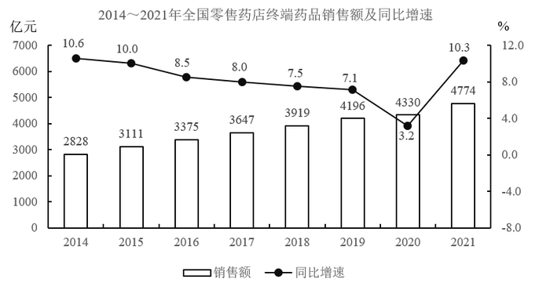

# 连续年份多期值加总（区间总额范围判断）

考点：[[20-考点/资料分析/其他/连续年份多期值加总（区间总额范围判断）|其他 / 连续年份多期值加总（区间总额范围判断）]]
材料：[[15-材料/资料分析/336794 2014～2021年全国零售药店终端|336794 2014～2021年全国零售药店终端]]

**问法模型**：题干问'某连续年份区间总额在哪个范围内'→ 从对应口径图表读取各年当期值直接加总，换算单位后与范围选项对照

## 推理链
1. 第1步：题干主体为'零售药店终端'，定位图1（终端口径）而非图2（实体口径）；年份区间2016～2020共5年，不含2015年与2021年
2. 第2步：读取图1各年柱值（左轴，亿元）：2016年3375、2017年3647、2018年3919、2019年4196、2020年4330
3. 第3步：加总：3375+3647+3919+4196+4330=19467亿元
4. 第4步：单位换算：19467亿元=1.9467万亿元
5. 第5步：对照选项：1.9≤1.9467<2，落在1.9～2万亿元区间，排除A/C/D，选B

**最快解法**：⚡ 取整速算+量级排除：五数按整百取整 3400+3600+3900+4200+4300≈19400亿元≈1.94万亿元，直接锁定1.9～2万亿；亦可按'5年×年均约3900亿≈1.95万亿'先估量级排除A（<1.9）与C/D（≥2）

## 易错点
- ⚠ 看串口径：误用图2实体药店数据（3327+3577+3820+4057+4087=18868亿=1.8868万亿<1.9万亿），会误选A——两图柱值仅差几十到三百多亿，必须先确认'终端'对应图1
- ⚠ 年份区间多算：若误将2021年（4774）计入，总额达约2.42万亿，会误选D；区间是2016～2020共5年
- ⚠ 单位换算：加总结果单位为亿元，选项以'万亿元'表述，需÷10000，勿把19467亿当作19.467万亿

## 母题抽象
> 🧩 当题干出现'某连续几年××总额在以下哪个范围内'时，先锁定正确口径图表与年份区间，读取各年当期柱值取整加总、换算单位，再对照范围选项验证

**同类特征**：连续年份区间总额、在以下哪个范围内、零售药店终端（双图近值需辨口径）、柱状图当期值加总、亿元→万亿元单位换算、估算型设问不必精确

## 相关题
- [[10-真题/资料分析/比重/2274533 现期比重求整体（给定部分与比重求总体）|2274533]]（北京 2019，相关度1）
- [[10-真题/资料分析/比重/2719387 现期比重计算与区间定位（多主体求和÷全国总量）|2719387]]（国考 2021，相关度1）
- [[10-真题/资料分析/其他/5894965 多年份数据加总求和（区间判定型）|5894965]]（国考 2024，相关度1）
- [[10-真题/资料分析/比重/10297462 现期比重计算（部分占整体比重+区间型选项）|10297462]]（四川 2025，相关度1）
- [[10-真题/资料分析/增长/15833688 增长量计算（累计值相减求当期现期+混合增长率定当期增速）|15833688]]（黑龙江 2026，相关度1）

---

### 题干
2016～2020年，全国零售药店终端药品销售总额在以下哪个范围内？

### 选项
- A. 小于1.9万亿元
- B. 1.9～2万亿元　✅
- C. 2～2.1万亿元
- D. 大于2.1万亿元

### 官方解析
定位统计图1可得2016～2020年各年份的全国零售药店终端药品销售额，则2016～2020年全国零售药店终端药品销售总额=3375+3647+3919+4196+4330=19467亿元=1.9467万亿元，在B项范围内。
故正确答案为B。

### 给定材料

        零售药店终端包含实体药店和网上药店两大市场。2021年，全国零售药店终端药品销售额4774亿元，同比增长10.3%。其中，实体药店市场药品销售额4405亿元，同比增长7.8%；网上药店市场药品销售额368亿元，同比增长51.5%。

