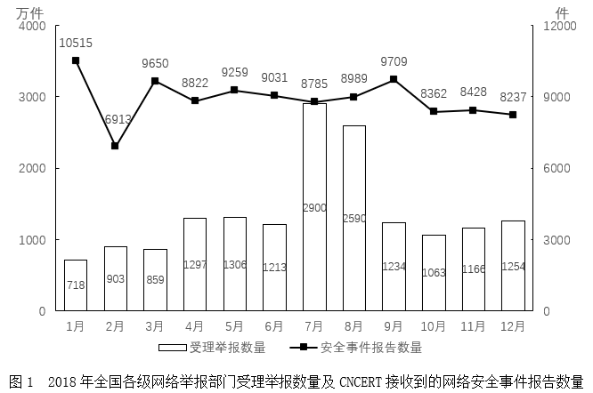
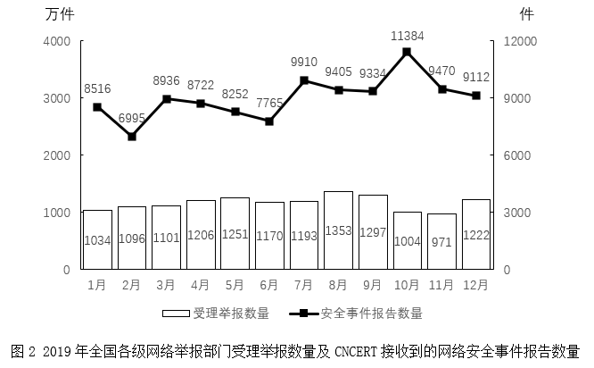

# 简单计算·月度值按季度加总后比较大小（双轴图读数）

考点：[[20-考点/资料分析/其他/简单计算·月度值按季度加总后比较大小（双轴图读数）|其他 / 简单计算·月度值按季度加总后比较大小（双轴图读数）]]
材料：[[15-材料/资料分析/339703 2018-2019年全国各级网络举报|339703 2018-2019年全国各级网络举报]]

**问法模型**：题干问'某年某指标数量最少的季度'且材料只给月度当期值 → 定位对应年份图表与指标（折线），将每3个月数值加总得季度合计，再比较四季度大小

## 推理链
1. 第1步：题干要求2018年，定位图1；指标为'CNCERT接收到的网络安全事件报告数量'，对应图1中的折线（右轴，单位：件），而非柱状（万件）
2. 第2步：材料无现成季度数据，规则为'季度=三个月当月值加总'，逐季度取折线读数
3. 第3步：第一季度=10515+6913+9650=27078件；第二季度=8822+9259+9031=27112件
4. 第4步：第三季度=8785+9899+9709=28393件；第四季度=8362+8428+8237=25027件
5. 第5步：比较25027<27078<27112<28393，第四季度合计最少，对照选项选D

**最快解法**：⚡ 截位粗算比较：按季度扫一眼折线水平——Q4三个月（8362、8428、8237）全部低于8500件，是唯一'各月均<9000'的季度，合计必为最低；Q1含10515高点、Q2含9259、Q3含9899，粗加即排除；精确验证Q4=25027件为最小

## 易错点
- ⚠ 指标取错：双轴图中误读柱状'受理举报数量'（左轴，万件）而非折线'安全事件报告数量'（右轴，件），柱与线量级差约万倍
- ⚠ 年份取错：2018年应读图1，误读图2（2019年，其折线最低季度为第二季度），年份与指标双重陷阱
- ⚠ 单月最值≠季度合计：2018年折线单月最低是2月6913件（在第一季度），若以单月最低代替季度加总会误选A；按季度加总实际最低是第四季度25027件

## 母题抽象
> 🧩 当题干出现'某指标最大/最小的季度（或半年）'且材料只有月度当期值时，先按题干年份定位对应图表并确认指标对应哪根轴，再将3个月数值加总，用'全月均低/含高点'的粗筛加截位加总验证即可锁定答案

**同类特征**：2018年（基期年份，读图1）、CNCERT/网络安全事件报告（折线指标，右轴，单位件）、最少的季度、月度数据需自行按季度加总、双轴图读数易混、当期值大小比较

## 相关题
- [[10-真题/资料分析/其他/2022294 当年累计值差分还原当期值后比大小|2022294]]（吉林 2016，相关度1）
- [[10-真题/资料分析/其他/5893734 季度加总比较（月度数据求和后比大小）|5893734]]（国考 2024，相关度1）

---

### 题干
2018年CNCERT接收到的网络安全事件报告数量最少的季度是：

### 选项
- A. 第一季度
- B. 第二季度
- C. 第三季度
- D. 第四季度　✅

### 官方解析
定位图1可知2018年各月CNCERT接收到的网络安全事件报告数量。2018年各季度报告数量分别为：
第一季度，件；
第二季度，件；
第三季度，件；
第四季度，件。
比较可知，2018年CNCERT接收到的网络安全事件报告数量最少的季度是第四季度。
故正确答案为D。

### 给定材料

        2019年全国各级网络举报部门共受理举报13899万件，较2018年下降15.8%。CNCERT接收到网络安全事件报告107801件，较2018年增长1.0%。

