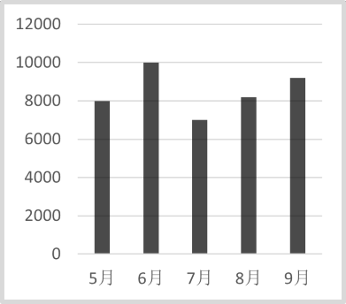
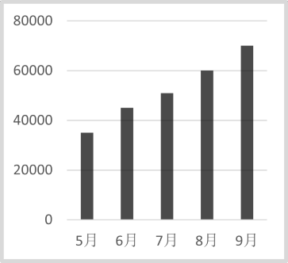
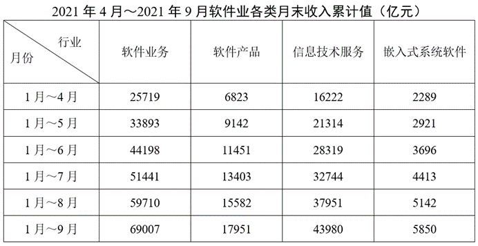

# 累计值相减求当期值+图形匹配

考点：[[20-考点/资料分析/其他/累计值相减求当期值+图形匹配|其他 / 累计值相减求当期值+图形匹配]]
材料：[[15-材料/资料分析/340956 2021年1～9月我国软件业四类收入|340956 2021年1～9月我国软件业四类收入]]

**问法模型**：给出月末累计值表并要求匹配某月当期值序列的图形 → 先逐行相减求各月单月值，再用极值与升降特征对照图形

## 推理链
1. 第1步：从软件产品列提取累计值：1~4月6823、1~5月9142、1~6月11451、1~7月13403、1~8月15582、1~9月17951（亿元），全表为月末累计值
2. 第2步：规则为当月值=相邻两行累计值之差（如9月=1~9月−1~8月）
3. 第3步：代入计算：5月=9142−6823=2319；6月=11451−9142=2309；7月=13403−11451=1952；8月=15582−13403=2179；9月=17951−15582=2369（亿元）
4. 第4步：提取序列特征：7月最低（1952）、9月最高（2369）、5月略高于6月（2319>2309）、8月回升至2179
5. 第5步：与四个选项图形对照，仅A项呈现'5月2319微降6月2309、7月探底1952、8月回升、9月冲高2369'的形态，其余图形在最低点或5/6月相对高低上不吻合
6. 第6步：故正确答案为A

**最快解法**：⚡ 逐行相减+特征点排除法：不必精算全部五个数，先口算7月=13403−11451=1952（全序列最低点），再算9月=17951−15582=2369（最高点），最后确认5月2319>6月2309（先降后探底再回升），用这三个特征即可锁定A

## 易错点
- ⚠ 累计/当期混淆：直接抄累计列（9142、11451、13403…）作图必错，本题所有点都必须由相邻行相减得到
- ⚠ 5月与6月数值极接近（2319 vs 2309，仅差10），图形上近乎平齐且5月略高，误把6月看得比5月高会选错图形
- ⚠ 7月是序列最低点而非9月，若凭'收入逐月增长'的直觉想象趋势，会误选单调上升型图形

## 母题抽象
> 🧩 当题干出现'月末累计值表+某月序列图形匹配'特征时，先逐行相减求当期值，再用'最高点、最低点、相邻月相对高低'三个特征排除选项，无需精算每个数

**同类特征**：月末累计值表、某月当期值序列、5月至9月、图形匹配/数图对照、相邻行相减、软件产品收入

## 相关题
- [[10-真题/资料分析/其他/5509886 累计值相减求当期值（单月值比较大小）|5509886]]（内蒙古 2023，相关度2）
- [[10-真题/资料分析/综合/5509894 综合分析判断（累计差值求当期值＋总量量级比较）|5509894]]（内蒙古 2023，相关度1）

---

### 题干
下图能正确反映2021年5月至9月软件产品收入（亿元）的是：

### 选项
- A. 

　✅
- B. 

- C. 

- D. 

### 官方解析

软件产品收入：5月=1月~5月-1月~4月=9142-6823=亿元；6月=1月~6月-1月~5月=11451-9142亿元；7月=1月~7月-1月~6月=13403-11451=1952亿元；8月=1月~8月-1月~7月=15582-13403亿元；9月=1月~9月-1月~8月=17951-15582亿元。只有A项满足。

故正确答案为A。

### 给定材料

> [!warning] 疑点（官方解析可能有误，待人工复核）
> 官方解析排版存在缺漏，部分等式缺少得数（如'9142-6823=亿元''11451-9142亿元''15582-13403亿元'未写结果2319、2309、2179），但计算过程与结论正确，不影响答案A

<!-- CODEX-ANSWER-REVIEW:BEGIN -->
### 本次独立复核

**复核状态：** `resolved`（答案与解析已核定）

**计分答案：** A（可计分）

**复核解析：**

1. 第1步：从软件产品列提取累计值：1~4月6823、1~5月9142、1~6月11451、1~7月13403、1~8月15582、1~9月17951（亿元），全表为月末累计值
2. 第2步：规则为当月值=相邻两行累计值之差（如9月=1~9月−1~8月）
3. 第3步：代入计算：5月=9142−6823=2319；6月=11451−9142=2309；7月=13403−11451=1952；8月=15582−13403=2179；9月=17951−15582=2369（亿元）
4. 第4步：提取序列特征：7月最低（1952）、9月最高（2369）、5月略高于6月（2319>2309）、8月回升至2179
5. 第5步：与四个选项图形对照，仅A项呈现'5月2319微降6月2309、7月探底1952、8月回升、9月冲高2369'的形态，其余图形在最低点或5/6月相对高低上不吻合
6. 第6步：故正确答案为A

**最快解法**：⚡ 逐行相减+特征点排除法：不必精算全部五个数，先口算7月=13403−11451=1952（全序列最低点），再算9月=17951−15582=2369（最高点），最后确认5月2319>6月2309（先降后探底再回升），用这三个特征即可锁定A

**相关信息：**

2023年内蒙古公务员录用考试《行测》题（网友回忆版）；其他 / 累计值相减求当期值+图形匹配。单位与比较口径按题面材料：2023年度/期间。

**题源依据：** [固定版本原题](https://github.com/Mentat-Uran/kaogongzhentizhengliu/blob/84ab93d4b64b61d897bece8a1c0a5bab06b4feb2/10-%E7%9C%9F%E9%A2%98/%E8%B5%84%E6%96%99%E5%88%86%E6%9E%90/%E5%85%B6%E4%BB%96/5509883%20%E7%B4%AF%E8%AE%A1%E5%80%BC%E7%9B%B8%E5%87%8F%E6%B1%82%E5%BD%93%E6%9C%9F%E5%80%BC%2B%E5%9B%BE%E5%BD%A2%E5%8C%B9%E9%85%8D.md)；固定内容 commit `84ab93d4b64b61d897bece8a1c0a5bab06b4feb2`，Markdown blob `1b6ccfd817a7dd1d1db151cb26f022842518e110`。
<!-- CODEX-ANSWER-REVIEW:END -->
