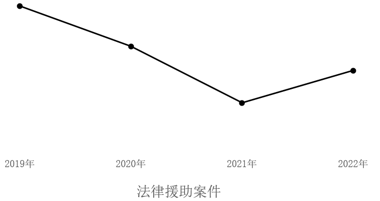
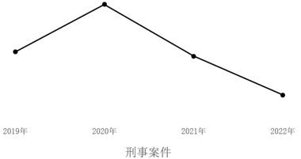
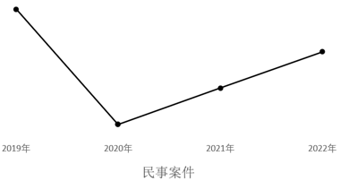

# 一般增长率计算与趋势图匹配（同比增长率逐年比较）

考点：[[20-考点/资料分析/增长/一般增长率计算与趋势图匹配（同比增长率逐年比较）|增长 / 一般增长率计算与趋势图匹配（同比增长率逐年比较）]]
材料：[[15-材料/资料分析/7527825 2022年我国及G省法律援助工作情况|7527825 2022年我国及G省法律援助工作情况]]

**问法模型**：‘哪个选项最有可能准确反映2018-2022年同比增长率’的图形匹配题 → 逐年套增长率=(现期−基期)/基期求出各年增速，再按最高点、最低点及升降趋势与折线图形态逐一对照排除。

## 推理链
1. 第1步：定位统计表第一列'法律援助案件（万件）'：2018年14.25、2019年24.05、2020年24.56、2021年23.67、2022年19.58；2018年为基期不产出增速，需计算2019-2022共4个同比增速。
2. 第2步：公式：同比增长率=（现期−基期）÷基期。
3. 第3步：代入计算：2019年(24.05−14.25)/14.25=9.80/14.25≈+68.8%；2020年(24.56−24.05)/24.05=0.51/24.05≈+2.1%；2021年(23.67−24.56)/24.56=−0.89/24.56≈−3.6%；2022年(19.58−23.67)/23.67=−4.09/23.67≈−17.3%。
4. 第4步：交叉验证：文字段'2022年较2021年减少40937件、同比下降17.29%'，且195779+40937=236716≈23.67万件，与表格2021年数据及计算的−17.3%完全吻合，口径无误。
5. 第5步：归纳增速形态特征：2019年+68.8%为唯一大幅正增长即最高点，此后逐年回落，2022年−17.3%为最低点，四年走势为持续下行（+68.8%→+2.1%→−3.6%→−17.3%）。
6. 第6步：与四个选项折线图形态对照：A、B、D的起伏形态与上述特征矛盾，仅C图呈现2019年最高、其后一路下行至2022年最低，故选C。

**最快解法**：⚡ 截位直除+两端定性排除：不必精算四年增速，只算两端——2019年9.8/14.25≈68.8%（其余年份均远低于此，必为图最高点）、2022年−4.09/23.67≈−17.3%（唯一大负增长，必为最低点），中间2020年微增、2021年小降，即'2019冲高后逐年回落'，直接锁定C，排除图形形态不符的A、B、D。

## 易错点
- ⚠ 基期错位：2018年无同比增速，折线只有2019-2022四个增速点，勿把2018年当成第一个增速点或去求2018年增速。
- ⚠ 混淆'案件量峰值'与'增速峰值'：案件总量在2020年达峰（24.56万件），但同比增速峰值在2019年（+68.8%）；且2020年仍为正增长(+2.1%)，若凭'总量先增后减'直觉画增速线会错判升降节奏。
- ⚠ 用错数据列：必须用统计表第一列法律援助案件总量，不能误用刑事/民事/行政分项列，也不能误用折线图'帮助受援群众人数'（21.3万等）来算增速。

## 母题抽象
> 🧩 当题干给出逐年总量表并问'哪幅图准确反映同比增长率'时，用增长率=(现期−基期)/基期逐年（至少算出最大与最小两端）求增速，再以'最高点年份+最低点年份+升降趋势'三要素与折线选项形态匹配排除。

**同类特征**：最有可能准确反映、同比增长率、2018-2022年间、选项为折线/趋势图、G省法律援助机构办理的相关案件、增长率计算与图形匹配

## 相关题
- [[10-真题/资料分析/增长/23299 增长率计算之百分点换算（跨期增速倒推）|23299]]（安徽 2012，相关度1）
- [[10-真题/资料分析/增长/2015318 同比增长率计算|2015318]]（重庆 2016，相关度1）
- [[10-真题/资料分析/增长/2456363 基期量计算|2456363]]（浙江 2020，相关度1）
- [[10-真题/资料分析/增长/4695874 同比增长率计算（分量增速，一般增长率）|4695874]]（选调 2018，相关度1）
- [[10-真题/资料分析/比重/5510317 现期比重计算与饼图结构比对排除|5510317]]（广东 2023，相关度1）

---

### 题干
下列选项最有可能准确反映了2018-2022年间G省法律援助机构办理的相关案件的同比增长率的是（    ）。

### 选项
- A. 

- B. 

- C. 

　✅
- D. 

### 官方解析

根据题干“下列选项最有可能准确反映了······2018-2022年间······同比增长率的是”，可判定本题为一般增长率问题。定位统计表可得：2018-2022年G省法律援助案件数量。根据公式：增长率，则2019-2022年，G省法律援助机构办理的相关案件的同比增长率分别为：

A项：2019年为，2020年为，2021年为，2022年为。其中2022年的同比增长率最小，应处在最低点，排除；

B项：2019年为，2020年为，2021年为，2022年为。其中2019年的同比增长率最大，应处在最高点，排除；

C项：2019年为，2020年为，2021年为，2022年为。其中2019年的同比增长率最大，2020年的同比增长率最小，且2019-2022年的同比增长率的变化趋势为先下降再上升，当选；

D项：2019年为，2020年为，2021年为，2022年为。其中2019年的同比增长率最大，应处在最高点，排除。

故正确答案为C。

### 给定材料

        自2022年1月1日《中华人民共和国法律援助法》施行以来，我国法律援助覆盖面不断扩大、服务水平显著提升。据统计，2022年全国法律援助机构共组织办理法律援助案件137万余件，值班律师提供法律帮助95万余件，为1980万余人次提供法律咨询，提供法律咨询人次同比增加约5%。

        2022年，G省法律援助机构共组织办理法律援助案件（以下简称G省法律援助案件）195779件，较2021年减少40937件，同比下降17.29%，其中刑事案件133509件（含值班律师法律帮助案件65647件），民事案件61754件，行政案件516件。帮助受援群众212993人。

> [!warning] 疑点（官方解析可能有误，待人工复核）
> 官方解析文字表述'2020年的同比增长率最小、2019-2022年增速先下降再上升'与表格数据计算结果不符：按数据应为2022年增速最小（−17.3%），且2019→2022增速为+68.8%→+2.1%→−3.6%→−17.3%持续下降，不存在回升；解析中各年增速数值在转录中缺失，疑为解析文字识别/转录错误，但正确答案C本身与数据吻合（C图应呈2019年最高、逐年下行至2022年最低），不影响答案判定。

<!-- CODEX-ANSWER-REVIEW:BEGIN -->
### 本次独立复核

**复核状态：** `resolved`（答案与解析已核定）

**计分答案：** C（可计分）

**复核解析：**

按题表计算法律援助、刑事、民事、行政案件2019—2022年的同比率。民事案件：6.63/6.00−1=10.5%；6.08/6.63−1≈−8.3%；5.96/6.08−1≈−2.0%；6.18/5.96−1≈3.7%，走势为先大降、后连续回升，匹配选项C。原解析声称“2020年增速最小”不成立；实际极小值是行政案件2020年约−25.6%，但所问图形走势由民事系列匹配。

**相关信息：**

图表只表达增速的趋势，不按各类案件原始量比较；民事案件单位万件。

**题源依据：** [固定版本原题](https://github.com/Mentat-Uran/kaogongzhentizhengliu/blob/84ab93d4b64b61d897bece8a1c0a5bab06b4feb2/10-%E7%9C%9F%E9%A2%98/%E8%B5%84%E6%96%99%E5%88%86%E6%9E%90/%E5%A2%9E%E9%95%BF/10204440%20%E4%B8%80%E8%88%AC%E5%A2%9E%E9%95%BF%E7%8E%87%E8%AE%A1%E7%AE%97%E4%B8%8E%E8%B6%8B%E5%8A%BF%E5%9B%BE%E5%8C%B9%E9%85%8D%EF%BC%88%E5%90%8C%E6%AF%94%E5%A2%9E%E9%95%BF%E7%8E%87%E9%80%90%E5%B9%B4%E6%AF%94%E8%BE%83%EF%BC%89.md)；固定内容 commit `84ab93d4b64b61d897bece8a1c0a5bab06b4feb2`，Markdown blob `caf83e08188795e772633adaca58b92cbf85cbc6`。
<!-- CODEX-ANSWER-REVIEW:END -->
