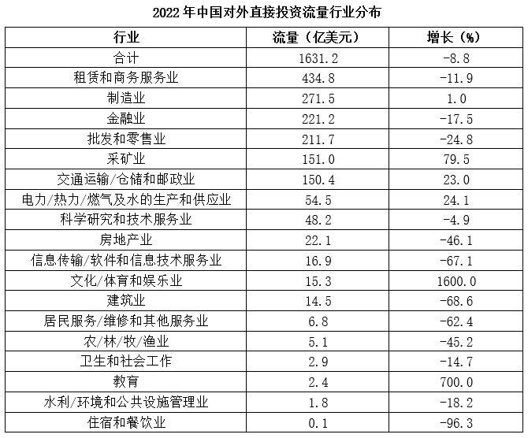

# 基期量比较（用同比增速反推2021年分行业流量后排序）

考点：[[20-考点/资料分析/增长/基期量比较（用同比增速反推2021年分行业流量后排序）|增长 / 基期量比较（用同比增速反推2021年分行业流量后排序）]]
材料：[[15-材料/资料分析/4463712 中国对外直接投资：2022年全球格局|4463712 中国对外直接投资：2022年全球格局]]

**问法模型**：题干问'2021年（材料现期为2022年）四个行业流量从大到小排序' → 基期量比较模型：现期量÷(1+g)逐项反推基期值再与选项对照。

## 推理链
1. 第1步：题干求2021年排序，材料表格只给2022年现期值与增速：租赁和商务服务业434.8（-11.9%）、制造业271.5（+1.0%）、金融业221.2（-17.5%）、批发和零售业211.7（-24.8%）
2. 第2步：基期量=现期量÷(1+增长率)，增速为负时分母取(1-|g|)
3. 第3步：代入计算——租赁=434.8÷0.881≈493.5亿美元；批发和零售=211.7÷0.752≈281.5亿美元；制造=271.5÷1.01≈268.8亿美元；金融=221.2÷0.825≈268.1亿美元
4. 第4步：排序为租赁(493.5)>批发和零售(281.5)>制造(268.8)>金融(268.1)，其中制造与金融仅差约0.7亿美元，需保留三位有效数字才能分出先后
5. 第5步：对照选项——租赁第一可排除A、B（两选项金融居首），批发和零售第二可排除C（C中制造第二、金融末位），锁定D

**最快解法**：⚡ 基期公式+截位直除+排除法：①先算最大项租赁434.8÷0.881≈493，四项中明显最大，排除A、B；②再比较后三名：批发和零售211.7÷0.752≈282，虽现期最小但因降幅24.8%最大，基期反超至第二位，排除C即选D；③制造271.5÷1.01≈268.8与金融221.2÷0.825≈268.1差距不足0.3%，无需精确比较，但估算时分子分母均保留三位有效数字以防排反。

## 易错点
- ⚠ 现期基期混淆：直接按2022年现期流量排序（租赁>制造>金融>批发和零售）不对应任何选项，易误选形式最接近的C，必须用'现期÷(1+g)'反推2021年
- ⚠ 负增长方向搞反：金融-17.5%、批发和零售-24.8%反推的基期值应大于现期值，若误用现期×(1-|g|)（如批发和零售211.7×0.752≈159）会把批发和零售错排到末位
- ⚠ 精度与文字诱导：制造(≈268.8)与金融(≈268.1)差距不足0.3%，粗估易排反；文字'制造业由上年第三位上升至第二位'只能确认制造2021年列第三，不能顺推金融当年第二（实际批发和零售2021年约281.5亿居第二）

## 母题抽象
> 🧩 当题干出现'上年/基期多个主体指标从大到小（或从小到大）排序'且材料只有现期值和同比增速时，逐项用基期量=现期÷(1+g)反推再排序；增速为负时分母取(1-|g|)，数值接近的两项保留三位有效数字细算，并善用排除法先定最大项。

**同类特征**：问2021年（早于材料现期2022年）、四个行业流量并列比较、'从大到小排序正确的是'、选项为行业全排列式、必须用表格增速列反推基期、现期排名与基期排名不同（批发和零售降幅大实现反超）

## 相关题
（暂无）

---

### 题干
2021年，中国下列行业的对外直接投资流量，从大到小排序正确的是（    ）。

### 选项
- A. 金融业>租赁和商务服务业>批发和零售业>制造业
- B. 金融业>租赁和商务服务业>制造业>批发和零售业
- C. 租赁和商务服务业>制造业>批发和零售业>金融业
- D. 租赁和商务服务业>批发和零售业>制造业>金融业　✅

### 官方解析

根据题干“2021年······从大到小排序正确的是”，结合材料时间为2022年，可判定本题为基期比较问题。定位统计表可得2022年中国租赁和商务服务业、制造业、金融业、批发和零售业对外直接投资流量及增长率。根据公式：基期量，则2021年这四个行业对外直接投资流量分别为：

租赁和商务服务业：亿美元；

制造业：亿美元；

金融业：亿美元；

批发和零售业：亿美元。

对比可得，四个行业中，租赁和商务服务业对外直接投资流量最大，排除A、B两项；其次为批发和零售业，排除C项。

故正确答案为D。

### 给定材料

        2022年，全球对外直接投资流量1.5万亿美元，比上年下降14%。其中发达经济体对外直接投资1.03万亿美元，比上年下降17.2%；发展中经济体对外直接投资4589亿美元，比上年下降5.4%。

        2022年，中国对外直接投资流量1631.2亿美元，与上年历史次高值相比，下降8.8%，占全球份额的10.9%。

        2022年，中国对外直接投资涵盖了国民经济的18个行业大类，其中流向租赁和商务服务、制造、金融、批发和零售、采矿、交通运输/仓储和邮政业的投资均超过百亿美元，租赁和商务服务业保持首位，制造业由上年第三位上升至第二位。

