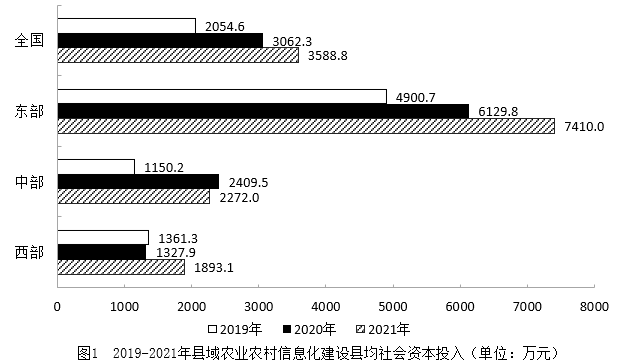

# 年均增长率计算（两年期，n=2）

考点：[[20-考点/资料分析/增长/年均增长率计算（两年期，n=2）|增长 / 年均增长率计算（两年期，n=2）]]
材料：[[15-材料/资料分析/3680726 2021年全国及东、中、西部县域农业|3680726 2021年全国及东、中、西部县域农业]]

**问法模型**：题干问'2019-2021年……年均增率约为'→ 用年均增长率模型 (1+r)^n = 现期/基期，n=年份差（2021-2019=2），对总倍数开n次方

## 推理链
1. 第1步：题干'年均增率'+限定'县均社会资本投入'，定位图1全国行：基期2019年2054.6万元，现期2021年3588.8万元（单位：万元，勿误取图2的元）
2. 第2步：确定期数 n=2021-2019=2（两个增长期，非三年三个间隔），套公式 (1+r)^2 = 3588.8/2054.6
3. 第3步：截位直除 3588.8/2054.6 ≈ 1.747，即两年总增幅约74.7%
4. 第4步：开方估数：1.32²=1.7424，1.33²=1.7689，1.747略大于1.7424，故 r≈32.2%，且复利年均32%小于单利折半值74.7%÷2=37.3%，方向自洽
5. 第5步：对照选项：10%（过低）、21%（对应误用n=3，1.747^(1/3)-1≈20.4%）、43%（对应误用图2人均数据135.2/67.2≈2.01，开方≈42%），仅C 32%吻合，选C

**最快解法**：⚡ 截位直除+常见平方数验证：先算 3589/2055≈1.75，再逐项代选项验证 (1+r)²：B的1.21²=1.4641≠1.75，C的1.32²=1.7424≈1.75，秒选C；也可用'总增幅74.7%单利折半=37.3%，复利年均应略低'锁定32%附近

## 易错点
- ⚠ 期数陷阱：'2019-2021年'只有2个增长期（n=2），误按n=3计算得≈20.4%，恰好落入B 21%的干扰项
- ⚠ 图表错拿：图1（县均，单位万元）与图2（乡村人均，单位元）图例完全相同，若误用图2全国数据（135.2/67.2≈2.01，开方≈42%）会误选D 43%
- ⚠ 增速口径混淆：文字段'分别增长17.2%和24.0%'是2021年县均、人均的同比增速，总投入954.6亿元的增速材料未给，三者均不能替代2019-2021的年均增长率

## 母题抽象
> 🧩 当题干出现'20XX-20XX年……年均增长（率）约为'特征时，先取同指标现期与基期之比得总倍数，再令 (1+r)^n=总倍数（n=年份差），用选项代回平方/立方验证取最近值

**同类特征**：2019-2021年、年均增率（年均增长率）、县均社会资本投入、定位图1全国行（万元）、基期2019、现期2021、n=2、选项为粗略百分数（估算型）

## 相关题
- [[10-真题/资料分析/增长/10204452 增长率大小比较（四选项现期-基期比值比较）|10204452]]（广东 2024，相关度1）

---

### 题干
2019-2021年，全国县域农业农村信息化建设县均社会资本投入的年均增率约为（    ）。

### 选项
- A. 10%
- B. 21%
- C. 32%　✅
- D. 43%

### 官方解析

根据题干“2019-2021年，······年均增率约为”，可判定本题为年均增长率问题。定位图1可得：2019年全国县域工业农村信息化建设县均社会资本投入为2054.6万元，2021年为3588.8万元。根据公式：，则，解得。

故正确答案为C。

### 给定材料

        2021年，各地区各部门全面落实党中央、国务院关于实现数字乡村发展战略的决策部署，积极引入社会资本投资建数字乡村。2021年全国用于县域农业农村信息化建设的社会资本投入为954.6亿元，县均社会资本投入3588.8万元、乡村人均社会资本投入135.2元，分别比上年增长17.2%和24.0%。分区域看，东部地区社会资本投入562.4亿元，占全国社会资本投入58.9%；中部地区社会资本投入193.8亿元；西部地区社会资本投入198.4亿元。

