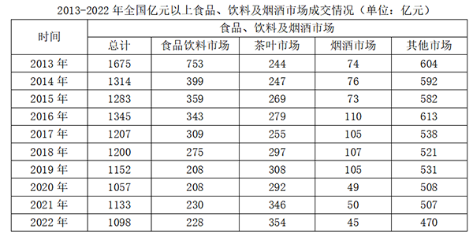

# 同比增长率大小排序（负增长比较）

考点：[[20-考点/资料分析/增长/同比增长率大小排序（负增长比较）|增长 / 同比增长率大小排序（负增长比较）]]
材料：[[15-材料/资料分析/3372263 2013-2022年全国亿元以上食品|3372263 2013-2022年全国亿元以上食品]]

**问法模型**：题干出现'2017年……同比增速由大到小排序正确的是'→ 对四个分项分别套用增长率=（现期−基期）/基期，算出（或粗估）四个增速后按降序排列对照选项

## 推理链
1. 第1步：从表中提取2017年（现期）与2016年（基期）四个分项成交额：食品饮料309/343、茶叶255/279、烟酒105/110、其他538/613（单位亿元）
2. 第2步：增长率公式：同比增速=（2017年值−2016年值）/2016年值
3. 第3步：代入计算：食品饮料=(309−343)/343=−34/343≈−9.9%；茶叶=(255−279)/279=−24/279≈−8.6%；烟酒=(105−110)/110=−5/110≈−4.5%；其他=(538−613)/613=−75/613≈−12.2%
4. 第4步：四个增速均为负值，负数比大小时'降幅（绝对值）越小、增速越高'：降幅4.5%<8.6%<9.9%<12.2%
5. 第5步：故增速由大到小为：烟酒市场>茶叶市场>食品饮料市场>其他市场
6. 第6步：对照选项，D项'烟酒市场、茶叶市场、食品饮料市场、其他市场'与计算排序一致，故选D

**最快解法**：⚡ 负增长降幅比较法（截位直除估量级）：全部为负增长，无需精算百分比，只比|增量|/基期：烟酒5/110≈4.5%最小→增速最高；其他75/613≈12%最大→增速最低；茶叶24/279与食品饮料34/343交叉相乘比较：24×343=8232<34×279=9486，故24/279<34/343，茶叶降幅更小、增速更高。排序：烟酒>茶叶>食品饮料>其他，直接锁定D

## 易错点
- ⚠ 2017年四个分项同比全部为负增长，负数比大小方向极易搞反：降幅（绝对值）最小的增速反而最大，勿把'负得多'排在前面
- ⚠ 列名口径混淆：'食品饮料市场'仅是分项之一，与总口径'食品、饮料及烟酒市场（总计列）'不同，误用总计列（1207/1345）会全错
- ⚠ 基期取错：2017年同比的基期是表中相邻上一年2016年，勿错用2013年或其他年份作分母

## 母题抽象
> 🧩 当题干出现'某年多个主体同比增速由大到小/小到大排序'且各主体均为负增长时，用（现期−基期）/基期粗估降幅并牢记'降幅越小增速越高'，用截位直除或交叉相乘比较分数大小后对照选项

**同类特征**：同比增速由大到小排序、同一年份四个分项横向比较、食品饮料/茶叶/烟酒/其他市场、全部负增长、增长率比较问题

## 相关题
- [[10-真题/资料分析/增长/2742054 增长率比较（已知现期值与同比增加额，先减法求基期再算增速）|2742054]]（江苏 2021，相关度1）

---

### 题干
2017年，食品饮料市场、茶叶市场、烟酒市场和其他市场成交额同比增速由大到小排序正确的是：

### 选项
- A. 茶叶市场、食品饮料市场、其他市场、烟酒市场
- B. 其他市场、食品饮料市场、茶叶市场、烟酒市场
- C. 烟酒市场、食品饮料市场、茶叶市场、其他市场
- D. 烟酒市场、茶叶市场、食品饮料市场、其他市场　✅

### 官方解析

根据题干“2017年······同比增速由大到小排序正确的是”，可判定本题为一般增长率比较问题。定位统计表可得2016年、2017年食品饮料市场、茶叶市场、烟酒市场和其他市场成交额。根据公式：增长率，可得2017年各市场同比增速分别为：

食品饮料市场，；

茶叶市场，；

烟酒市场，；

其他市场，。

因此，2017年同比增速由大到小排序为烟酒市场、茶叶市场、食品饮料市场、其他市场。

故正确答案为D。

### 给定材料

