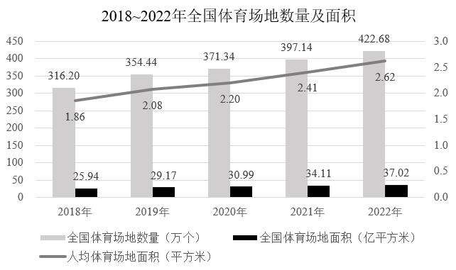

# 年均增长量计算（间隔年数判定）

考点：[[20-考点/资料分析/增长/年均增长量计算（间隔年数判定）|增长 / 年均增长量计算（间隔年数判定）]]
材料：[[15-材料/资料分析/4412925 2018~2022年全国体育场地发展|4412925 2018~2022年全国体育场地发展]]

**问法模型**：'2019-2022年……年均增量约为' → 年均增长量=(现期值-基期值)/间隔年数，基期取区间首年2019年，间隔=2022-2019=3（不是年份数4）

## 推理链
1. 第1步：题干限定区间2019-2022年求'年均增量'，判定基期为2019年、现期为2022年，间隔年数=2022-2019=3
2. 第2步：定位图1灰色数量柱（单位万个），2019年全国体育场地数量354.44万个，2022年为422.68万个，均为当期值
3. 第3步：公式：年均增长量=(现期值-基期值)/间隔年数=(422.68-354.44)/3
4. 第4步：代入计算：422.68-354.44=68.24万个，68.24/3≈22.75万个
5. 第5步：与选项对照：22.75与B项22.7万个最接近，A项17.1对应误除以4（68.24/4≈17.1），C项26.6对应误用2018作基期((422.68-316.20)/4≈26.6)，均排除，故选B

**最快解法**：⚡ 截位直除：先口算差值68.24，再68.24÷3，首位商2、次位得22.7左右即可锁定B，无需精算到小数第二位

## 易错点
- ⚠ 间隔年数错算：把2019、2020、2021、2022当成4个间隔而除以4，得68.24/4≈17.1误选A；正确做法是除以末年减首年=3
- ⚠ 基期取错：惯性套用材料全区间2018-2022口径，算成(422.68-316.20)/4≈26.6误选C，题干起点明确是2019年
- ⚠ 读图陷阱：图1双轴含三种单位，本题只取灰色数量柱（万个）354.44与422.68，勿误取黑色面积柱（亿平方米）或副轴折线人均面积数据

## 母题抽象
> 🧩 当题干出现'某年-某年年均增长量/增量'特征时，用(现期-基期)/(末年-首年)，间隔数按年份差而非年份个数取，先算差值再截位直除对照选项，并警惕选项中预设的'除以年份数'和'基期前移一年'陷阱

**同类特征**：2019-2022年（区间首尾年明确）、年均增量、全国体育场地数量、柱状图当期值、间隔年数=3而非4

## 相关题
- [[10-真题/资料分析/增长/4651483 年均增长量计算（'十三五'时期年均增量）|4651483]]（江苏 2022，相关度1）
- [[10-真题/资料分析/增长/4651693 年均增长量计算|4651693]]（江苏 2022，相关度1）

---

### 题干
2019-2022年全国体育场地数量年均增量约为：

### 选项
- A. 17.1万个
- B. 22.7万个　✅
- C. 26.6万个
- D. 29.4万个

### 官方解析
根据题干“2019-2022年······年均增量约为”，可判定本题为年均增长量问题。定位柱状图可得：2019年和2022年全国体育场地数量分别为354.44万个和422.68万个。根据公式：年均增长量，则所求万个，与B项最接近。
故正确答案为B。

### 给定材料

