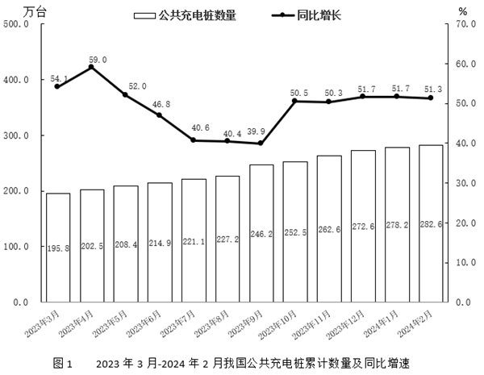
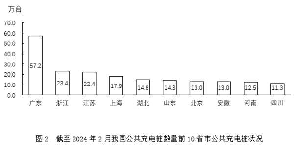

# 由同比增速求同比增量（现期×r-(1+r)）并比较多月变化趋势

考点：[[20-考点/资料分析/增长/由同比增速求同比增量（现期×r-(1+r)）并比较多月变化趋势|增长 / 由同比增速求同比增量（现期×r/(1+r)）并比较多月变化趋势]]
材料：[[15-材料/资料分析/5207694 截至2024年2月我国公共充电桩的总|5207694 截至2024年2月我国公共充电桩的总]]

**问法模型**：题干问'2023年哪几个月同比增量的变化趋势'→对图1各月套用 同比增量=累计量×r/(1+r) 逐月换算，再逐项比较4个月的高低顺序与选项折线是否吻合

## 推理链
1. 第1步：定位图1提取2023年5—11月'量×率'数据：5月208.4万台/52.0%、6月214.9/46.8%、7月221.1/40.6%、8月227.2/40.4%、9月246.2/39.9%、10月252.3/50.5%、11月262.6/50.3%
2. 第2步：同比增量=基期量×r=现期累计量×r/(1+r)（由现期=基期×(1+r)反推），柱值为累计存量，同比增量既不能用增速升降代替、也不能用相邻月差分代替
3. 第3步：百化分换算r/(1+r)：52/152≈1/2.92、46.8/146.8≈1/3.14、40.6/140.6≈1/3.46、40.4/140.4≈1/3.48、39.9/139.9≈1/3.50、50.5/150.5≈1/2.98
4. 第4步：逐月估算同比增量（万台）：5月≈208/2.92≈71、6月≈215/3.14≈68、7月≈221/3.46≈64、8月≈227/3.48≈65、9月≈246/3.50≈70、10月≈252/2.98≈85、11月≈263/2.99≈88
5. 第5步：逐项排除：A项5-8月为71→68→64→65，第二点(68)高于第三点(64)，与折线第二点低于第三点不符；C项7-10月64→65→85、D项8-11月65→70均为首点低于第二点，排除
6. 第6步：B项6-9月为68→64→65→70，先降后升、第二点64最低、第四点70最高，与折线趋势完全吻合，当选B（6-9月）

**最快解法**：⚡ 百化分+截位估算法：把各月r/(1+r)化为1/n（52/152≈1/2.9、47/147≈1/3.1、41/141≈1/3.5、40/140≈1/3.5），口算5—11月增量约为71、68、64、65、70、85、88万台，只需比较相对高低：唯一满足'降→升→升、第二点最低且第四点最高'的区间是6-9月，锁定B，无需精确计算

## 易错点
- ⚠ 把右轴同比增速的升降误当同比增量的升降：图1增速5—9月一路下行（52.0%→39.9%），但同比增量在8月已由64回升至65、9月跳升至70万台，增速降≠增量降，必须逐月按量×率换算
- ⚠ 把图1柱值'累计数量'（存量）误当量纲使用：同比增量须对上年同月用累计量×r/(1+r)计算，若误用相邻月差分（那是环比新增）或直接读柱，结果全错
- ⚠ 公式r/(1+r)漏加1或读错双轴：用r直接乘累计量会高估约四成且7月与8月的大小关系易误判；柱值看左轴（万台）、增速看右轴（%），读错轴数据即失效

## 母题抽象
> 🧩 当题干出现'折线图反映某几个月同比增量变化趋势'且材料给出各期'累计量×同比增速'组合时，用增量=现期×r/(1+r)逐月换算后比较相邻月高低，匹配选项折线的高低点顺序，切勿以增速走势代替增量走势

**同类特征**：折线图…变化趋势、同比增量、哪几个月（区间判断）、累计数量（存量口径）、柱线双轴图逐月量率组合、增长量计算与趋势匹配

## 相关题
- [[10-真题/资料分析/增长/12536399 增长量计算与增长量倍数比较（增长量=现期×r-(1+r)）|12536399]]（四川 2024，相关度1）
- [[10-真题/资料分析/平均数/12881912 平均数增长量（两期平均数作差求同比增量）|12881912]]（河北 2025，相关度1）
- [[10-真题/资料分析/增长/15419182 由同比增速求增长量并作倍数比较（增长量作比）|15419182]]（湖北 2025，相关度1）
- [[10-真题/资料分析/增长/15833796 增长量计算与两年增量差值比较|15833796]]（贵州 2026，相关度1）
- [[10-真题/资料分析/增长/16593067 同比增量计算与差值比较（普及率百分点增量）|16593067]]（甘肃 2024，相关度1）

---

### 题干
以下折线图最能准确反映2023年哪几个月我国公共充电桩累计数量同比增量的变化趋势？

### 选项
- A. 5-8月
- B. 6-9月　✅
- C. 7-10月
- D. 8-11月

### 官方解析
根据题干“······2023年哪几个月······同比增量的变化趋势”，可判定本题为增长量比较问题。定位图1可知2023年5-11月各月我国公共充电桩累计数量及对应的同比增速。根据公式：增长量，则各选项对应月份我国公共充电桩累计数量同比增量分析如下：
A项：5月：万台；6月：万台；7月：万台。比较可知，6月同比增量&gt;7月同比增量，与折线图中第二个点低于第三个点不符，排除；
B项：8月：万台；9月：万台。结合A项可知6月、7月的同比增量，比较可知，折线图应先降再升且第二个点为最低点、第四个点为最高点，符合题干折线图趋势，当选；
C项：结合A、B两项可知，7月同比增量&lt;8月同比增量，与折线图第一个点高于第二个点不符，排除；
D项：结合B项可知，8月同比增量&lt;9月同比增量，与折线图第一个点高于第二个点不符，排除。
故正确答案为B。

### 给定材料

截至2024年2月，我国公共充电桩数量为282.6万台，环比增加4.4万台，同比增长51.3%。其中直流充电桩123.9万台，环比增长2.1%；交流充电桩158.6万台，环比增长1.2%。

