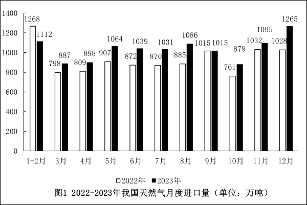
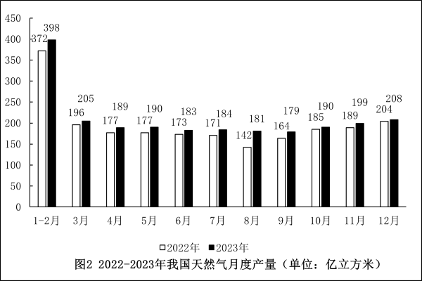

# 同比增长量计算与折线趋势匹配

考点：[[20-考点/资料分析/增长/同比增长量计算与折线趋势匹配|增长 / 同比增长量计算与折线趋势匹配]]
材料：[[15-材料/资料分析/4853735 2022-2023年我国天然气月度进|4853735 2022-2023年我国天然气月度进]]

**问法模型**：'折线图最能反映2023年哪几个月月度产量同比增量的变化趋势'→逐月计算同比增量（2023年黑柱−2022年白柱）排成序列，再与选项各连续四点区间的升降形态逐一匹配

## 推理链
1. 第1步：题干问'同比增量的变化趋势'，锁定图2（产量，单位亿立方米），提取5-11月数据：2023年（黑柱）为190、183、184、181、179、190、199，2022年（白柱）为177、173、171、142、164、185、189
2. 第2步：公式：同比增量=现期量−基期量，即黑柱减白柱
3. 第3步：逐月作差：5月190−177=13、6月183−173=10、7月184−171=13、8月181−142=39、9月179−164=15、10月190−185=5、11月199−189=10（亿立方米）
4. 第4步：增量序列为13、10、13、39、15、5、10，对四个选项的滑动四点段验证形态：A(5-8月)13→10→13→39为'降-升-升'，B(6-9月)10→13→39→15为'升-升-降'，C(7-10月)13→39→15→5为'升-降-降'，D(8-11月)39→15→5→10为'降-降-升'
5. 第5步：只有D段（39→15→5→10）呈'先连续下降两个月再回升'的形态，与给定折线图一致，故选D

**最快解法**：⚡ 心算逐月作差+形态排除法：黑柱减白柱得5-11月增量13、10、13、39、15、5、10，不必描点作图，直接扫四个滑动窗口找'首点最高、中段两连降、末点回升'的形态——仅8-11月（39→15→5→10）满足，秒选D

## 易错点
- ⚠ 增量与增速混淆：本题比的是增量的升降形态而非同比增速（8月基期仅142使增速畸高），若错比增速结论不同，且同材料题3正是比增速，两题模型不同
- ⚠ 图例读反：白柱=2022年基期、黑柱=2023年现期，做差方向搞反则增量数值与折线走势全错
- ⚠ 选项为滑动四点窗口，只看个别点的升降或只看首尾点易误选C（13→39→15→5同样有升有降）；另外图2'1-2月'为两月合并值、单位为亿立方米，跨段取数时须防口径与单位串图

## 母题抽象
> 🧩 当题干出现'折线图最能反映…同比增量的变化趋势'且选项为连续月份区间时，先逐月用'现期−基期'算出增量序列，再对每个选项的滑动四点窗口验证升降形态逐一排除，唯一吻合者即答案

**同类特征**：折线图、同比增量、变化趋势、连续四个月区间选项、月度产量、先降后升形态

## 相关题
- [[10-真题/资料分析/增长/2051184 增长量比较（同比增长量趋势折线图判断）|2051184]]（黑龙江 2017，相关度3）
- [[10-真题/资料分析/增长/5893795 同比增量计算与折线趋势比对（增长量比较）|5893795]]（国考 2024，相关度3）
- [[10-真题/资料分析/增长/5445750 增长量比较（逐年同比增量序列与折线趋势判定）|5445750]]（国考 2023，相关度3）
- [[10-真题/资料分析/增长/5445763 增长量比较（同比增量折线趋势识别）|5445763]]（国考 2023，相关度3）
- [[10-真题/资料分析/增长/5894970 增长量比较（同比增量逐年差分与折线趋势匹配）|5894970]]（国考 2024，相关度3）

---

### 题干

以下折线图最能反映2023年哪几个月天然气月度产量同比增量的变化趋势？

### 选项
- A. 5-8月
- B. 6-9月
- C. 7-10月
- D. 8-11月　✅

### 官方解析
根据题干“以下折线图最能反映2023年哪几个月······同比增量的变化趋势”，可判定本题为增长量比较问题。定位图2可知2022年3-12月、2023年3-12月天然气月度产量。根据公式：增长量=现期量-基期量。则2023年5-11月天然气月度产量同比增量分别为：
5月：190-177=13亿立方米；
6月：183-173=10亿立方米；
7月：184-171=13亿立方米；
8月：181-142=39亿立方米；
9月：179-164=15亿立方米；
10月：190-185=5亿立方米；
11月：199-189=10亿立方米。
综上可知，符合先下降两个月后上升趋势的为8-11月。
故正确答案为D。

### 给定材料

