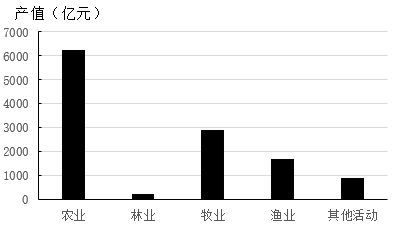

# 基期量计算（现期÷(1+增速)）与图形结构匹配

考点：[[20-考点/资料分析/增长/基期量计算（现期÷(1+增速)）与图形结构匹配|增长 / 基期量计算（现期÷(1+增速)）与图形结构匹配]]
材料：[[15-材料/资料分析/6108202 某省2022年国民经济与农业统计公报|6108202 某省2022年国民经济与农业统计公报]]

**问法模型**：题干要求选出符合'2021年（基期）各组成部分产值数量关系'的图形 → 判定为基期计算问题，用基期量=现期产值÷(1+同比增速)逐项还原2021年各分项，再与图形相对大小对照

## 推理链
1. 第1步：从表1提取2022年五个组成部分产值及增速：农业6206.5(+4.7%)、林业227.3(+8.5%)、牧业3003.5(+3.5%)、渔业1729.7(+4.4%)、农林牧渔专业及辅助性活动963.7(+9.1%)，总计12130.7(+4.8%)
2. 第2步：题干问2021年而材料为2022年年报数据，基期数值未直接给出 → 采用公式基期量=现期量/(1+同比增长率)
3. 第3步：代入计算总基期=12130.7/1.048≈11575亿元；2021年农业=6206.5/1.047≈5928亿元，约占总基期一半、为最大部分，据此排除A、B两项
4. 第4步：2021年牧业=3003.5/1.035≈2902亿元，2021年渔业=1729.7/1.044≈1657亿元，渔业明显小于牧业、约为其57%
5. 第5步：2021年辅助性活动=963.7/1.091≈883亿元，林业=227.3/1.085≈209.5亿元为最小项；对照图形各部分相对大小，D项渔业与牧业比例不符，C项各部分大小关系与基期量吻合，故选C

**最快解法**：⚡ 截位直除+排除法：先算最大项农业6206.5/1.047≈5930亿元（约占总基期12130.7/1.048≈11575亿元的一半），据此排除A、B；再算渔业1729.7/1.044≈1657亿元与牧业3003.5/1.035≈2902亿元，渔业约为牧业六成且明显小于牧业，仅C图形符合，排除D

## 易错点
- ⚠ 直接用2022年现期产值对照图形、忘记除以(1+增速)还原基期：林业(+8.5%)与辅助性活动(+9.1%)增速高于总体4.8%，其基期占比比现期更小，图形相对大小会被放大失真
- ⚠ 遗漏'农林牧渔专业及辅助性活动'(963.7亿元)也是总产值组成部分（五个分项之和恰等于12130.7亿元），图形应含5个部分而非4个
- ⚠ 各分项增速不同，不能用总增速4.8%统一去除所有分项，否则农业(5928)与渔业(1657)等基期量算错导致图形匹配失败

## 母题抽象
> 🧩 当题干出现'基期年份（上年/2021年）各部分数量关系/结构图形匹配'特征时，用基期量=现期÷(1+增速)逐项还原，先算最大项排除两组选项，再比较次大项与第三项的相对大小锁定答案

**同类特征**：基期年份（2021年）、各组成部分产值、数量关系、图形选项匹配、表1现期产值与同比增速齐全、基期量计算

## 相关题
- [[10-真题/资料分析/增长/12019697 基期量计算（现期累计值−当期新增值）|12019697]]（广东 2026，相关度1）
- [[10-真题/资料分析/增长/2033794 基期量计算|2033794]]（江苏 2016，相关度1）
- [[10-真题/资料分析/增长/2166218 基期量计算（同比下降型）|2166218]]（深圳市考 2018，相关度1）
- [[10-真题/资料分析/增长/2187625 基期量计算（现期−增长量还原基期）|2187625]]（选调 2018，相关度1）
- [[10-真题/资料分析/增长/2187798 基期量计算（现期÷(1+同比增速)）＋单位换算（亿元→万亿元）|2187798]]（天津 2018，相关度1）

---

### 题干
下列各图符合2021年农林牧渔业各组成部分产值数量关系的是：

### 选项
- A. 

- B. 

- C. 

　✅
- D. 

### 官方解析
根据题干“······2021年······各组成部分产值数量关系的是”，结合材料时间为2022年，可判定本题为基期计算问题。定位表1可得2022年农林牧渔业各组成部分产值及增长速度。根据公式：基期量，则2021年农业产值亿元，排除A、B两项；渔业产值亿元，排除D项。
故正确答案为C。

### 给定材料

        2022年全省实现地区生产总值87435.1亿元，按不变价格计算，比上年增长3.9%。分产业看，第一产业增加值6298.6亿元，增长4.3%，三次产业结构为7.2：40.0：52.8。

        农林牧渔业产值12130.7亿元，按可比价格计算，比上年增长4.8%。猪牛羊禽肉产量838.4万吨，比上年增长2.9%；禽蛋产量（不含小品种)）438.1万吨，下降3.8%；牛奶产量304.4万吨，增长5.6%。水产品总产量（不含远洋渔业产量）843.9万吨，增长2.8%。其中，海水产品产量724.9万吨，增长2.6%；淡水产品产量119.0万吨，增长4.3%。

