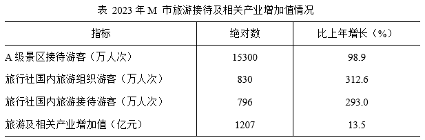

# 增长量计算（已知现期值与同比增速，求增长量）

考点：[[20-考点/资料分析/增长/增长量计算（已知现期值与同比增速，求增长量）|增长 / 增长量计算（已知现期值与同比增速，求增长量）]]
材料：[[15-材料/资料分析/6462966 2023年M市旅游接待规模（全市及核|6462966 2023年M市旅游接待规模（全市及核]]

**问法模型**：题干'2023年……比上年多'且选项带'万人次'单位 → 增长量计算模型：增长量=现期值×r/(1+r)

## 推理链
1. 第1步：题干问'2023年东南片区接待的过夜游客比上年多'，结合选项均带万人次单位，判定求增长量；定位文字材料得：2023年东南片区接待过夜游客739万人次，增长70.1%
2. 第2步：公式：基期量=现期值÷(1+r)，增长量=现期值×r/(1+r)（r=70.1%）
3. 第3步：代入计算：739×0.701/1.701=518.0/1.701≈304.6万人次
4. 第4步：与选项对照：304.6万人次与B项305万人次最接近，故选B（A项221、C项434、D项519均相差远）

**最快解法**：⚡ 百化分速算：70.1%≈70%=7/10，则增长量=739×7/(10+7)=739×7/17≈304万人次，直接锁定最接近的B项305万人次，避免硬除1.701

## 易错点
- ⚠ 漏除以(1+r)：直接算739×70.1%≈518万人次，误选D项519，这是本题最大陷阱
- ⚠ 基期与现期混淆：739是2023年现期值，不是基期量，不能先按739÷(1+70.1%)再误用其他增速
- ⚠ 口径混淆：东南片区739万人次是文字段'过夜游客'口径，不能误取表格中A级景区接待15300万人次或旅行社组织/接待数据（材料导读明确提示口径不能混用）

## 母题抽象
> 🧩 当题干出现'某年某指标比上年多/增加了+选项带单位数值'特征时，用增长量公式现期×r/(1+r)，速算用百化分r≈a/b则增长量=现期×a/(a+b)，选最接近项

**同类特征**：2023年……比上年多、选项带'万人次'单位、增长70.1%、东南片区、过夜游客、增长量计算

## 相关题
- [[10-真题/资料分析/增长/2374812 增长量计算（已知现期值与同比增速，求增长量）|2374812]]（广东 2019，相关度3）
- [[10-真题/资料分析/增长/7159 增长量计算|7159]]（北京 2009，相关度1）
- [[10-真题/资料分析/增长/2571729 增长量计算——每增长1个百分点对应的增量（基期量×1%）|2571729]]（山东 2020，相关度1）
- [[10-真题/资料分析/增长/3018839 增长量计算（负增长情形：基期减少量）|3018839]]（广东 2021，相关度1）
- [[10-真题/资料分析/增长/10204654 增长量计算（已知现期与同比下降率求下降量）|10204654]]（安徽 2024，相关度1）

---

### 题干
2023年M市东南片区接待的过夜游客比上年多：

### 选项
- A. 221万人次
- B. 305万人次　✅
- C. 434万人次
- D. 519万人次

### 官方解析
根据“2023年······比上年多”，结合选项带单位，可判定本题为增长量计算问题。定位文字材料可得：2023年，M市东南片区接待过夜游客739万人次，增长70.1%。根据公式：增长量=，则所求万人次，与B项最接近。
故正确答案为B。

### 给定材料

        2023年，M市接待过夜游客10190万人次，比上年增长88.1%。其中，核心片区接待过夜游客8326万人次，增长99.9%；东北片区接待过夜游客1125万人次，增长38.2%；东南片区接待过夜游客739万人次，增长70.1%。旅游及相关产业增加值占全市地区生产总值的比重为4.0%，比上年提高0.3个百分点。

