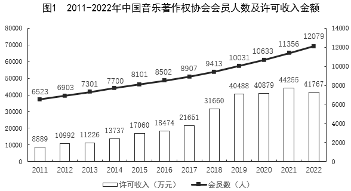
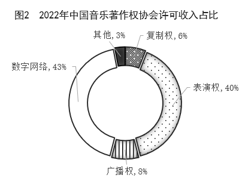

# 同比增速计算与超过阈值的年份计数

考点：[[20-考点/资料分析/增长/同比增速计算与超过阈值的年份计数|增长 / 同比增速计算与超过阈值的年份计数]]
材料：[[15-材料/资料分析/4993639 中国音乐著作权协会2011-2022|4993639 中国音乐著作权协会2011-2022]]

**问法模型**：题干问'某连续年份区间内同比增速超过10%的有几个'→以区间前一年为基期，逐年套用'增速=当年÷上年-1'并与10%比较后计数。

## 推理链
1. 第1步：从图1柱形提取2011-2022年许可收入（万元）：8889、10992、11226、13737、17060、18474、21651、31660、40488、40879、44255、41767；会员数折线与图2占比均为干扰数据，不使用。
2. 第2步：判定规则变形：增速>10%等价于'当年-上年>上年×10%'，即比较'逐年增量'与'上年数值的十分之一'，避免11次除法。
3. 第3步：逐年比较：2012年增量2103>889✓；2013年234<1099✗；2014年2511>1123✓；2015年3323>1374✓；2016年1414<1706✗；2017年3177>1847✓；2018年10009>2165✓；2019年8828>3166✓；2020年391<4049✗；2021年3376<4088✗；2022年增量-2488为负✗（41767<44255，同比负增长）。
4. 第4步：满足条件的是2012、2014、2015、2017、2018、2019年，共6个，对照选项D（6个），故选D。

**最快解法**：⚡ 增量对照法（增速>10%⟺增量>上年×10%）：先心算各上年值的1/10，再与逐年增量比大小，2013、2016、2020、2021、2022五项直接排除，2022年为负增量必排除，余下6年全过，数出6个选D。

## 易错点
- ⚠ 双轴柱线混排看错轴：柱形读左轴（万元，量级万），折线读右轴（人，量级万），把会员数当许可收入或量级混淆即全盘皆错。
- ⚠ 末年反例：2022年收入41767低于2021年44255，同比负增长，不能凭图上整体上升趋势默认2022年也满足；2019-2021年数值接近（40488→40879→44255），2020、2021增速仅约1%和8.3%，肉眼比柱高会误判，必须用数值计算。
- ⚠ 2016年（18474对17060）柱高差看似不小但增速仅约8.3%不超10%；另注意'超过10%'不含恰好等于10%的年份。

## 母题抽象
> 🧩 当题干出现'某连续区间内同比增速超过X%的年份有几个'时，用等价变形'增量>上年×X%'逐年代入（只心算上年的一成与增量比大小），排除不达标年份后数出个数。

**同类特征**：同比增速超过10%、年份有几个（计数型问法）、连续年份区间2012-2022、基期为区间前一年(2011)、双轴柱线图中只取柱形数据、伴生干扰：折线会员数与占比图均不使用

## 相关题
- [[10-真题/资料分析/增长/4817773 增长率计算与判断（逐年同比增速与20%临界值比较计数）|4817773]]（四川 2022，相关度1）
- [[10-真题/资料分析/增长/14355345 增长量比较（相邻年份作差与阈值比较计数）|14355345]]（浙江 2024，相关度1）
- [[10-真题/资料分析/其他/2033334 两行指标逐年同列作差与固定阈值比较后的年份计数（简单计算类差值比较）|2033334]]（河南 2016，相关度1）

---

### 题干
2012-2022年，中国音乐著作权协会许可收入同比增速超过10%的年份有（    ）个。

### 选项
- A. 3
- B. 4
- C. 5
- D. 6　✅

### 官方解析

根据题干“······同比增速超过10%的年份有······”，可判定本题为一般增长率问题。定位图1可得2011-2022年各年份中国音乐著作权协会许可收入，根据公式：增长率，则2012-2022年同比增速分别为：

2012年：；2013年：；

2014年：；2015年：；

2016年：；2017年：；

2018年：；2019年：；

2020年：；2021年：；

2022年：。

综上，同比增速超过10%的年份有2012年、2014年、2015年、2017年、2018年、2019年，共6个。

故正确答案为D。

### 给定材料

> [!warning] 疑点（官方解析可能有误，待人工复核）
> 官方解析中各年增长率的具体计算式显示缺失（仅有'增长率'字样），但所列6个年份（2012/2014/2015/2017/2018/2019）经逐项验算（如2012年约23.7%、2016年约8.3%、2022年约-5.6%）与答案D一致，答案无误。

<!-- CODEX-ANSWER-REVIEW:BEGIN -->
### 本次独立复核

**复核状态：** `resolved`（答案与解析已核定）

**计分答案：** D（可计分）

**复核解析：**

逐年以（本年许可收入－上年许可收入）÷上年许可收入计算，2012—2022年约为23.7%、2.1%、22.4%、24.2%、8.3%、17.2%、46.2%、27.9%、1.0%、8.3%、-5.6%。严格大于10%的为2012、2014、2015、2017、2018、2019，共6年，选D。图表起始于2011年，因此无需计算2011增速。

**相关信息：**

许可收入单位为万元；同比增速=(本期/上期)-1。

**题源依据：** [固定版本原题](https://github.com/Mentat-Uran/kaogongzhentizhengliu/blob/84ab93d4b64b61d897bece8a1c0a5bab06b4feb2/10-%E7%9C%9F%E9%A2%98/%E8%B5%84%E6%96%99%E5%88%86%E6%9E%90/%E5%A2%9E%E9%95%BF/11226980%20%E5%90%8C%E6%AF%94%E5%A2%9E%E9%80%9F%E8%AE%A1%E7%AE%97%E4%B8%8E%E8%B6%85%E8%BF%87%E9%98%88%E5%80%BC%E7%9A%84%E5%B9%B4%E4%BB%BD%E8%AE%A1%E6%95%B0.md)；固定内容 commit `84ab93d4b64b61d897bece8a1c0a5bab06b4feb2`，Markdown blob `d194ae3094e8174fa5d5ca352223ebe5276bbb21`。
<!-- CODEX-ANSWER-REVIEW:END -->
