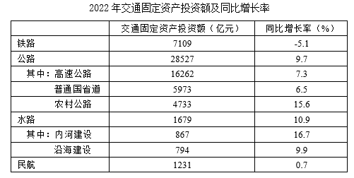
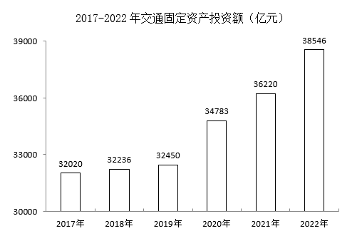

# 基期量求和（基期和差问题）

考点：[[20-考点/资料分析/增长/基期量求和（基期和差问题）|增长 / 基期量求和（基期和差问题）]]
材料：[[15-材料/资料分析/4375286 2017-2022年全国交通固定资产|4375286 2017-2022年全国交通固定资产]]

**问法模型**：题干问'2021年（基期年份）公路与水路投资额共多少'，而材料给的是2022年现期值+同比增速 → 用基期量=现期量÷(1+增长率)分别反推两主体基期值后求和，对照区间选项。

## 推理链
1. 第1步：定位表格，2022年公路投资额28527亿元、同比增长9.7%；水路投资额1679亿元、同比增长10.9%（注意取母项公路28527，不用其中子项）。
2. 第2步：题干所求为2021年（基期）两方式投资额之和，判定为基期和差问题，公式：基期量=现期量÷(1+增长率)。
3. 第3步：公路基期量=28527÷1.097≈26005亿元；水路基期量=1679÷1.109≈1514亿元。
4. 第4步：求和26005+1514≈27519亿元，换算单位：27519亿元≈2.75万亿元。
5. 第5步：交叉验证（可用柱状图）：2021年总额36220－铁路基期7109÷0.949≈7491－民航基期1231÷1.007≈1222≈27507亿元，与直接求和一致。
6. 第6步：与选项对照：2万亿元<2.75万亿元<3万亿元，落在B区间，故选B。

**最快解法**：⚡ 截位直除+区间排除：选项为万亿元级区间，只需粗估——公路基期≈28500÷1.097≈26000亿元，水路基期≈1680÷1.109≈1510亿元，合计≈27500亿元≈2.75万亿元，锁定B；考场还可走扣减捷径：2021年总额36220（图中直读）－7109÷0.949≈7491－1231÷1.007≈1222≈27507亿元，同样落B，且可顺手验证公路+水路基期量。

## 易错点
- ⚠ 基期反推方向搞反：须用'现期÷(1+增速)'，误用现期×(1+增速)或按增量思路即错。
- ⚠ 单位口径陷阱：计算结果是亿元（约27519），选项以万亿元为区间，需÷10000换算为2.75万亿元，不换算易误判成C/D。
- ⚠ 包含关系陷阱：公路28527是母项，高速公路16262、普通国省道5973、农村公路4733是其中项（子项和26968<28527），不能用子项之和或母项+子项重复相加代替母项。

## 母题抽象
> 🧩 当题干出现'基期年份+A与B共/和多少'且材料只给现期值与同比增速时，用'基期=现期÷(1+增速)'分别反推再求和；若同材料有基期年总额，可用'总额扣减其余主体基期量'速算验证，最后按区间选项只需粗估。

**同类特征**：问过去年份（2021年）的量、两个主体'共'（基期求和）、材料给现期值+同比增速、选项为金额区间（万亿元量级）、需亿元→万亿元单位换算、基期=现期÷(1+增长率)

## 相关题
- [[10-真题/资料分析/增长/2195849 基期计算（已知现期值与增长倍数反推基期）|2195849]]（黑龙江 2018，相关度1）
- [[10-真题/资料分析/倍数/4663221 基期倍数计算|4663221]]（山东 2022，相关度1）

---

### 题干
2021年公路交通固定资产投资额与水路交通固定资产投资额共（    ）。

### 选项
- A. 不到2万亿元
- B. 2~3万亿元　✅
- C. 3~4万亿元
- D. 超过4万亿元

### 官方解析
根据题干“2021年公路交通固定资产投资额与水路交通固定资产投资额共”，结合材料时间为2022年，可判定本题为基期和差问题。定位表格材料可得∶2022年，公路交通固定资产投资额为28527亿元，同比增长率为9.7%；水路交通固定资产投资额为1679亿元，同比增长率为10.9%。根据公式：基期量，则所求亿元，在B项范围内。
故正确答案为B。

### 给定材料

