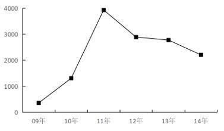
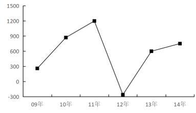

# 增长量比较（逐年同比增量计算+折线图趋势匹配）

考点：[[20-考点/资料分析/增长/增长量比较（逐年同比增量计算+折线图趋势匹配）|增长 / 增长量比较（逐年同比增量计算+折线图趋势匹配）]]
材料：[[15-材料/资料分析/347317 2008-2014年全国税收总额及主|347317 2008-2014年全国税收总额及主]]

**问法模型**：题干问'2009-2014年企业所得税同比增量变化最符合哪个折线图' → 逐年用'现期值-基期值'算出六个同比增量序列，再与选项折线图的升降趋势、峰值谷值匹配。

## 推理链
1. 第1步：定位表中'企业所得税'行，提取2008-2014年数值：11176、11537、12844、16770、19655、22427、24632亿元，其中2008年数值是2009年增量的基期，表中已给出
2. 第2步：依据公式'增长量=现期量-基期量'，对2009-2014年逐年做相邻两年相减，共六次减法
3. 第3步：代入计算：2009年11537-11176=361；2010年12844-11537=1307；2011年16770-12844=3926；2012年19655-16770=2885；2013年22427-19655=2772；2014年24632-22427=2205（单位均为亿元）
4. 第4步：增量序列为361→1307→3926→2885→2772→2205，趋势为先上升后下降，最低点在2009年（361），最高点（峰值）在2011年（3926）
5. 第5步：将'先升后降、谷值2009年、峰值2011年'的特征与选项折线图对照，只有A项符合该趋势，故选A

**最快解法**：⚡ 相邻年份截位相减（可只取前三位：537-176=361、844-537=307、770-844、655-770、427-655、632-427），快速得增量序列361、1307、3926、2885、2772、2205；锁定'先升后降、2011年最高、2009年最低'两大特征即可直接匹配A图，无需逐点精绘。

## 易错点
- ⚠ 误用增长率代替增量：题问'同比增量'（绝对量，纵轴单位亿元），若按增速判断趋势会选错图
- ⚠ 漏算2009年增量：2009年的基期2008年虽在题问年份区间之外，但表中已给出11176，必须取数计算（361），否则会误把2010年当最低点
- ⚠ 取错行或近值误判：须对准'企业所得税'行，勿混取税收合计或个人所得税行；2012年2885与2013年2772非常接近，易误判为持平或继续上升，需精确相减确认2011年后为连续下降

## 母题抽象
> 🧩 当题干出现'某年区间××指标同比增量变化最符合哪个折线图'时，用'现期-基期'逐年相减得增量序列，只需抓最低点、最高点和升降转折即可匹配图形，无须精确作图。

**同类特征**：同比增量变化、最符合折线图、2009-2014年、企业所得税（指定分项指标）、纵轴单位为亿元、需跨行取基期年份数据

## 相关题
（暂无）

---

### 题干
2009-2014年，企业所得税同比增量变化最符合以下        个折线图（图中纵轴单位为亿元）。

### 选项
- A. 

　✅
- B. 

- C. 

- D. 
暂缺

### 官方解析
根据题干“2009-2014年······同比增量变化最符合······”，可判定本题为增长量比较问题。定位统计表可得2008-2014年各年企业所得税。根据公式：增长量=现期量-基期量，可得2009-2014年企业所得税同比增量分别为：
2009年，11537-11176=361亿元；
2010年，12844-11537=1307亿元；
2011年，16770-12844=3926亿元；
2012年，19655-16770=2885亿元；
2013年，22427-19655=2772亿元；
2014年，24632-22427=2205亿元。
综上可知，2009-2014年企业所得税同比增量呈先上升后下降的趋势，且2009年同比增量最低，2011年同比增量最高，与A项变化趋势一致。
故正确答案为A。

### 给定材料

